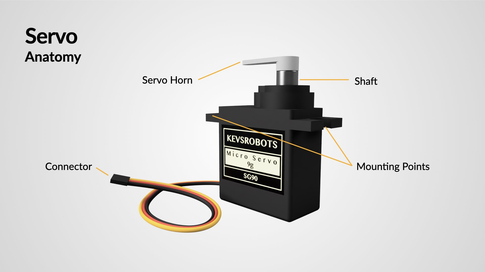
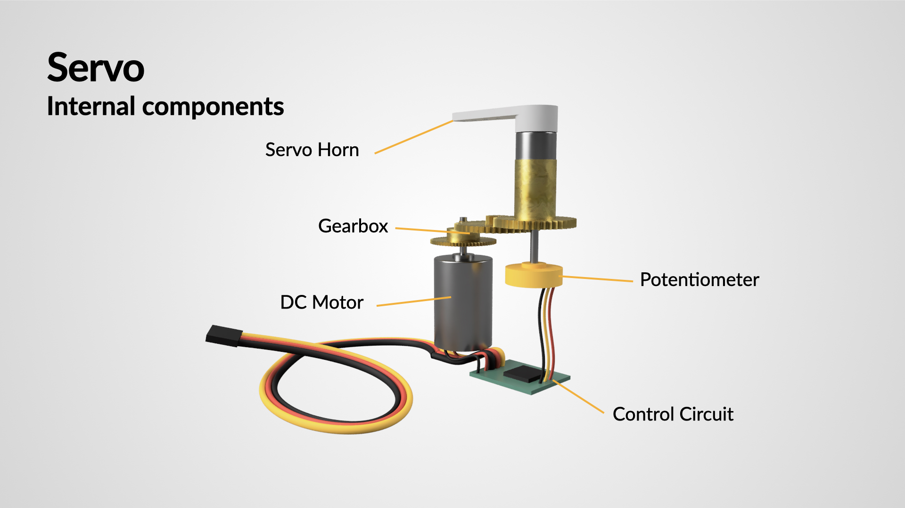
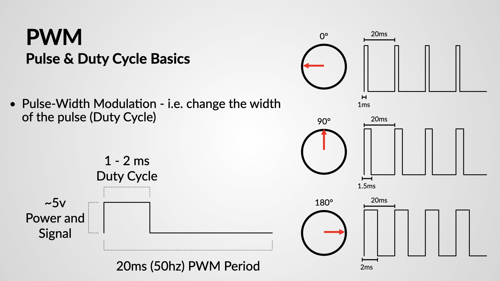

{:class="cover"}

---

By the end of this lesson you will be able to work out the pulse width for any servo angle, point an SG90 where you want it, and use it to scan with the ultrasonic sensor.

With a fixed ultrasonic sensor, your robot only knows what is directly in front of it. Mount the sensor on a **servo** and it can look left, ahead and right before deciding where to go, just like a cautious driver checking mirrors.

## How a servo is controlled

A hobby servo like the SG90 has a motor, gears and a position sensor in one box, with three wires: signal, power and ground. You do not set its speed. You tell it an **angle**, by sending a pulse every 20 ms (50 times a second), and the **width of the pulse** is the angle.

{:class="w-100 rounded-3"}

{:class="w-100 rounded-3"}

{:class="w-100 rounded-3"}

The SG90 datasheet describes 1.5 ms as the middle, about 1 ms at one end and about 2 ms at the other. We'll use that 1.0 to 2.0 ms range as the safe default.


## From angle to duty: worked through

On the Pico, `PWM.freq(50)` gives a period of 20 ms = 20,000 microseconds, and `duty_u16()` takes 0 to 65535 for that whole period. So:

1. Pulse width = 1000 + (angle / 180) x 1000 microseconds
2. Duty = pulse width x 65535 / 20000

Using real numbers:

| Angle | Pulse width | Duty (u16) |
|-------|-------------|------------|
| 0 | 1000 us | 1000 x 65535 / 20000 = 3276 |
| 90 | 1500 us | 4915 |
| 180 | 2000 us | 6553 |
{:class="table table-single"}

Some servos can go beyond 1 to 2 ms, up to about 0.5 to 2.5 ms for a bigger sweep. Test slowly: if the servo buzzes or strains at the end of its travel, it is trying to go past its mechanical stop, so narrow the range.

## Wiring

| Servo wire | Connect to |
|------------|------------|
| Signal (orange or yellow) | Pico GP10 (physical pin 14) |
| Power (red) | 5 V rail (see lesson 6), not a Pico GPIO pin |
| Ground (brown or black) | GND |
{:class="table table-single"}

The ultrasonic sensor stays on GP8 (TRIG) and GP9 (ECHO). A servo draws brief surges of current when it moves, which can reset a Pico sharing its supply. If that happens, add a 470 microfarad capacitor across the 5 V rail, close to the servo.

## The servo module

Save this on the Pico as `servo.py`:

```python
# servo.py - hobby servo on a PWM pin
from machine import Pin, PWM


class Servo:
    def __init__(self, pin=10, min_us=1000, max_us=2000):
        self.pwm = PWM(Pin(pin))
        self.pwm.freq(50)             # one pulse every 20 ms
        self.min_us = min_us
        self.max_us = max_us

    def angle(self, degrees):
        degrees = max(0, min(180, degrees))
        pulse_us = self.min_us + (self.max_us - self.min_us) * degrees / 180
        self.pwm.duty_u16(int(pulse_us * 65535 / 20000))

    def off(self):
        self.pwm.duty_u16(0)          # stop sending pulses, the servo goes limp
```

Test it by sweeping:

```python
from time import sleep
from servo import Servo

servo = Servo()

while True:
    for angle in range(0, 181, 30):
        servo.angle(angle)
        sleep(0.4)
    for angle in range(180, -1, -30):
        servo.angle(angle)
        sleep(0.4)
```

Ninety degrees should point straight ahead when the sensor is mounted on the centre line. Fit the servo horn so that 90 is dead ahead.

## Scanning

Now we combine the servo with the sonar from lesson 5. Wait a moment at each angle, so the servo has time to arrive before we ping:

```python
from time import sleep
from servo import Servo
from sonar import Sonar

servo = Servo()
sonar = Sonar()

def look(angle):
    servo.angle(angle)
    sleep(0.4)                 # let the servo get there
    return sonar.distance_cm()

for angle in range(0, 181, 45):
    d = look(angle)
    print("Angle", angle, "distance", d)

servo.angle(90)
```

Run it with the robot facing a corridor or a few obstacles, and you will see where the open space is. That is the data the robot needs to choose a direction.

## Common Issues

- **Problem**: The servo twitches or the Pico resets when the servo moves.
- **Solution**: Power the servo from the 5 V rail with a capacitor across it, not from a GPIO pin.
- **Why**: The servo's surge current dips the shared supply.

- **Problem**: The servo hums at the end of its travel.
- **Solution**: Narrow the range, for example `Servo(min_us=1100, max_us=1900)`.
- **Why**: Pulses beyond the servo's range push it against its mechanical stop.

- **Problem**: Distance readings are wrong or `None` right after the servo moves.
- **Solution**: Keep the pause after `servo.angle()` before reading the sonar.
- **Why**: The servo takes a few hundred milliseconds to arrive, and a moving sensor hears confusing echoes.

## Try it Yourself

1. Work out by hand the duty for 45 degrees, then check it by printing from the code.
2. Change `min_us` and `max_us` to find your servo's true range.
3. Scan at 30, 90 and 150 degrees and print which of the three has the most open space.
4. Challenge: send the angle and distance to your computer and draw a radar-style plot with a few lines of computer-side Python.

## Check your understanding


? What does the width of the pulse tell a servo?
- [ ] How fast to turn
- [x] Which angle to move to
- [ ] Which direction the motor spins
> The servo compares the pulse width to its position and moves to the matching angle.

? At 50 Hz, what duty_u16 value gives a 1.5 ms pulse?
- [ ] 1500
- [x] 4915
- [ ] 32768
> 1500 x 65535 / 20000 is about 4915, which is the centre position.

? Why does the scan program sleep after setting the angle?
- [ ] To save power
- [x] To let the servo arrive before the distance is measured
- [ ] Because the sonar is slow to start
> The servo needs a moment to move, and a reading taken while it moves can be wrong.

