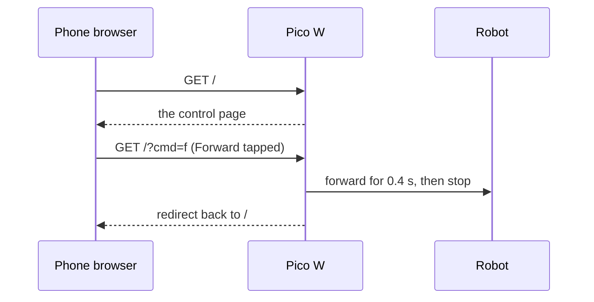

{:class="cover"}

---

By the end of this lesson you will be able to connect a Pico W to Wi-Fi, serve a control page from it, and drive the robot from a browser on your phone.

Bluetooth needs an extra module. With a **Pico W** the Wi-Fi radio is built in, so the Pico can run its own tiny web server. Your phone opens a page, taps a button, and the robot moves. No app to install.

## What you'll need

- A Raspberry Pi Pico W (or Pico 2 W) with the Pico W build of MicroPython, which includes the `network` module. The ordinary Pico firmware has no Wi-Fi.
- The robot from lesson 6, with `robot.py` on the Pico
- A 2.4 GHz Wi-Fi network (the Pico W does not use 5 GHz), and a phone or computer on the same network

The wiring is unchanged from the earlier lessons. On a Pico W the Wi-Fi chip is wired internally, and it uses GP23, GP24, GP25 and GP29 internally, none of which we use.

> **Teachers**: School networks often block this lesson. Some isolate devices from each other, so the phone cannot reach the Pico even on the same Wi-Fi, and some use WPA2-Enterprise logins, which this simple method does not support. Ask your IT team first, or use the access-point option below so each robot makes its own network. Never put the school Wi-Fi password in code that learners share or upload.

## How it works



The page is plain HTML. Each button is a form button, so when you tap one the browser asks for `/?cmd=f`, and the Pico reads that letter off the end of the address. The same letters as Bluetooth keep things simple: `f`, `b`, `l`, `r` and `s`.

## The complete program

Fill in your Wi-Fi name and password. The robot moves in **short nudges** of 0.4 seconds, so a dropped connection cannot leave it driving away. Save it as `main.py`.

```python
import network
import socket
from time import sleep
from robot import Robot

SSID = "YOUR_SSID"            # your 2.4 GHz network name
PASSWORD = "YOUR_PASSWORD"
SPEED = 60
NUDGE_SECONDS = 0.4

bot = Robot()

PAGE = """<!DOCTYPE html>
<html>
<head>
<meta name="viewport" content="width=device-width, initial-scale=1">
<title>Robot Control</title>
</head>
<body>
<h2>Robot Control Panel</h2>
<form>
<button name="cmd" value="f" style="width:6em;height:3em">Forward</button><br><br>
<button name="cmd" value="l" style="width:6em;height:3em">Left</button>
<button name="cmd" value="s" style="width:6em;height:3em">Stop</button>
<button name="cmd" value="r" style="width:6em;height:3em">Right</button><br><br>
<button name="cmd" value="b" style="width:6em;height:3em">Backward</button>
</form>
</body>
</html>
"""


def connect():
    wlan = network.WLAN(network.STA_IF)
    wlan.active(True)
    wlan.connect(SSID, PASSWORD)
    for _ in range(20):                 # wait up to 20 seconds
        if wlan.isconnected():
            break
        print("Connecting...")
        sleep(1)
    if not wlan.isconnected():
        raise RuntimeError("Could not connect to Wi-Fi")
    return wlan.ifconfig()[0]


def nudge(cmd):
    if cmd == "f":
        bot.forward(SPEED)
    elif cmd == "b":
        bot.backward(SPEED)
    elif cmd == "l":
        bot.spin_left(SPEED)
    elif cmd == "r":
        bot.spin_right(SPEED)
    else:
        bot.stop()
        return
    sleep(NUDGE_SECONDS)
    bot.stop()


ip = connect()
print("Open http://" + ip + " in your browser")

server = socket.socket()
server.setsockopt(socket.SOL_SOCKET, socket.SO_REUSEADDR, 1)
server.bind(("0.0.0.0", 80))
server.listen(1)

while True:
    client, addr = server.accept()
    try:
        request = client.recv(1024).decode()
        first_line = request.split("\r\n")[0]          # e.g. GET /?cmd=f HTTP/1.1
        if "?cmd=" in first_line:
            cmd = first_line.split("?cmd=")[1][:1]
            nudge(cmd)
            client.send("HTTP/1.0 303 See Other\r\nLocation: /\r\n\r\n")
        else:
            client.send("HTTP/1.0 200 OK\r\nContent-Type: text/html\r\n\r\n")
            client.send(PAGE)
    except OSError as e:
        print("Client error:", e)
    finally:
        client.close()
```

Run it and the shell prints the IP address, something like `Open http://192.168.1.57 in your browser`. Type that address into your phone's browser (the phone must be on the same Wi-Fi) and tap the buttons.

Why redirect after a command? Without the redirect, refreshing the page would repeat the last command. The 303 response sends the browser back to a clean `/` page.

## No Wi-Fi? Make your own network

For a classroom, or when there is no router, the Pico W can be the access point instead. Replace the `connect()` function with this and join the Pico's network from your phone:

```python
def connect():
    ap = network.WLAN(network.AP_IF)
    ap.config(ssid="PicoRobot", password="robot1234")   # password: at least 8 characters
    ap.active(True)
    return ap.ifconfig()[0]
```
{: .no-snakie }

The program prints the address to open, which is the one in `ap.ifconfig()[0]`. Give each robot in a classroom a different name.

## Common Issues

- **Problem**: `RuntimeError: Could not connect to Wi-Fi`.
- **Solution**: Check the name and password are exact (capitals count), and that the network is 2.4 GHz.
- **Why**: The Pico W's radio has no 5 GHz band, and a mistyped password silently fails.

- **Problem**: `OSError: [Errno 98] EADDRINUSE` when you re-run the program.
- **Solution**: Stop the program, wait a moment, then run it again. The `SO_REUSEADDR` line helps; a reset of the Pico clears it for certain.
- **Why**: The old socket is still bound to port 80 from the last run.

- **Problem**: The page does not open on the phone.
- **Solution**: Check the phone is on the same network as the Pico, and type the address starting `http://`.
- **Why**: Many phone browsers search for the text instead of opening an address, or some networks keep devices apart.

## Try it Yourself

1. Change `NUDGE_SECONDS` to 0.2 and then 1, and see which feels best to drive.
2. Change the page so the buttons are in a different layout, or add a title colour with a `<style>` tag.
3. Add a "Speed" pair of buttons that change `SPEED` by 10.
4. Challenge: show the current sonar distance on the page each time it loads.

## Check your understanding


? Which Pico do you need for this lesson?
- [ ] Any Pico
- [x] A Pico W running the Pico W build of MicroPython
- [ ] A Pico with an HC-05 module
> The `network` module and the Wi-Fi radio are only on the W models.

? Why does each button press move the robot for just 0.4 seconds?
- [x] So a lost connection cannot leave the robot driving away
- [ ] Because the Pico cannot run motors for longer
- [ ] The web page forgets the button
> A short nudge means the robot always stops by itself.

? What does the 303 redirect achieve?
- [ ] It speeds up the robot
- [ ] It encrypts the page
- [x] It stops a page refresh from repeating the last command
> The browser is sent back to a plain `/` page, so refreshing does not resend the command.

