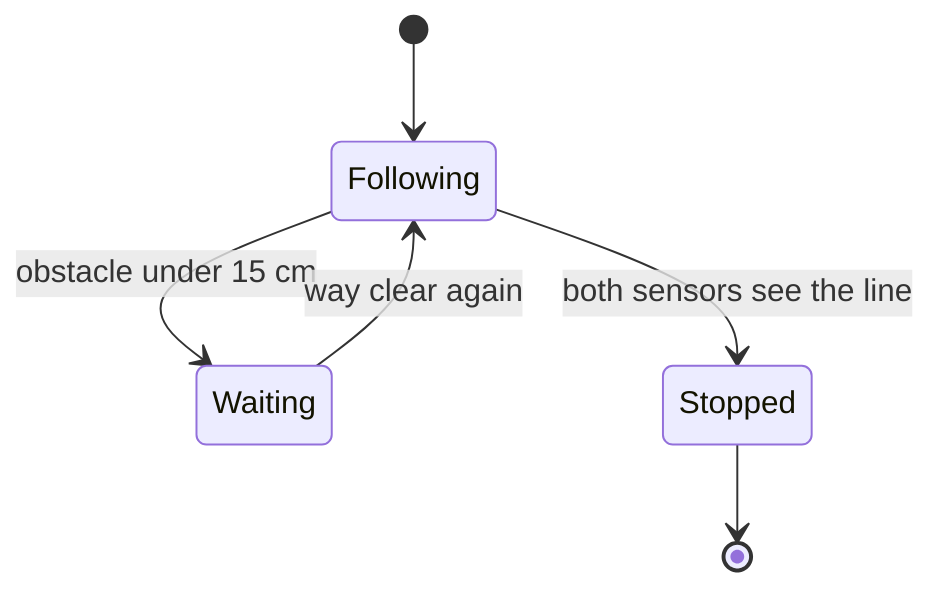

{:class="cover"}

---

By the end of this lesson you will be able to plan a robot project, combine more than one sensor in a single program, and test it step by step against a checklist.

You can now drive motors, read a line sensor, measure distance, point a servo and take commands over Bluetooth or Wi-Fi. This is where it all comes together. First we'll build one complete example together, a **line-following patrol robot that stops for obstacles**. Then you design your own.

## The worked example: patrol bot

The brief: follow a black line round a track. If something steps onto the line, stop and wait. When it moves, carry on. That uses two kinds of sensor (IR and ultrasonic), movement control and a decision between behaviours.



Two behaviours (following and waiting) and one rule for deciding between them: **safety checks come first**. Look for an obstacle before you look at the line, so the robot never steers on blindly.

### Wiring

Use the pin table from the intro and the power plan from lesson 6. You need the two IR sensors, the HC-SR04, the motors and `robot.py` and `sonar.py` on the Pico. The servo, Bluetooth and Wi-Fi are not needed here.

### The program

```python
from machine import Pin
from time import sleep_ms
from robot import Robot
from sonar import Sonar

LINE = 1             # sensor value over black tape (found in lesson 4)
SPEED = 50           # percent
STOP_CM = 15         # stop if something is closer than this
CHECK_EVERY = 5      # measure distance every 5th loop

bot = Robot()
sonar = Sonar()
left = Pin(6, Pin.IN)
right = Pin(7, Pin.IN)

loop_count = 0
blocked = False

while True:
    # 1. Sense (distance only every few loops, so the line check stays quick)
    if loop_count % CHECK_EVERY == 0:
        d = sonar.distance_cm()
        blocked = d is not None and d < STOP_CM
    loop_count += 1

    on_left = left.value() == LINE
    on_right = right.value() == LINE

    # 2. Decide and act: safety first
    if blocked:
        bot.stop()
        print("Obstacle, waiting")
    elif on_left and on_right:
        bot.stop()
        print("End marker, finished")
        break
    elif on_left:
        bot.drive(0, SPEED)
    elif on_right:
        bot.drive(SPEED, 0)
    else:
        bot.forward(SPEED)

    sleep_ms(20)
```

A few design choices are worth noticing. The sonar is read only every fifth loop because a measurement takes up to 30 ms when nothing echoes, and we do not want that delay on every steering decision. The `blocked` flag remembers the latest result between measurements. And `break` ends the loop when both sensors see a wide marker, so the last line of the program is where the robot ends up stopped (the motors were stopped just before).

## Planning your own project

Your project should:

- Use **at least two types of sensor** (for example IR and ultrasonic)
- Include some form of **movement control**
- Show **autonomous behaviour**, **remote control**, or both
- Be **documented and repeatable**: someone else can rebuild it from your notes

### Ideas

| Project | Sensors | Hint |
|---------|---------|------|
| Maze explorer | Ultrasonic on a servo | Use version 2 from lesson 10 with a wall-following rule |
| Line racer | Two IR sensors | Tune the speed and use a gentler turn |
| Patrol bot | IR and ultrasonic | Extend the worked example to beep or flash an LED on a stop |
| Light seeker | Two LDRs (ADC pins) | Read each with `ADC(26).read_u16()` and `ADC(27).read_u16()`, and turn to the brighter side |
| Wi-Fi RC car | Ultrasonic | Add an auto-stop when something is close to the Wi-Fi control from lesson 9 |
{:class="table table-single"}

### A planning checklist

1. **Define the goal** in one sentence: what will your robot do?
2. **List the parts** and the pins, and add them to your own pin table. Check no two parts share a pin.
3. **Write pseudocode** in plain English before the Python, for example: "if blocked, stop; else if on the line, follow it".
4. **Test in parts.** Get each sensor printing sensible values before driving anything.
5. **Drive on a block** first, then on the floor, with a hand ready to switch off.
6. **Change one thing at a time** and write down what happened.

## Sharing your work

Take photos and a video of your build. Write down what it does, the parts, the pin table, any problems you hit and how you fixed them, and link your code. Explaining your robot to someone else is the best test of whether you understand it.

> **Teachers**: Allow a double session or two for this, and plan for things to go wrong. Assess the process as well as the result, for example the pin table, the pseudocode, the test log and a short explanation of one design choice. Keep a tidy kit list so all parts can be returned, and have learners save their code to a folder with their names, since the Pico itself will be wiped for the next class. Stagger the first power-up of every robot, and check polarity yourself.

## Common Issues

- **Problem**: The robot follows the line fine until the obstacle check is added, then stutters.
- **Solution**: Measure the distance less often, as with `CHECK_EVERY`.
- **Why**: Each sonar reading can take up to 30 ms, which slows the steering loop.

- **Problem**: Two parts do not work together although each works alone.
- **Solution**: Look for a shared pin, or a power dip when the motors start.
- **Why**: Conflicts come from two parts using the same pin or the same supply.

- **Problem**: Your code is long and nothing works.
- **Solution**: Go back to the smallest working piece and add one feature at a time.
- **Why**: With one change per test you always know which change broke it.

## Try it Yourself

1. Run the patrol bot and tune `STOP_CM` and `SPEED` for your track.
2. Add an LED on a free pin that lights whenever the robot is waiting.
3. Change the patrol bot so it reverses and tries another route when blocked for more than five seconds. Use `ticks_ms()` for the timing.
4. Challenge: design and build your own project from the table, and write a one-page build note.

## Check your understanding


? In the patrol bot, why is the obstacle check done before the line check?
- [x] Safety checks come first, so the robot never steers on blindly
- [ ] The sonar is faster than the IR sensors
- [ ] The line check needs the distance
> The decision order puts blocked first, so an obstacle always wins over line following.

? Why is the sonar read only every fifth loop?
- [ ] The sonar can only be used five times
- [ ] To save battery
- [x] A reading can take up to 30 ms, which would slow steering
> The line check stays quick and the blocked flag remembers the last result.

? Which is a good first step when two parts do not work together?
- [ ] Rewrite the whole program
- [x] Test each part alone, and check for a shared pin or power dip
- [ ] Replace the Pico
> The common causes are pin conflicts and power problems, which show up when parts are tested one at a time.

