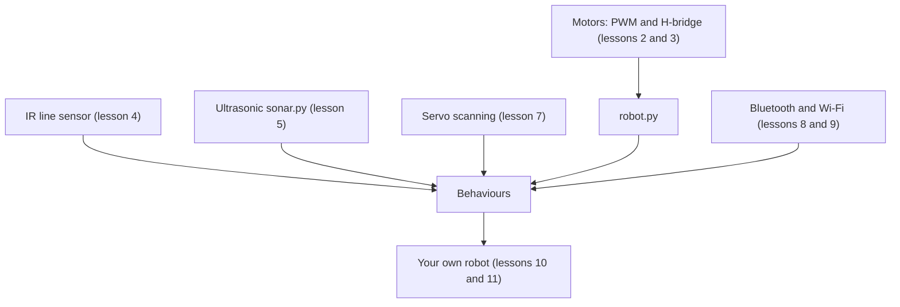

{:class="cover"}

---

By the end of this lesson you will be able to recap every part of the robot, say which lesson to revisit when something breaks, and choose your next project.

Congratulations on completing **MicroPython Robotics Projects with the Raspberry Pi Pico**! You've gone from single components to a robot that can sense, move, react, and even take orders from your phone. That's a real achievement in physical computing.

## What you've learned

| If this goes wrong | Revisit |
|--------------------|---------|
| Motor will not turn, or always runs flat out | Lesson 2 |
| Wheels turn the wrong way | Lesson 3 |
| Robot loses the line | Lesson 4 |
| Distance readings are wrong or the Pico is damaged by ECHO | Lesson 5 |
| Resets, heat or power trouble | Lesson 6 |
| Servo angle is off or buzzing | Lesson 7 |
| Remote control not responding | Lessons 8 and 9 |
{:class="table table-single"}

The big ideas to keep:

- A Pico cannot run motors directly, so a **driver** switches the power
- **PWM** sets speed: duty of 65535 means fully on, and a servo angle is a pulse width
- **Sensors** give numbers, and you must calibrate and check their voltage levels
- Robots run a **sense, decide, act** loop
- Build in **safety stops** and test each part on its own

## What's next

Here are some ways to take your skills further:

- **Understand drivers deeply** with [Motors and motor drivers](/learn/motors_and_drivers/): motor classes, braking, servos, steppers and encoders
- **Go back to the foundations** with [Robotics 101](/learn/robotics_101/)
- **Build more MicroPython skills** with [GPIO Mastery](/learn/micropython_gpio/) and [Intermediate level MicroPython](/learn/intermediate_micropython/)
- **Try a complete robot kit** with [Build your own BurgerBot](/learn/burgerbot/) or the SMARS robot courses, such as [Learn how to program SMARS with Arduino](/learn/smars_code/)
- **Wire and test in a simulator** with [Wire It Up - Electronics in Snakie](/learn/snakie_electronics/)
- **Smarter robots**: add wheel encoders, try PID control, or add more sensors

## Share what you've built

Share your photos, code and write-ups on your favourite maker forums. Show what went wrong as well as what worked, since that's what other makers learn the most from.

## Try it Yourself

1. Write down the three biggest problems you fixed during the course and what caused each.
2. Draw your robot's wiring as a table, from memory, then compare it to the intro.
3. Pick one idea from What's next and write a plan for it using the checklist in lesson 11.

## Check your understanding


? What sets the speed of a DC motor driven through an L298N enable pin?
- [ ] The direction pins
- [x] The PWM duty cycle on the enable pin
- [ ] The motor wire colour
> PWM on ENA or ENB sets the average power the motor gets.

? Which loop describes how an autonomous robot works?
- [x] Sense, decide, act
- [ ] Wire, solder, test
- [ ] Pair, connect, drive
> The robot reads its sensors, decides, and then moves.

? Why should you build in a safety stop in remote-controlled robots?
- [ ] It makes the code shorter
- [ ] It saves memory
- [x] So the robot stops if the connection is lost
> The Bluetooth lesson stops the robot when commands stop arriving, and the Wi-Fi lesson uses short nudges.

