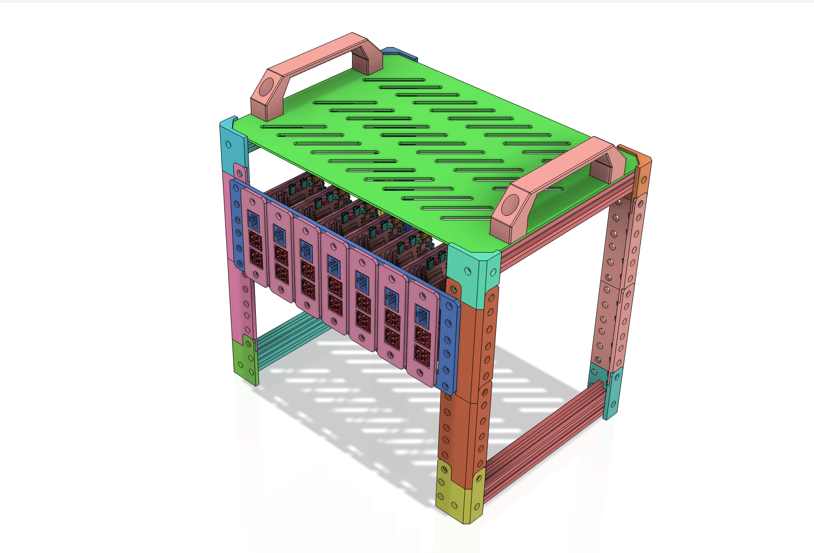
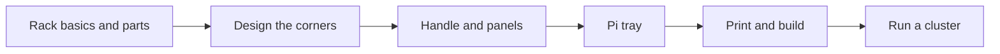

{:class="cover"}

---

Ahoy there makers! Do you have a few Raspberry Pis, a network switch and a tangle of cables on your desk? In this course we'll design a neat 10" mini-rack to house them all, and build the 3D printed and laser-cut parts ourselves.

Kev made a video of the design. Watch it first, then come back and let's build.



---

## Overview

A mini-rack is a small, 10" rack that can hold network equipment, computers and other related equipment. A full size rack, the kind you find in a server room or data centre, is 19" wide. A mini-rack is roughly half that width, which makes it perfect for a home lab or a small office.

{:class="img-fluid w-100"}

Why bother? A rack keeps cables tidy and everything neat and in its place. Because the equipment is mounted in a frame with gaps around it, air can flow past it, which helps with cooling too.

We design the rack in Fusion 360, one part at a time, so you finish with a rack that you understand and can change. Every part is built from the same few tools: sketch, extrude, cut and fillet. Each lesson shows the finished part first, and then a series of pictures to follow.

## Course Content

- **Overview**: the parts of the rack and how each is made
- **Part Designs**: the 2U, bottom and top corners, the handle, the cluster panel, the Pi tray, the top panel and the laser-cut cluster panel
- **Printing**: printing tips, assembly, safety and what to do next

## Key Results

After completing this course, you will:

- Explain what a rack unit is, and how rack hole spacing sets the shape of a part
- Name each part of the mini-rack and say how it is made
- Sketch, extrude, cut, fillet and mirror parts in Fusion 360
- Design a Raspberry Pi tray with mounting holes and cooling slots
- Prepare a DXF file for a laser cutter
- Print the parts with sensible settings and plan the assembly safely

## What you'll need

- A computer with Fusion 360 (or another CAD package, if you adapt the steps)
- A 3D printer, or access to a print service
- A laser cutter, or a makerspace or cutting service, for the top and front panels
- 20x20mm aluminium extrusion, and rack mount nuts and bolts for assembly
- Raspberry Pis, if you want to fill the rack. You do not need them for the design lessons

## How the course works

Most lessons are build-along: a list of numbered steps, each with a picture of the result. Names in `code style` are what we call sketches and files, so follow them and the timeline stays easy to read. Measurements are in millimetres. Each lesson ends with exercises, common problems and a short quiz.

If you get stuck, compare your screen with the picture for that step, and look at the Common Issues section.

> **Teachers**: This course suits beginners who are comfortable with a computer, and works for a club or a class. Each design lesson takes 30 to 60 minutes, and lesson 2 is the longest. All the design work can be done with no hardware beyond a computer with Fusion 360, and the STL files can go to any printer or print service. Printing, laser cutting and metal cutting need supervision, and the Raspberry Pis are optional. For a class, the budget is mostly printer time, extrusion and a power strip, so plan it ahead.

## Before you start

New to 3D design? Try [Design a SMARS Robot in Fusion 360](/learn/smars_fusion360/) first, or the free [FreeCAD course](/learn/freecad/). Once your rack is finished, [Docker](/learn/docker/), [Raspberry Pi 5 Cluster with Docker Swarm](/learn/docker_swarm/) and [Running K3s on Raspberry Pi](/learn/k3s/) show you what to run on it.

## Check your understanding


? How wide is a mini-rack?
- [ ] 19 inches
- [x] 10 inches
- [ ] 1.75 inches
> A full-size rack is 19 inches wide, and a mini-rack is 10 inches.

? Which tool will you use to design the parts?
- [ ] Thonny
- [x] Fusion 360
- [ ] Docker
> The design lessons use Fusion 360.

? Which parts are cut with a laser?
- [x] The panels
- [ ] The corners
- [ ] The handle
> Flat panels are laser cut, while the corners and handle are printed.

