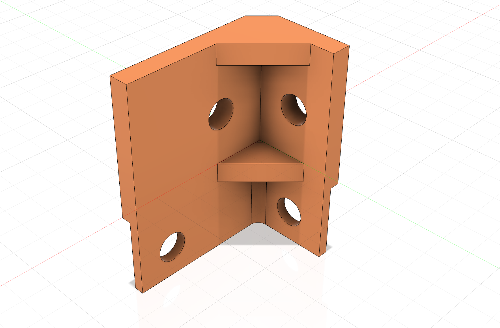

{:class="cover"}

---

By the end of this lesson you will be able to design the top corner, and say how it differs from the bottom corner.

Ahoy there makers! The top corner finishes each post and supports the top panel and handle. If you made the bottom corner in the last lesson, this one will go quickly. It reuses the same pattern, with a fillet added at the end to round off the inside edge.

Here is the finished part.

{:class="img-fluid w-100"}

1. Create a new file named `top_corner` in Fusion 360

1. Create a new sketch on the XY plane, named `top_base`

1. Create the following sketch:

    {:class="img-fluid w-100"}

1. Extrude the body profile by `4mm`:

    {:class="img-fluid w-100"}

1. Create a sketch on the top of the new part, named `top_profile`

    {:class="img-fluid w-100"}

1. Extrude the sketch:

    {:class="img-fluid w-100"}

1. Create a new sketch on the top of the body, named `side holes`

    {:class="img-fluid w-100"}

1. Extrude the sketch:

    {:class="img-fluid w-100"}

1. Extrude the sketch:

    {:class="img-fluid w-100"}

1. Extrude the sketch:

    {:class="img-fluid w-100"}

1. Create a new sketch on the top of the body, named `ribs`

    {:class="img-fluid w-100"}

1. Extrude the sketch:

    {:class="img-fluid w-100"}

1. Create a construction plane:

    {:class="img-fluid w-100"}

1. Extrude the `ribs` sketch:

    {:class="img-fluid w-100"}

1. Fillet the inside bottom edge:

    {:class="img-fluid w-100"}

## What is different from the bottom corner?

The workflow is the same: a 4mm base, a `top_profile`, `side holes`, then `ribs`. The differences are in the shapes, and in the last step, where we fillet the inside bottom edge. A fillet rounds a sharp inside corner. On a printed part that helps, because sharp inside corners are where stress builds up and cracks start.

Where the steps say "Extrude the sketch" several times in a row, you are extruding different profiles of the same sketch. Select each profile in turn, and compare your result with the picture after each one.

## Try it Yourself

1. Before you start the fillet, check the inside edge you will select. Which edge is "inside bottom"?
2. Try a larger fillet and a smaller one. What changes in the picture?
3. Challenge: look at the components photo in lesson 1. Which face of the top corner meets the top panel?

## Common Issues

- **Problem**: The fillet fails with an error.
- **Solution**: Make the fillet radius smaller, or select just one edge at a time.
- **Why**: A fillet cannot be bigger than the face next to it, so Fusion 360 refuses.

- **Problem**: I extruded the wrong profile in one of the repeated steps.
- **Solution**: Press Ctrl+Z (Cmd+Z on a Mac) and select the profile that matches the picture.
- **Why**: A sketch with many closed areas offers each of them as a profile.

## Check your understanding


? What does the last step of the top corner do?
- [ ] Adds ribs
- [x] Fillets the inside bottom edge
- [ ] Cuts side holes
> The final step rounds the inside bottom edge with the Fillet tool.

? Why do designers round inside corners?
- [x] Sharp inside corners concentrate stress and can crack
- [ ] It makes the part lighter
- [ ] It is needed to export an STL
> Rounded corners spread the load more evenly.

? Which plane is the `top_base` sketch drawn on?
- [ ] The top face
- [x] The XY plane
> Step 2 creates the sketch on the XY plane.

