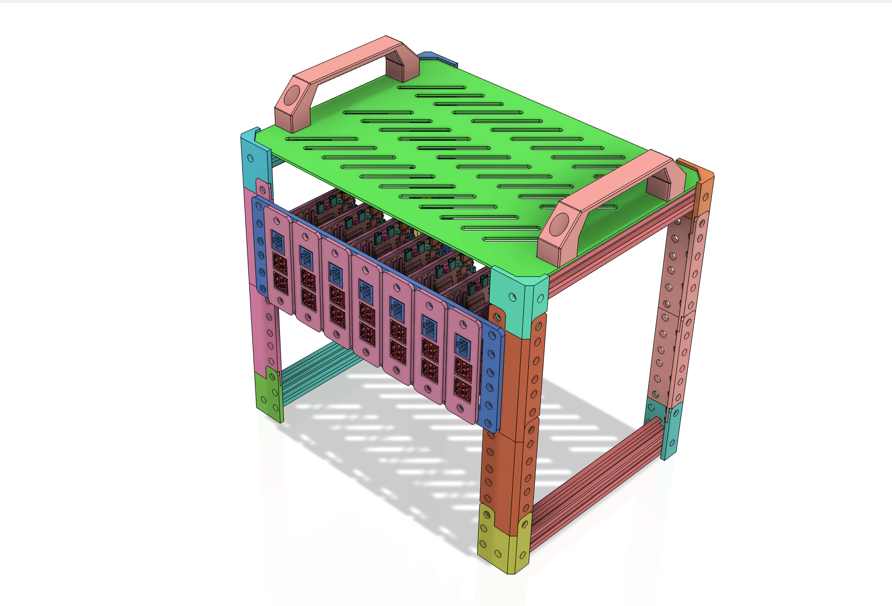
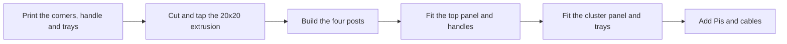

{:class="cover"}

---

By the end of this lesson you will be able to prepare the printed parts for printing, check them, and plan the assembly of your mini-rack.

Ahoy there makers! The design work is done, so let's turn it into a real rack. This lesson is the finish line for the course, with a print checklist, an assembly plan and some ideas for what to run on your finished rack.

## Printing tips

As these parts will be load bearing, it's best to print them with 100% infill. This makes the parts stronger and more durable.

{:class="img-fluid w-100"}

The corners, the handle and the Pi trays are the parts to print. The panels are flat sheets, which the original project laser cuts from basswood (the top panel from lesson 8 and the front panel from lesson 9).

### A print checklist

1. Download the STL files from the [Mini-Rack project](/projects/mini-rack/) page, or export your own from Fusion 360.
2. The project page offers the corners in mirrored pairs, so you can build both the left and right sides of the rack. Print one of each type to start.
3. Set infill to 100%.
4. As a starting point, lay each part with its flat back face on the bed.
5. Print one part first, test its fit, then print the rest.

Test the first part against a short length of the 20x20mm extrusion before you print the rest. Holes can shrink a little in printing, so check the bolts fit.

## Putting the rack together

In the original build the extrusion is cut to length with a chop saw, and the ends are tapped with a 6M tap, so the bolts screw in easily. The 2U, top and bottom corners slot into each other, the printed parts are bolted to the extrusion with rack mount nuts and bolts, and the handle is bolted on with T-nuts. Take care cutting and handling aluminium: wear eye protection, and deburr the cut ends so they don't catch your hands.

## Keep it cool and safe

- Leave the ventilation slots open, top and bottom. A closed box of Pis gets hot.
- Don't put the rack in direct sun or beside a radiator. Some printing plastics soften when warm, so check your filament's heat rating.
- Plug the rack into a proper 10 inch rack power strip, and don't overload it. Never wire mains electricity yourself.
- Use the official power supply for each Pi model.

> **Teachers**: Printing a full rack is a lot of printer time, so plan it across several sessions and split the parts between groups. Learners should not open or modify mains power strips. Where possible, test the frame and trays with an unpowered Pi (or a dead board) first. The assembly needs a saw and a tap, which an adult should do; learners can fit the printed parts and bolts. If you have no printer at all, the design lessons can still be done on screen and the STLs sent to a print service.

## Where to go next

A rack is only as good as what it runs. Now your Pis have a home, why not make them work as a cluster?

- [Docker](/learn/docker/) teaches you to run software in containers, the easiest way to move work from one Pi to another.
- [Raspberry Pi 5 Cluster with Docker Swarm](/learn/docker_swarm/) joins several Pis into one cluster.
- [Running K3s on Raspberry Pi](/learn/k3s/) installs a lightweight Kubernetes on your Pis.

If you got stuck with Fusion 360, the [FreeCAD course](/learn/freecad/) is a free alternative to learn the same ideas.

## Try it Yourself

1. Print the smallest part first (a corner or handle) and test the fit against a piece of extrusion.
2. Print a corner, then try it on a short length of extrusion with a bolt. Does it fit without forcing?
3. Challenge: plan your own rack. Which of the parts in this course would you reuse, and which would you redesign?

## Common Issues

- **Problem**: My print warps or lifts from the bed.
- **Solution**: Clean the bed, use a brim, and make sure the bed is levelled.
- **Why**: Large flat parts cool unevenly and pull their corners up.

- **Problem**: The bolt will not go into the extrusion.
- **Solution**: Tap the end of the extrusion with a 6M tap.
- **Why**: The hole in the end of the extrusion is not threaded for your bolt until you cut a thread.

- **Problem**: A printed part cracks when I tighten a bolt.
- **Solution**: Print it again at 100% infill, and tighten gently until the part is snug.
- **Why**: Low infill leaves hollow gaps, so the part can crack under load.

## Check your understanding


? What infill is recommended for the rack parts?
- [ ] 10%
- [ ] 50%
- [x] 100%
> The parts are load bearing, so 100% infill is the best choice.

? What do you do to the ends of the extrusion so the bolts fit?
- [x] Tap them with a 6M tap
- [ ] Paint them
- [ ] Sand them flat
> The original build taps the ends with a 6M tap.

? Which course would you take to join your Pis into a cluster?
- [ ] FreeCAD
- [x] Raspberry Pi 5 Cluster with Docker Swarm
- [ ] Markdown
> The Docker Swarm course joins Pis into a cluster.

