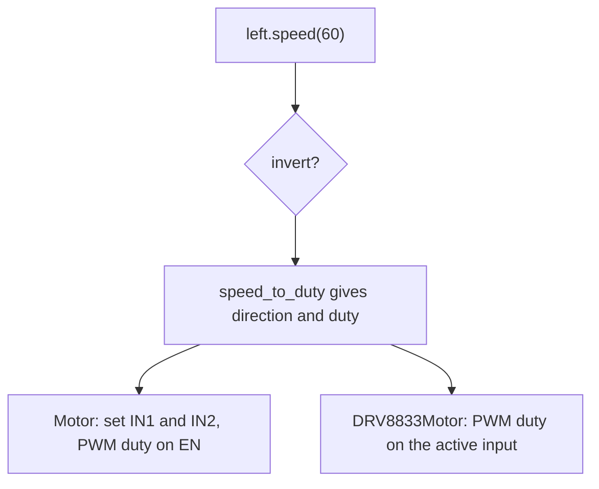

{:class="cover"}

---

By the end of this lesson you will be able to wrap an L298N or DRV8833 channel in a reusable motor class with speed, brake and coast methods.

Our test scripts work, but they are cluttered with pins and truth tables. Scout will have two motors, so let's wrap the details in a **class**. After this lesson, the rest of the course just says `left.speed(60)`.

## What a good motor class looks like

We want:

- `speed(value)` where value is -100 (full reverse) to 100 (full forward)
- `brake()` to stop quickly and `coast()` to let go
- An `invert` option, so a motor wired backwards can be fixed in code rather than with a screwdriver
- A `deadzone` option, from lesson 6

The maths is kept in a plain function, `speed_to_duty`, with no hardware in it. That makes it easy to test, even on a laptop.

## motor.py

Create a new file on the Pico called `motor.py` and paste this in. It contains one class for each driver, with identical methods, so Scout does not care which you built.

```python
# motor.py - DC motor classes for the L298N and DRV8833
from machine import Pin, PWM

MAX_DUTY = 65535


def speed_to_duty(speed, deadzone=0):
    """Turn a speed of -100..100 into (direction, duty_u16).

    direction is 1 (forward), -1 (reverse) or 0 (stopped).
    deadzone is the duty percent at which your motor first turns.
    """
    speed = max(-100, min(100, speed))
    if speed == 0:
        return 0, 0
    direction = 1 if speed > 0 else -1
    percent = deadzone + (100 - deadzone) * abs(speed) / 100
    return direction, int(percent * MAX_DUTY / 100)


class Motor:
    """One L298N channel: two direction pins plus a PWM enable pin."""

    def __init__(self, in1, in2, en, freq=1000, deadzone=0, invert=False):
        self.in1 = Pin(in1, Pin.OUT)
        self.in2 = Pin(in2, Pin.OUT)
        self.en = PWM(Pin(en))
        self.en.freq(freq)
        self.deadzone = deadzone
        self.invert = invert
        self.coast()

    def speed(self, value):
        if self.invert:
            value = -value
        direction, duty = speed_to_duty(value, self.deadzone)
        if direction == 0:
            self.coast()
            return
        self.in1.value(1 if direction > 0 else 0)
        self.in2.value(0 if direction > 0 else 1)
        self.en.duty_u16(duty)

    def brake(self):
        self.in1.value(1)
        self.in2.value(1)
        self.en.duty_u16(MAX_DUTY)

    def coast(self):
        self.in1.value(0)
        self.in2.value(0)
        self.en.duty_u16(0)


class DRV8833Motor:
    """One DRV8833 channel: PWM on both inputs, no enable pin."""

    def __init__(self, in1, in2, freq=10000, deadzone=0, invert=False):
        self.in1 = PWM(Pin(in1))
        self.in2 = PWM(Pin(in2))
        self.in1.freq(freq)
        self.in2.freq(freq)
        self.deadzone = deadzone
        self.invert = invert
        self.coast()

    def speed(self, value):
        if self.invert:
            value = -value
        direction, duty = speed_to_duty(value, self.deadzone)
        if direction > 0:
            self.in1.duty_u16(duty)
            self.in2.duty_u16(0)
        elif direction < 0:
            self.in1.duty_u16(0)
            self.in2.duty_u16(duty)
        else:
            self.coast()

    def brake(self):
        self.in1.duty_u16(MAX_DUTY)
        self.in2.duty_u16(MAX_DUTY)

    def coast(self):
        self.in1.duty_u16(0)
        self.in2.duty_u16(0)
```

Here is what happens when you call `left.speed(60)`:



### How it works

- `speed_to_duty` is the maths from lesson 6, extended for negative speeds. It returns a direction and a duty so the class only has to set pins.
- On the L298N, the direction is set with IN1 and IN2, and the speed is the PWM duty on EN.
- On the DRV8833, the direction is *which* input carries the PWM, and the other stays low.
- `brake()` and `coast()` match the truth tables from lesson 4.

## Using it

A short script to check it. Copy it into `main.py` or run it from Thonny. It assumes the L298N wiring from lesson 5:

```python
from time import sleep_ms
from motor import Motor

# Pins from the wiring table: IN1=GP0, IN2=GP1, ENA=GP2
left = Motor(0, 1, 2, deadzone=30)

try:
    for speed in (25, 50, 75, 100, 0, -50, 0):
        print("speed", speed)
        left.speed(speed)
        sleep_ms(1000)
    left.brake()
finally:
    left.coast()
```

Using a DRV8833 instead? Swap one line. Everything else stays the same:

```python
from time import sleep_ms
from motor import DRV8833Motor

left = DRV8833Motor(0, 1, deadzone=20)

try:
    left.speed(50)
    sleep_ms(1000)
    left.speed(-50)
    sleep_ms(1000)
    left.brake()
finally:
    left.coast()
```

**Why this matters:** The rest of the course, and any robot you build afterwards, only ever calls `speed()`, `brake()` and `coast()`. If you change drivers, you change one line.

## Try it Yourself

1. Use your own dead zone value from lesson 6 and see how speed 10 feels compared with before.
2. If the wheel turns the wrong way, add `invert=True` rather than swapping wires.
3. Challenge: add a `stop()` method that calls `brake()`, and a `__repr__` that returns the last speed. This is a useful debugging aid.

## Common Issues

- **Problem**: `ImportError: no module named 'motor'`.
- **Solution**: Save the file on the Pico itself (File, Save as, Raspberry Pi Pico), not just on your computer.
- **Why**: MicroPython can only import files that are in the Pico's own filesystem.

- **Problem**: The wheel only moves in one direction.
- **Solution**: Check IN1 and IN2 are both wired and in the right order, and test them with the plain script from lesson 5.
- **Why**: One direction pin that is not connected leaves the bridge stuck pushing one way.

## Check your understanding


? What range of values does speed() take?
- [x] -100 (full reverse) to 100 (full forward)
- [ ] 0 to 65535
- [ ] 0 to 360
> Negative is reverse and positive is forward, so one number holds both speed and direction.

? A wheel spins the wrong way. What is the tidy fix?
- [x] Pass invert=True to that motor
- [ ] Rewrite speed_to_duty
- [ ] Swap the Pico's GP numbers
> invert lets you fix a backwards motor in code rather than with a screwdriver.

? What is the key difference between the Motor and DRV8833Motor classes?
- [x] Motor puts PWM on the enable pin, DRV8833Motor puts PWM on the active input
- [ ] Motor is for servos
- [ ] DRV8833Motor has no brake
> Both have the same methods, so the rest of your code does not care which driver you built.

