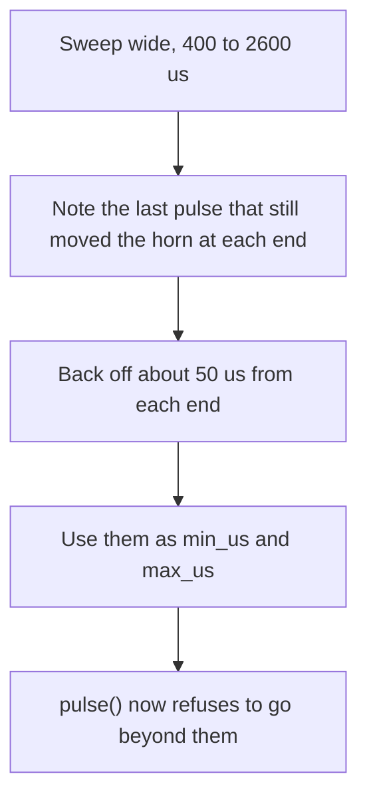

{:class="cover"}

---

By the end of this lesson you will be able to build a reusable Servo class and find the real minimum and maximum pulse widths of your own servo.

Last lesson's maths works, but no one wants to write `PWM(Pin(10))` and convert microseconds every time. Let's package it as a `Servo` class, with two features that make a real difference: calibration limits and smooth movement.

## servo.py

Create `servo.py` on the Pico:

```python
# servo.py - hobby servo helper for the Pico
from machine import Pin, PWM
from time import sleep_ms


def pulse_to_duty(us, freq=50):
    """Pulse width in microseconds -> duty_u16."""
    period_us = 1000000 / freq
    return int(us / period_us * 65535)


def angle_to_pulse(angle, min_us=1000, max_us=2000, max_angle=180):
    """Angle in degrees -> pulse width in microseconds."""
    angle = max(0, min(max_angle, angle))
    return min_us + (max_us - min_us) * angle / max_angle


class Servo:
    def __init__(self, pin, min_us=1000, max_us=2000, max_angle=180, trim=0, freq=50):
        self.pwm = PWM(Pin(pin))
        self.pwm.freq(freq)
        self.freq = freq
        self.min_us = min_us
        self.max_us = max_us
        self.max_angle = max_angle
        self.trim = trim            # degrees added to every move
        self.current = None         # last angle commanded

    def pulse(self, us):
        """Send a raw pulse, limited to this servo's safe range."""
        us = max(self.min_us, min(self.max_us, us))
        self.pwm.duty_u16(pulse_to_duty(us, self.freq))

    def angle(self, degrees):
        """Jump straight to an angle."""
        degrees = max(0, min(self.max_angle, degrees))
        self.current = degrees
        us = angle_to_pulse(degrees + self.trim, self.min_us, self.max_us, self.max_angle)
        self.pulse(us)

    def smooth(self, target, ms=500, step_ms=20):
        """Glide to an angle over `ms` milliseconds."""
        if self.current is None:
            self.angle(target)
            return
        start = self.current
        steps = max(1, ms // step_ms)
        for i in range(1, steps + 1):
            self.angle(start + (target - start) * i / steps)
            sleep_ms(step_ms)

    def off(self):
        """Stop sending pulses, so the servo relaxes and stops buzzing."""
        self.pwm.duty_u16(0)
```

`min_us` and `max_us` are the real limits of *your* servo, and `pulse()` refuses to go beyond them, which protects the gears.

## Calibrating

Servos are made cheaply, so the end points differ from one to the next. Let's find yours. Make sure the horn is free to move, and nothing is attached to it. The sweep goes wide on purpose:

```python
from time import sleep_ms
from servo import Servo

# Deliberately wide limits, just for finding the real ones
servo = Servo(10, min_us=400, max_us=2600)

try:
    servo.pulse(1500)
    sleep_ms(1000)

    print("sweeping up from the centre...")
    for us in range(1500, 2601, 50):
        print(us)
        servo.pulse(us)
        sleep_ms(300)

    print("sweeping down to the other end...")
    for us in range(2600, 399, -50):
        print(us)
        servo.pulse(us)
        sleep_ms(300)

    servo.pulse(1500)
    sleep_ms(500)
finally:
    servo.off()
```

Watch and listen. At each end, the horn stops moving even though the number keeps going. Beyond that point, the servo pushes against its stop and may buzz, which is the wrong place to be. Note the last pulse at which the horn was still moving at each end.

Back off by about 50 us from each, to stay clear of the stop. On a typical SG90 you end up with roughly 600 us at one end and 2400 us at the other.

The calibration routine, as steps:



## Scout's head

Now fit the horn so the head looks straight ahead at 90 degrees, and use your numbers in a head test. The values here are typical; use your own:

```python
from time import sleep_ms
from servo import Servo

head = Servo(10, min_us=600, max_us=2400)

try:
    head.angle(90)                  # look straight ahead
    sleep_ms(800)
    for target in (135, 90, 45, 90):
        print("looking at", target)
        head.smooth(target, ms=600)
        sleep_ms(400)
finally:
    head.off()
```

If the head looks the wrong way when you ask for 135, you have two options: flip the horn round when you fit it, or decide in your code that 45 is "left". For Scout, the project code in lesson 15 has `LEFT_ANGLE` and `RIGHT_ANGLE` constants so there is just one place to change.

If 90 is not quite straight, set `trim` rather than refitting the horn: `Servo(10, min_us=600, max_us=2400, trim=-3)` shifts every move by minus 3 degrees.

**Why this matters:** A distance sensor on a jerky head gives smeared readings. `smooth()` gives steady sweeps, and `off()` gives a quiet robot.

## Try it Yourself

1. Run the calibration and write down your own `min_us` and `max_us`.
2. Move the head with `smooth()` using 200 ms, then 2000 ms. Where does it start to look natural?
3. Challenge: write a `scan()` function that sweeps the head from 45 to 135 in 10 degree steps and prints each angle, ready for a distance sensor to join in later.

## Common Issues

- **Problem**: The horn buzzes at the end of its travel.
- **Solution**: Reduce `max_us` or `min_us` by 50 to 100 us.
- **Why**: The servo is trying to turn past its mechanical limit and is straining the gears.

- **Problem**: `smooth()` jumps on the first call.
- **Solution**: Call `angle()` once first so the class knows where the servo is.
- **Why**: Until the first move, the class has no starting position to glide from.

- **Problem**: The head droops or twitches after `off()`.
- **Solution**: Keep sending pulses with `angle()` if the head must hold against a load, and only call `off()` while idle.
- **Why**: With no pulses a servo has no torque, so the horn can be pushed around.

> **Teachers**: a servo pushed against its end stop buzzes and strains its plastic gears, and cheap SG90 servos are easy to break that way. Tell learners to stop the program at the first buzz and back off the limits. Spare horns and a spare servo per group save lesson time.

## Check your understanding


? What does Servo.pulse() do with a pulse outside min_us and max_us?
- [x] It clamps the pulse to the safe range
- [ ] It raises an error
- [ ] It sends it anyway
> The limits protect the gears, so pulse() refuses to go beyond your servo's real range.

? After finding where the horn stops moving at each end, what should you do?
- [x] Back off about 50 us from each end
- [ ] Use the exact end values
- [ ] Double them
> Staying clear of the mechanical stop avoids buzzing and strain.

? Scout's head looks slightly off-centre at 90 degrees. What is the simple fix?
- [x] Set trim to a small number of degrees
- [ ] Refit the horn every time
- [ ] Change the PWM frequency
> trim is added to every move, so Servo(10, min_us=600, max_us=2400, trim=-3) shifts everything by minus 3 degrees.

