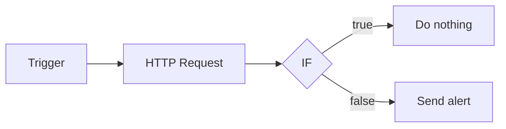

{:class="cover"}

---

n8n looks like a diagram, but it is really a tiny machine for moving data from one step to the next. Once you know five words, every workflow you meet makes sense.

---

## The five words

| Word | What it means | Butler example |
|---|---|---|
| Workflow | A saved chain of nodes that does one job | "Check the media server" |
| Node | One box on the canvas that does one thing | An HTTP Request node |
| Trigger | The first node, which decides when the workflow starts | A Schedule Trigger |
| Item | One chunk of data passed along the lines | One sensor reading |
| Execution | One run of a workflow, with a record of what happened | Last night's 02:00 check |
{:class="table table-single"}

**Why this matters:** when something goes wrong you can ask the right question. Did the trigger fire? What items came out of this node? Which execution failed?

## A workflow is a line of items

Data moves along the lines as **items**. Each node receives items, does its job, and passes new items on.

Every node you add to this course follows that shape. Something starts it, something fetches or reshapes data, something decides, and something acts.

## The robot butler plan

One butler, built a skill at a time.

| Stage | Lesson | Skill |
|---|---|---|
| 1 | 3 | Runs a workflow on demand |
| 2 | 4 | Checks a service every few minutes |
| 3 | 5 | Emails you when the check fails |
| 4 | 6 and 7 | Listens for Pico W readings |
| 5 | 8 | Tidies readings and flags a hot room |
| 6 | 9 to 11 | Keeps secrets, can be debugged, updated and restored |
{:class="table table-single"}

## Why self-host on a Pi?

Everything runs on your own hardware, with no monthly fee and no cloud account, and your data stays at home. The trade is that you look after it: updates, backups and security are your job. The last third of the course shows you how.

For basic workflows, a Raspberry Pi 4 or newer is fine. SD cards wear out under constant writes, so a Pi booting from an SSD is happier, and we will keep that in mind when we plan backups.

## Try it Yourself

1. Think of three chores in your homelab you do by hand. For each, write down the trigger, what it fetches and what it does.
2. Sketch one of them as boxes and arrows, like the diagram above.
3. Challenge: which of your three would need to react to something arriving (a webhook), and which to a clock (a schedule)?

## Common Issues

**Problem**: "Isn't this just a script?"
**Solution**: It can replace a script, but it also gives you a canvas, a run history and stored logins for free.
**Why**: Seeing every run and every item makes debugging far quicker than reading `print` output.
