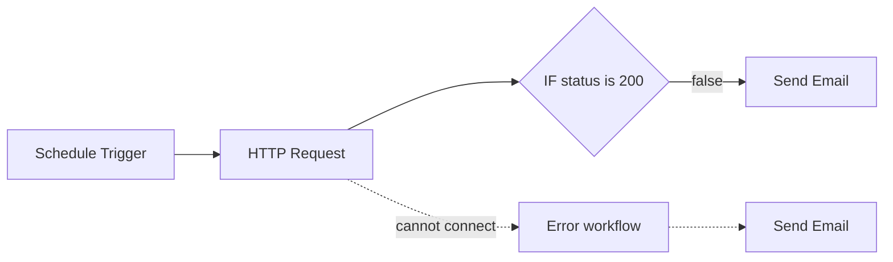

{:class="cover"}

---

Stage 3: the butler speaks up. We'll test the status code with an **IF** node and send an email down the failing branch.

---

## The IF node

The IF node splits the flow in two. Items that meet your conditions go out of the **true** output, and everything else goes out of the **false** output.

Add an **IF** node after the HTTP Request. Each condition has three parts: a value, a data type with an operation, and a value to compare with.

1. Drag the status code field from the left-hand input panel into the first box. It becomes an expression such as `{{ $json.statusCode }}` (use whatever field name your own output showed in lesson 4).
2. Choose the **Number** data type and the operation **is equal to**.
3. Type `200` as the second value.

Run it. A healthy service leaves through **true**. Change the URL to something that doesn't exist and it leaves through **false**.

| Data type | Handy operations |
|---|---|
| String | contains, starts with, matches regex |
| Number | is equal to, is greater than, is less than |
| Boolean | is true, is false |
{:class="table table-single"}

Use **Add condition** to combine several tests. **AND** needs all of them to pass, and **OR** needs any one.

**Common mistake:** comparing a number as a string. If the status shows up as `"200"` in quotes, use the String type, or compare as a Number and let n8n convert it.

## Send the alert

Connect a **Send Email** node to the **false** output. You'll need an SMTP account (your mail provider's settings page tells you the server details). The node's main fields are:

- **Credential to connect with**: your SMTP account
- **From Email** and **To Email**
- **Subject**, for example `Homelab alert: media server is down`
- **Email Format**: Text, HTML or Both, plus the message body

Create the SMTP credential from the node's credential drop-down. Use an app password if your provider offers them, rather than your main password. Lesson 9 explains where that secret ends up.

You can put data from earlier nodes in the subject with an expression, so the email says what failed:

```
Homelab alert: {{ $('HTTP Request').item.json.statusCode }} from the health check
```

(The part between `$('` and `')` is the name of the node, so match yours.)

## When the service can't be reached at all

If nothing answers, the HTTP Request node itself fails, so the IF node never sees it. For that, build a second tiny workflow: start with an **Error Trigger** node, then add a **Send Email** node. Open your health check workflow's **Workflow Settings** and choose that workflow in the **Error workflow** field. Now both a bad status and a dead service reach your inbox.



Publish the health check when it works.

## Try it Yourself

1. Turn the service off (`docker compose stop` for a test container) and confirm the email arrives within one interval.
2. Add an OR condition, so a slow response also counts as a failure.
3. Challenge: send the alert only once per outage, not every five minutes. Think about what the workflow would need to remember between runs.

## Common Issues

**Problem**: The IF node says the field doesn't exist.
**Solution**: Run the HTTP Request node first, then drag the field in from the input panel.
**Why**: n8n needs real output data to build the field path, and a typo breaks it.

**Problem**: Emails never arrive.
**Solution**: Check the SMTP credential and the spam folder, and look at the Send Email node's error in the **Executions** tab.
**Why**: Providers often reject plain passwords, and want an app password.
