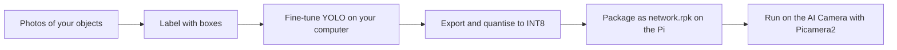

{:class="cover"}

---



## Overview

Ahoy there makers! Most robot cameras can only tell you "here are some pixels". An **object detection model** tells you "there is a mug, about here, and I am 87% sure". That one upgrade is what lets a robot find a tool, count parts or stop when a pet walks past.

In this course you will build your own detector for your own objects. You will photograph and label a small dataset, fine-tune a pre-trained YOLO model on it, shrink it down so it fits on the Raspberry Pi AI Camera, and run it live from Python. The AI Camera has a Sony IMX500 sensor with a neural network processor built in, so the Pi itself barely has to work.

Here is the whole journey:



## Course Content

- **Setup** - a Python environment on your computer that can train and export
- **Dataset preparation** - collecting photos, drawing boxes, laying out the folders
- **Training** - transfer learning with a pre-trained YOLO model
- **Export** - quantising the model and producing a file the IMX500 understands
- **Deployment** - getting the model onto the Pi and the camera
- **Real-time detection** - reading detections in Python and making a robot react
- **Troubleshooting** - measuring what is wrong and fixing it
- **Summary** - where to go next

## Key Results

After completing this course, you will be able to:

- Explain what a detection model outputs and what confidence means
- Build a labelled dataset in the format YOLO training expects
- Fine-tune a pre-trained model on your own objects
- Export, quantise and package a model for the IMX500
- Run it on the Raspberry Pi AI Camera and use the results in a program
- Work out why a detector is missing things or imagining things, and fix it

## What you'll need

**Hardware**

- Raspberry Pi 5 or Raspberry Pi 4 with Raspberry Pi OS
- Raspberry Pi AI Camera (IMX500) and the camera cable that fits your Pi
- A computer for training (a graphics card helps but is not essential)
- A phone or webcam for taking photos

**Software**

- Python 3.10 to 3.12 on your computer
- Java 17 or later on the computer that does the export step
- Raspberry Pi OS on the Pi, with the `imx500-all` package (we install it in lesson 05)

You can do lessons 01 to 04 with no Pi or camera at all.

## How the course works

Each lesson teaches one idea, shows a real example, then gives you **Try it Yourself** exercises, a **Common Issues** list and a short quiz. Commands for your computer or Pi are shown in `bash` blocks. Python blocks that can run anywhere are complete programs, so you can paste them straight in and see the output shown.

```python
import sys
print(f"Running Python {sys.version_info.major}.{sys.version_info.minor}")
```

Two honest notes up front. First, the IMX500 tooling changes quickly, so we point you at the official documentation whenever a command might move. Second, only a few model families can be exported for the IMX500 at the time of writing, so we use the smallest YOLO model and keep the course to the one workflow that works end to end.

## Prerequisites

- The [Python course](/learn/python/) if loops and functions are new to you
- The [Linux intro course](/learn/linux_intro/) if the terminal is new to you
- Helpful: the [OpenCV and cvzone course](/learn/cvzone/) for a gentler first look at computer vision

> **Teachers**: This course suits ages 14 and up with some Python. Allow about six to eight lessons of 45 to 60 minutes. Training is the slow part (30 minutes to a few hours depending on the computer), so start it at the end of one lesson and use the next lesson's time to review results. Lessons 01 to 04 need only a computer per learner or pair. Lessons 05 and 06 need one Pi and AI Camera per group of two to four, which is the main cost. Photographing people means privacy rules: have learners photograph objects, not classmates, and check your school's policy before collecting any images of faces.

## Let's get started

Ready to give your robot some eyes? On to setting up your environment.
