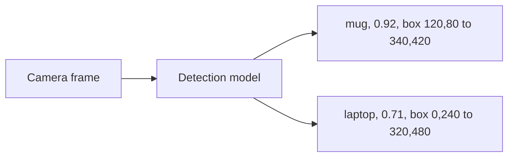

{:class="cover"}

---

By the end of this lesson you will be able to create a virtual environment, install the tools this course uses, and check that your Python version suits the IMX500 export step.

## What a detector gives you

Before we install anything, let's be clear about what we are building towards. An object detection model looks at one image and returns a list. Each item in the list has three parts: a **bounding box** (where), a **class** (what) and a **confidence score** between 0 and 1 (how sure).



Everything in this course is about getting a model that produces a good list, and getting that list onto a robot.

## Why a virtual environment?

A virtual environment is a private folder of Python packages for one project. Training tools are fussy about versions, so keeping them away from your system Python saves you from "it worked yesterday" problems.

**Real robot example:** you might have an old robot project that needs one version of NumPy, while Ultralytics wants another. With a virtual environment each project gets its own.

**Common mistake:** installing packages without activating the environment first. They land in your system Python and Jupyter cannot find them.

## Create and activate it

Check your Python first. The Ultralytics IMX export, which we use in lesson 04, supports **Python 3.10 to 3.12** on **Linux**. If you use Windows, the simplest route is WSL (Windows Subsystem for Linux). Training itself works on Windows and macOS, so you can still do lessons 01 to 03 there.

```bash
python3 --version
python3 -m venv venv
```

Activate it:

```bash
# Linux and macOS
source venv/bin/activate

# Windows (PowerShell)
venv\Scripts\activate
```

You know it worked when your prompt starts with `(venv)`.

## Install the tools

```bash
pip install ultralytics jupyterlab
```

- `ultralytics` is the library that trains, exports and runs YOLO models. It installs PyTorch for you.
- `jupyterlab` gives you notebooks for looking at images and loss curves.

Installing PyTorch is a big download, so expect a few minutes.

If you want Jupyter to offer your environment as a kernel, register it:

```bash
pip install ipykernel
python -m ipykernel install --user --name=venv --display-name "Python (venv)"
jupyter lab
```

`jupyter lab` prints a local address with a token. Open it in your browser. Leave out `--ip=0.0.0.0` unless you really want other machines on your network to reach it, because anyone who gets the token can run code on your computer.

## Check everything

Save this as `check_setup.py` and run it with `python check_setup.py`. It needs nothing but the standard library, so it works even if an install failed.

```python
import shutil
import sys

major, minor = sys.version_info[:2]
print(f"Python version: {major}.{minor}")

if (3, 10) <= (major, minor) <= (3, 12):
    print("Good: this Python suits the Ultralytics IMX export.")
else:
    print("Heads up: the IMX export expects Python 3.10 to 3.12.")

java = shutil.which("java")
if java:
    print(f"Java found at {java}")
else:
    print("Java not found (only needed on the machine that runs the export).")
```

Example output on Python 3.11:

```text
Python version: 3.11
Good: this Python suits the Ultralytics IMX export.
Java not found (only needed on the machine that runs the export).
```

Now check Ultralytics itself:

```bash
yolo checks
```

It prints your Ultralytics, Python and PyTorch versions and whether a GPU was found. No GPU is fine, just slower.

> **Teachers**: Installing PyTorch needs a few GB of downloads and some school networks block package sites or limit disk quotas. Test one machine first, or ask IT to build the environment once on a shared machine. Learners without admin rights can still use a virtual environment in their home folder. Hosted notebook services also work for training, but check their terms for under-18s.

## Try it Yourself

1. Create the environment, activate it, then run `pip list` and find `ultralytics` in the output.
2. Run `check_setup.py` outside the environment (open a fresh terminal without activating) and compare the Python version.
3. Edit `check_setup.py` to also print whether the `ultralytics` package is importable, using `importlib.util.find_spec("ultralytics")`.
4. Challenge: make the script exit with an error message if Python is outside 3.10 to 3.12.

## Common Issues

- **Problem**: `python: command not found` on Linux or macOS.
- **Solution**: Use `python3` and `python3 -m pip`, or install Python from your package manager.
- **Why**: Many systems only provide `python3`.

- **Problem**: PowerShell refuses to run `venv\Scripts\activate`.
- **Solution**: Run `Set-ExecutionPolicy -ExecutionPolicy RemoteSigned -Scope CurrentUser`, then try again.
- **Why**: Windows blocks unsigned scripts by default.

- **Problem**: Packages install but Jupyter cannot import them.
- **Solution**: Pick the "Python (venv)" kernel from the top right of the notebook.
- **Why**: Jupyter may be running a different Python from the one you installed into.

## Check your understanding


? What are the three parts of one detection?
- [ ] Image, label and file name
- [x] Bounding box, class and confidence score
- [ ] Class, colour and size
> A detection says where the object is (box), what it is (class) and how sure the model is (confidence).

? Which Python versions does the Ultralytics IMX export support?
- [ ] Any version
- [ ] Python 2.7 only
- [x] Python 3.10 to 3.12 on Linux
> Training works more widely, but the IMX export step needs Linux and Python 3.10 to 3.12.

? Why use a virtual environment?
- [x] It keeps this project's package versions separate from other projects
- [ ] It makes training run faster
- [ ] It is required to use a camera
> Isolation prevents version clashes between projects.

