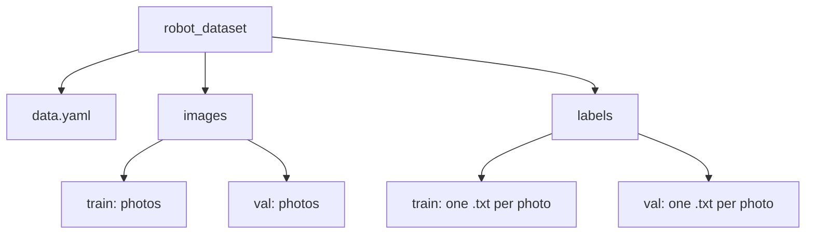

{:class="cover"}

---

By the end of this lesson you will be able to collect and label a small dataset, split it into training and validation sets, and write the `data.yaml` file that tells YOLO where everything is.

## Why the dataset matters most

Your model can only learn what your photos show it. A detector trained on mugs photographed on one desk in daylight will happily miss the same mug on a workshop bench at night.

**Real robot example:** a tidy-up robot trained only on photos of a screwdriver lying flat will fail the moment the screwdriver is in a gripper, at an angle, or half behind a box.

**Rules of thumb that hold up well:**

- Start with around 100 to 300 labelled images per class, then add more where the model fails. These are starting points, not guarantees.
- Variety beats volume. Fifty varied photos teach more than five hundred near-identical ones.
- Photograph the object where your robot will actually see it.

## Collect your photos

Your phone is perfect. For each object:

1. Change the **angle**: top, side, close, far.
2. Change the **light**: window, lamp, shadow, dim.
3. Change the **background**: desk, floor, shelf, clutter.
4. Include **partly hidden** objects and frames with **several objects**.
5. Include some photos with **none** of your objects. Labelled files for those are simply empty, and they teach the model what is not a mug.

If you can, capture some photos with the AI Camera itself later on, because its lens and colour will differ from your phone.

> **Teachers**: Have learners photograph objects, not people. Photos of faces raise consent and data protection questions, and a model trained on a handful of classmates is also a poor detector. Agree a shared naming scheme and a shared folder before the lesson, or learners will spend the time moving files.

## Draw the boxes

You need a labelling tool that exports **YOLO format**. [Label Studio](https://labelstud.io/) does, and you can install it into your virtual environment:

```bash
pip install label-studio
label-studio start
```

It opens in your browser, normally at `http://localhost:8080`. Create a project, import your images, choose the bounding box labelling template and add your class names. When you finish, use **Export** and choose the **YOLO** format. Menus change between versions, so check the Label Studio docs if a button has moved.

Whatever tool you use, the rules for good boxes are the same:

- Box **tightly** around the visible part of the object.
- If part of the object is hidden, box only what you can see.
- Use one spelling per class. `mug` and `cup` are two different classes to the computer.
- Label **every** instance in every image. A missed mug teaches the model that mugs can be background.

## What a YOLO label looks like

YOLO stores one text file per image, one line per box:

```text
class_number centre_x centre_y width height
```

The four numbers are fractions of the image size, between 0 and 1. A 640 by 480 photo with a mug box from pixel (120, 80) to (340, 420) becomes `0 0.359375 0.520833 0.343750 0.708333`.

Some tools, such as LabelImg, can only save Pascal VOC XML. This complete program converts XML text to YOLO lines and complains clearly about a typo in a label:

```python
import xml.etree.ElementTree as ET

SAMPLE = """
<annotation>
  <size><width>640</width><height>480</height></size>
  <object>
    <name>mug</name>
    <bndbox><xmin>120</xmin><ymin>80</ymin><xmax>340</xmax><ymax>420</ymax></bndbox>
  </object>
  <object>
    <name>laptop</name>
    <bndbox><xmin>0</xmin><ymin>240</ymin><xmax>320</xmax><ymax>480</ymax></bndbox>
  </object>
</annotation>
"""

CLASSES = ["mug", "laptop", "keyboard"]


def voc_to_yolo(xml_text, classes):
    """Turn Pascal VOC XML text into YOLO label lines."""
    root = ET.fromstring(xml_text)
    img_w = float(root.find("size/width").text)
    img_h = float(root.find("size/height").text)
    lines = []
    for obj in root.findall("object"):
        name = obj.find("name").text.strip()
        if name not in classes:
            raise ValueError(f"Unknown label '{name}'. Known labels: {classes}")
        box = obj.find("bndbox")
        xmin, ymin = float(box.find("xmin").text), float(box.find("ymin").text)
        xmax, ymax = float(box.find("xmax").text), float(box.find("ymax").text)
        cx = (xmin + xmax) / 2 / img_w
        cy = (ymin + ymax) / 2 / img_h
        w = (xmax - xmin) / img_w
        h = (ymax - ymin) / img_h
        lines.append(f"{classes.index(name)} {cx:.6f} {cy:.6f} {w:.6f} {h:.6f}")
    return lines


for line in voc_to_yolo(SAMPLE, CLASSES):
    print(line)

try:
    voc_to_yolo(SAMPLE.replace("laptop", "lapttop"), CLASSES)
except ValueError as err:
    print("Caught:", err)
```

Output:

```text
0 0.359375 0.520833 0.343750 0.708333
1 0.250000 0.750000 0.500000 0.500000
Caught: Unknown label 'lapttop'. Known labels: ['mug', 'laptop', 'keyboard']
```

## The folder layout YOLO expects



YOLO finds each label file by swapping `images` for `labels` in the image path and `.jpg` for `.txt`, so the names must match exactly: `images/train/mug_001.jpg` pairs with `labels/train/mug_001.txt`.

The **validation** set is photos the model never trains on. It is how you find out whether the model learned the objects or just memorised the photos.

## Split and write data.yaml

Export from your labelling tool into a folder like `my_export/` containing `images/`, `labels/` and `classes.txt` (one class name per line). Then save this as `make_dataset.py` and run `python make_dataset.py my_export robot_dataset`:

<!-- code-check: skip -->
```python
import random
import shutil
import sys
from pathlib import Path

# Folder exported from your labelling tool in YOLO format:
#   my_export/images/*.jpg, my_export/labels/*.txt, my_export/classes.txt
SOURCE = Path(sys.argv[1] if len(sys.argv) > 1 else "my_export")
OUTPUT = Path(sys.argv[2] if len(sys.argv) > 2 else "robot_dataset")
VAL_FRACTION = 0.2

random.seed(42)  # same split every run

classes = (SOURCE / "classes.txt").read_text().split()
images = sorted((SOURCE / "images").glob("*.jpg"))
if not images:
    sys.exit(f"No .jpg files found in {SOURCE / 'images'}")

pairs = []
for img in images:
    label = SOURCE / "labels" / f"{img.stem}.txt"
    if not label.exists():
        sys.exit(f"No label file for {img.name}")
    pairs.append((img, label))

random.shuffle(pairs)
n_val = max(1, int(len(pairs) * VAL_FRACTION))
splits = {"val": pairs[:n_val], "train": pairs[n_val:]}

for split, items in splits.items():
    (OUTPUT / "images" / split).mkdir(parents=True, exist_ok=True)
    (OUTPUT / "labels" / split).mkdir(parents=True, exist_ok=True)
    for img, label in items:
        shutil.copy(img, OUTPUT / "images" / split / img.name)
        shutil.copy(label, OUTPUT / "labels" / split / label.name)
    print(f"{split}: {len(items)} images")

lines = [f"path: {OUTPUT.resolve()}", "train: images/train", "val: images/val", "names:"]
lines += [f"  {i}: {name}" for i, name in enumerate(classes)]
(OUTPUT / "data.yaml").write_text("\n".join(lines) + "\n")
print(f"Wrote {OUTPUT / 'data.yaml'} with {len(classes)} classes")
```

We tested this on a ten-image test set and got:

```text
val: 2 images
train: 8 images
Wrote robot_dataset/data.yaml with 3 classes
```

The `data.yaml` it writes lists the folders and the class numbers:

```yaml
path: /home/you/robot_dataset
train: images/train
val: images/val
names:
  0: mug
  1: laptop
  2: keyboard
```

**Careful:** if you took ten near-identical burst photos of one scene, a random split puts some in training and some in validation. The model then "recognises" its own homework and the validation score looks better than real life. Keep burst photos together in one split, or take more varied scenes.

## Try it Yourself

1. Photograph one object 30 times with the variety rules above, and label every photo.
2. Run `make_dataset.py` and open one `.txt` label file. Work out by hand what the first box covers in pixels.
3. Delete one label file on purpose and see what error the script gives you.
4. Challenge: extend `make_dataset.py` to print how many boxes there are per class, so you can spot a class with far fewer examples.

## Common Issues

- **Problem**: Training says "no labels found" or ignores your images.
- **Solution**: Check that `images/train/x.jpg` has `labels/train/x.txt` with the same name.
- **Why**: YOLO finds labels by swapping `images` for `labels` in the path.

- **Problem**: Class numbers are wrong, so everything is detected as the wrong object.
- **Solution**: Make `classes.txt` order match the numbers in your label files, and do not reorder it later.
- **Why**: Label files store only the number, and `data.yaml` maps numbers to names.

- **Problem**: Boxes look right in the tool but are shifted in training.
- **Solution**: Confirm the values are fractions between 0 and 1, not pixels.
- **Why**: YOLO normalises by the image size, so pixel values fall outside the range.

## Check your understanding


? In a YOLO label line, what do the four numbers after the class mean?
- [ ] Pixel positions of the four corners
- [x] Box centre x, centre y, width and height as fractions of the image size
- [ ] Red, green, blue and brightness
> Fractions of the image size keep labels valid if the image is resized.

? Why keep a validation set the model never trains on?
- [ ] To make training faster
- [x] To measure whether the model works on photos it has not seen
- [ ] Because YOLO refuses to train without one folder of spare photos
> Validation tells you whether the model generalises or has just memorised the training photos.

? What is the problem with splitting ten near-identical burst photos randomly?
- [ ] Nothing, it is the best way
- [x] Near-copies land in both sets, so the validation score looks better than it really is
- [ ] The photos will be deleted
> Near-duplicates leak training information into validation.

