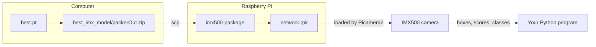

{:class="cover"}

---

By the end of this lesson you will be able to install the AI Camera software on a Raspberry Pi, package your exported model as `network.rpk`, and load it from Python.

## Why run it on the camera?

Running detection on the camera has real advantages for a robot. The images never leave the device, there is no internet delay, it works with the Wi-Fi off, and because the IMX500 does the neural network work, the Pi's own processor is free for driving motors and everything else.

Here is where each piece lives:



## Step 1: install the camera software

Connect the AI Camera to the Pi with the Pi powered off, then boot and run:

```bash
sudo apt update && sudo apt full-upgrade
sudo apt install imx500-all
sudo reboot
```

The `imx500-all` package installs the camera firmware, a set of ready-made models in `/usr/share/imx500-models/` and the post-processing files. You also need the packaging tool, which the official docs install separately:

```bash
sudo apt install imx500-tools
```

Check the Pi can see the camera:

```bash
rpicam-hello --list-cameras
```

You should see an `imx500` entry in the list.

## Step 2: test with a stock model first

Before using your own model, prove the hardware works with one that Raspberry Pi provides. With a monitor connected to the Pi, run:

```bash
rpicam-hello -t 0s --post-process-file /usr/share/rpi-camera-assets/imx500_mobilenet_ssd.json --viewfinder-width 1920 --viewfinder-height 1080 --framerate 30
```

This is the command from the official Raspberry Pi AI Camera documentation. The first run can take several minutes because the camera has to load its firmware and the network, so be patient. You should see a live preview with boxes drawn around everyday objects.

This split matters. If the stock model works but your model does not, the fault is in your model or packaging, not the camera. If neither works, check the cable and software first.

## Step 3: copy your model across

From your training computer:

```bash
scp -r best_imx_model <username>@raspberrypi.local:~/models/
```

Replace `<username>` with the user name you chose when you set up the Pi. On the Pi, `hostname -I` shows its address if `raspberrypi.local` does not resolve.

## Step 4: package it

On the Pi:

```bash
imx500-package -i ~/models/best_imx_model/packerOut.zip -o ~/models/robot_package
ls ~/models/robot_package
```

This produces `network.rpk` in the output folder. That is the file the camera loads. Keep `labels.txt` from the export folder somewhere handy, because the `.rpk` only knows class numbers.

## Step 5: load it from Python

Save this as `first_inference.py` and run it with `python3 first_inference.py`. It loads your network and prints the shape of what the camera sends back, which tells you how to read detections in the next lesson.

```python
import os

from picamera2 import Picamera2
from picamera2.devices.imx500 import IMX500

MODEL = os.path.expanduser("~/models/robot_package/network.rpk")

imx500 = IMX500(MODEL)                 # create this BEFORE Picamera2
picam2 = Picamera2(imx500.camera_num)  # attach to the IMX500 camera
config = picam2.create_preview_configuration(buffer_count=12)

imx500.show_network_fw_progress_bar()  # shows the model loading
picam2.start(config, show_preview=False)

for attempt in range(60):
    metadata = picam2.capture_metadata()
    outputs = imx500.get_outputs(metadata)
    if outputs is not None:
        print(f"Got {len(outputs)} output tensors:")
        for i, tensor in enumerate(outputs):
            print(f"  output {i}: shape {tensor.shape}")
        break
else:
    print("No network output received. Check the model loaded correctly.")

picam2.stop()
```
{: .no-snakie }

`get_outputs()` returns the model's output tensors as NumPy arrays, or `None` while the first frames are still arriving. Most exported YOLO detectors with on-chip non-maximum suppression give boxes, scores and class numbers as separate tensors. Print the shapes on your own model rather than trusting that: lesson 06 builds on what you see here.

> **Teachers**: One Pi and one AI Camera per group of two to four works well. The first run of each new model takes minutes, so load it before the lesson starts. Use a shared hostname scheme and a shared account on classroom Pis, and check that the school network lets learners SSH and `scp` between machines, because many school networks block that. A USB stick is a fine fallback for moving `packerOut.zip`. The camera is delicate: remind learners to power off before touching the ribbon cable.

## Try it Yourself

1. Run the stock model test and hold up three different objects. Which does it recognise?
2. Time how long `first_inference.py` takes on its first and second run, and explain the difference.
3. Edit the script to print `outputs[0][0]`, the first row of the first tensor.
4. Challenge: copy `labels.txt` to the Pi and print your class names at the start of the script.

## Common Issues

- **Problem**: `rpicam-hello --list-cameras` shows no cameras.
- **Solution**: Power off, reseat the ribbon cable at both ends with the contacts facing the right way, and check the Pi's own camera documentation for which way round your cable goes.
- **Why**: A half-seated cable is the most common cause.

- **Problem**: The first run seems frozen for minutes.
- **Solution**: Wait. Watch the firmware progress bar in your script or the terminal.
- **Why**: The camera loads firmware and your network on first use, and a bigger network takes longer.

- **Problem**: `imx500-package: command not found`.
- **Solution**: Run `sudo apt install imx500-tools` and try again.
- **Why**: The packaging tool is a separate package from `imx500-all`.

## Check your understanding


? Why test with the stock MobileNet SSD model before your own?
- [ ] It is faster than your model
- [x] It shows the camera and software work, so any later failure points at your model or packaging
- [ ] Your model will not load otherwise
> Changing one thing at a time makes faults easy to find.

? What does `imx500-package` produce from `packerOut.zip`?
- [ ] `best.pt`
- [x] `network.rpk`
- [ ] `data.yaml`
> `network.rpk` is the file the camera loads.

? In the Python script, what must be created before the Picamera2 object?
- [ ] The preview window
- [x] The `IMX500` object
- [ ] The labels file
> Creating `IMX500` first loads the network and gives you the right camera number.

