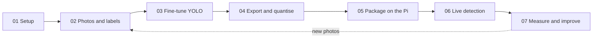

{:class="cover"}

---

By the end of this lesson you will be able to describe the whole detector pipeline in your own words and choose a next project to build with it.

## What you have built

You started with a pile of photos and ended with a camera that names objects and a program that reacts to them. Every stage was a place where something could go wrong, and you now know what to check at each one.

The dotted line is the most important one. Real detectors improve in a loop: run it, find where it fails, photograph those cases, label, retrain, export, test. Each lap makes it better.

## The ideas to keep

- **Data first.** Variety and honest labels matter more than model tricks.
- **Transfer learning.** Start from a pre-trained model and teach it your objects.
- **Small models for small chips.** The IMX500 needs a compact, INT8-quantised network, which is why we used the nano YOLO model.
- **Change one thing at a time.** Test with the stock model, then yours, then your program.
- **Measure.** Precision and recall tell you which kind of wrong you have.
- **React steadily.** Threshold and debounce so a robot does not twitch.

## Project ideas

**Beginner**

- A "did I leave my keys here" shelf camera that prints when keys appear or disappear.
- A desk guard that logs when a mug is picked up.

**Intermediate**

- A robot that drives towards a specific object and stops at a set distance, using box size as a rough distance guide.
- A parts counter for a workshop bin, counting boxes of screws on a shelf.

**Advanced**

- A pick-and-place arm that uses box position to line up its gripper.
- A multi-camera setup that reports to a central dashboard over your network.

## Keep learning

Courses on this site that go well with what you have just learned:

- [Python](/learn/python/) to get stronger with the language behind the scripts
- [Computer vision with cvzone](/learn/cvzone/) for OpenCV style vision on any camera
- [Pandas and NumPy](/learn/pandas_and_numpy/) for working with the arrays and results your model produces
- [Linux intro](/learn/linux_intro/) for confident terminal work on the Pi
- [Docker](/learn/docker/) for packaging projects so they run the same everywhere

For the official detail, the [Raspberry Pi AI Camera documentation](https://www.raspberrypi.com/documentation/accessories/ai-camera.html) and the [Ultralytics Sony IMX500 guide](https://docs.ultralytics.com/integrations/sony-imx500/) are the places that will change first, so check them when something stops working.

> **Teachers**: A good assessment is a short project report: the class chosen, how many photos, the precision and recall before and after one improvement, and one example the detector still gets wrong. This rewards honest measurement more than a high score. Allow a full lesson for the final demo, because setting up cameras takes longer than learners expect.

## Try it Yourself

1. Write the pipeline from memory in six steps, then compare with the diagram.
2. Add a second class to your dataset, retrain and see which class has lower recall.
3. Pick one project idea and list what photos you would need to take for it.
4. Challenge: run one full improvement lap. Find one failure, add 30 photos of it, retrain, export, and measure precision and recall again.

## Common Issues

- **Problem**: A project that worked suddenly fails after an update to Raspberry Pi OS or the tools.
- **Solution**: Check the official AI Camera docs for changes, and re-run the stock model test from lesson 05.
- **Why**: The IMX500 software is under active development, and package names or commands can change.

- **Problem**: A retrained model is worse than the previous one.
- **Solution**: Keep every `best.pt` with a note of the dataset and settings, and compare them on the same fixed test photos.
- **Why**: Without a record you cannot tell which change helped or hurt.

## Check your understanding


? What is the most important loop in improving a detector?
- [ ] Training for ever more epochs
- [x] Find failures, photograph those cases, label, retrain, export and test again
- [ ] Raising the threshold to 1.0
> Better data from the failures you actually see is the most reliable improvement.

? Why does this course use a nano-sized model?
- [ ] Nano models are always the most accurate
- [x] The IMX500 runs a small quantised network on the sensor itself, so the model must be compact
- [ ] Larger models cannot be trained
> The camera has limited on-chip memory and a small neural processor.

? Which pair of numbers tells you whether a detector misses things or invents things?
- [ ] Epochs and batch size
- [x] Recall and precision
- [ ] Width and height
> Recall measures misses and precision measures false alarms.

