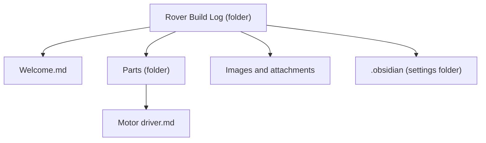

{:class="cover"}

---

By the end of this lesson you will be able to create a vault, explain what is inside it, and add your first note.

A **vault** in Obsidian is simply a folder where all your notes are stored. That's it. There is no hidden database and no account. Let's make one for our robot, which we will call **Rover Build Log**.

---

## Steps to create your first vault

1. **Open Obsidian.**
2. On the welcome screen, choose **Create new vault**.
3. **Name your vault.** Call it `Rover Build Log`.
4. **Choose a location** on your computer for the vault folder, somewhere you will remember such as your Documents folder.
5. Confirm to create it.

Obsidian creates the folder and opens it as your workspace.

---

## What is inside a vault?

- Your notes are Markdown files with the `.md` extension, which you can open with any text editor.
- Folders in the vault are normal folders. You can move notes around inside Obsidian or with your file manager.
- Obsidian keeps its own settings for the vault in a hidden folder called `.obsidian` inside it. That is why settings and plugins are **per vault** and are not shared between vaults.
- You can have as many vaults as you like, for example one for robots and one for school.

Because it is all plain files, you can back up a vault by copying the folder, and you can keep it in a cloud-synced folder if you want it on several devices.

---

## Adding your first note

1. Click the **New note** button in the sidebar.
2. Give your note a title, such as `Welcome`.
3. Type a line: `This vault holds the build log for the Rover robot.`

Your notes save automatically as you type. Open your vault folder in your file manager and you will see `Welcome.md` sitting there.

---

> ## Offline, by default
>
> Obsidian stores your notes locally on your own device, so you can edit them without an internet connection. If you want the notes on several devices, you can put the vault folder in a service you already use such as iCloud, Dropbox or Google Drive, but this is not required. Obsidian also offers a paid Sync service.

---

## Try it Yourself

1. Create the `Rover Build Log` vault and a `Welcome` note.
2. Open the vault folder in your file manager and find `Welcome.md`. Open it in a basic text editor and confirm you can read your text.
3. Create a second vault called `Scratch`, then switch between the two. Notice that they do not share anything.

---

## Common Issues

- **Problem**: I cannot find my vault folder on the computer.
- **Solution**: In Obsidian, look in the vault settings or vault switcher for the location, or search your files for the vault name.
- **Why**: Obsidian lets you choose where each vault lives, so there is no single fixed location.

- **Problem**: My note does not appear in the file list.
- **Solution**: Check you are in the right vault, and that you did not create the note in a folder that is collapsed.
- **Why**: Each vault is its own folder, and notes live in whichever folder you made them in.

> **Teachers**: on shared school computers, store each learner's vault on a USB stick or in their own network folder, and tell them where it is. If the machine is wiped at logout, a vault stored on the local disk is lost.

---

## Check your understanding


? What is a vault?
- [ ] A cloud database that Obsidian hosts for you
- [x] A folder on your computer that holds your notes
- [ ] A paid Obsidian subscription
> A vault is just a folder, and your notes are plain Markdown files in it.

? What file extension do Obsidian notes use?
- [ ] `.obs`
- [ ] `.docx`
- [x] `.md`
> Notes are Markdown files, so you can open them with any text editor.

? Why are plugins and settings not shared between two vaults?
- [x] Each vault keeps its own settings in its own `.obsidian` folder
- [ ] Obsidian only allows one vault to use plugins
- [ ] Plugins are deleted when you switch vaults
> Settings live inside each vault's own folder.

