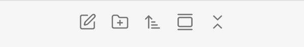
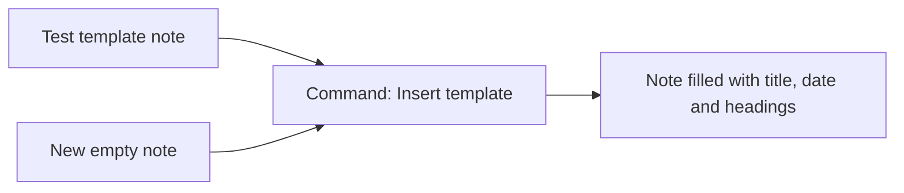

{:class="cover"}

---

By the end of this lesson you will be able to create, rename and organise notes, and use a template and a daily note to speed up your build log.

Notes are the building blocks of your vault. Each note is one Markdown file. In the Rover Build Log we will keep one note per topic: `Parts list`, `Motor driver wiring`, `Test 1 - driving straight` and so on. Small, focused notes are easier to link and easier to find later.

---

## How to create a new note

{:class="img-fluid w-50"}

1. Click the **New note** button in the sidebar, or press `Ctrl+N` (`Cmd+N` on a Mac).
2. Give the note a descriptive title, such as `Motor driver wiring`.
3. Start typing. Obsidian saves as you write.

The note's title is its file name, so `Motor driver wiring` becomes `Motor driver wiring.md`.

---

## Renaming, moving and deleting

- **Rename**: right-click the note in the file explorer and choose **Rename**. If other notes link to it, Obsidian normally offers to keep those links working, which is a big reason to rename inside Obsidian rather than in your file manager.
- **Move**: drag the note into another folder in the file explorer.
- **Delete**: right-click and choose **Delete**. By default deleted notes go to your system trash or recycle bin, so you can usually get them back.

---

## Templates: stop retyping the same layout

Every test result in a robot log has the same shape: date, what you tried, what happened. A **template** is a note whose contents you can insert into a new note. Templates is a built-in feature that you switch on in the settings under the core plugins. In the Templates settings you choose a folder to hold your templates.

Make a note called `Test template` in that folder with this content:


```markdown
# {{title}}

Date: {{date}}
Time: {{time}}

## What I tried

## What happened

## Next step
```


Now create a new note called `Test 1 - driving straight`, open the command palette (`Ctrl+P` or `Cmd+P`), and run the command **Templates: Insert template**. Pick `Test template`. Obsidian replaces `title`, `date` and `time` with the note's name, today's date and the current time.



---

## Daily notes: a build diary

Daily notes is another core feature. Once enabled, running the command **Open today's daily note** creates a note named after today's date (the default format is `YYYY-MM-DD`) or opens it if it already exists. You can point it at a template, and choose which folder daily notes go in. It is a perfect place for "Today I soldered the motor wires and the left wheel runs backwards."

---

## Try it Yourself

1. Create three notes in your vault: `Parts list`, `Motor driver wiring` and `Ideas`.
2. Rename `Ideas` to `Robot ideas`. Does anything break?
3. Make a template with your own headings and insert it into a new note.
4. Challenge: switch on daily notes, open today's note, and write down three things you did on your robot this week.

---

## Common Issues

- **Problem**: The template shows `{{title}}` text instead of the real title.
- **Solution**: Make sure you used the **Insert template** command from the Templates feature, and that the template note is in the template folder you chose in settings.
- **Why**: The text is only replaced when Obsidian inserts the template. Copying and pasting the text just pastes the placeholders.

- **Problem**: I cannot find the template or daily notes commands.
- **Solution**: Open the settings, find the core plugins list, and switch on Templates or Daily notes.
- **Why**: These are built in but are off until you enable them.

> **Teachers**: set the template folder and a shared template note for the class so every learner's test notes look the same. It makes marking and peer review much quicker.

---

## Check your understanding


? Why is it better to rename a note inside Obsidian than in your file manager?
- [ ] Obsidian is the only place you can rename files
- [x] Obsidian can update links in other notes that point to it
- [ ] It makes the file smaller
> Obsidian normally offers to update links that point to a renamed note.

? What does the title placeholder in a template turn into?
- [ ] The vault name
- [x] The name of the note you insert it into
- [ ] The date
> The title placeholder is replaced with the active note's title, while date and time give today's date and the time.

? What is the default file name format for a daily note?
- [ ] Day-Month-Year
- [x] `YYYY-MM-DD`
- [ ] A random number
> The default date format is `YYYY-MM-DD`.

