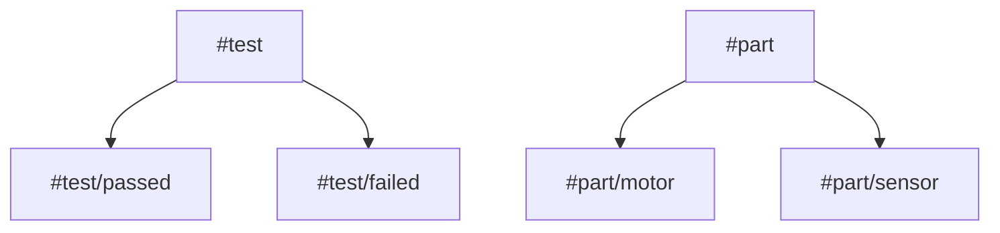

{:class="cover"}

---

By the end of this lesson you will be able to add tags to notes in two ways, nest them into a hierarchy, and find notes using the tags pane and search.

Tags are a quick way to group notes that belong together, even when they live in different folders. In our Rover Build Log, a wiring note and a test result might both be about the motor driver, and a tag lets you pull them up together.

---

## How to add tags

Type `#` followed by the tag name, for example `#motors` or `#idea`. Obsidian spots it and adds it to the index of tags automatically.

Tag names can use letters, numbers, underscores, hyphens and forward slashes, but **no spaces**, and they cannot be only numbers. So `#motor-driver` works, `#motor driver` does not (it would tag just `#motor`).

You can write tags in two places.

### Inline

Put the tag in the body of the note, anywhere you like:

```text
#wiring #motors
The left motor runs backwards. Swapping the two motor wires fixed it.
```

### In the properties at the top

Tags can also live in the properties block at the very top of the note:

```text
---
tags:
  - wiring
  - motors
---
```

Notice that inside the properties block you write the tag **without** the `#`.

> ## What is the block at the top?
>
> A note can begin with a block of metadata between two lines of three dashes (`---`). This is YAML, and Obsidian calls the entries **properties** (you will also see it called frontmatter). The block must be the very first thing in the note, with nothing above it. A quick way to start one is to type `---` on the first line of the note. We cover properties fully in a later lesson.

---

## Nested tags

Use a forward slash to build a hierarchy:

- `#test/passed`
- `#test/failed`
- `#part/motor`
- `#part/sensor`

Searching for `#test` finds both `#test/passed` and `#test/failed`, and the tags pane shows them as a tree.



---

## Viewing and managing tags

<div class="row">

</div>

Open the **Tags** pane from the sidebar. There you can:

- See every tag in the vault
- See nested tags as a hierarchy
- Click a tag to search for all the notes that use it

You can also type a tag into the search bar, and combine tags, for example `#part/motor #test/failed`, to find notes that have both.

---

## Tags or folders?

Folders are strict: a note lives in exactly one folder. Tags are flexible: a note can have as many as you like. A good habit is a few folders for the big areas (`Parts`, `Tests`) and tags for the cross-cutting ideas (`#motors`, `#todo`). Whatever you pick, stay consistent. If you use `#motor` in one note and `#motors` in another, a search for one misses the other.

---

## Try it Yourself

1. Add `#part/motor` to your `Motor driver wiring` note, and `#test/failed` to a test note.
2. Open the Tags pane and click `#test`. Which notes appear?
3. Move the tags of one note into its properties block, and check that it still shows up in the Tags pane.
4. Challenge: search for two tags at once and work out why the result is smaller than a search for one.

---

## Common Issues

- **Problem**: My tag does not show up in the Tags pane.
- **Solution**: Check there is no space inside the tag, and that it is not just numbers, for example `#2024` on its own.
- **Why**: A tag ends at the first space, and a number-only tag is not treated as a tag.

- **Problem**: The tags I listed in the properties block are ignored.
- **Solution**: Make sure the block is the very first thing in the note, is closed with a second `---`, and that `tags:` is followed by a list.
- **Why**: Obsidian only reads the properties block if it is at the very top of the file.

> **Teachers**: agree a short list of tags as a class before starting. Learners who invent their own spellings end up with notes that cannot be found together.

---

## Check your understanding


? Which of these is a valid tag?
- [ ] `#motor driver`
- [x] `#motor-driver`
- [ ] `#2024`
> Tags cannot contain spaces and cannot be only numbers.

? How do you write the tag `motors` in the properties block?
- [ ] `#motors` on the first line
- [x] As a list item under `tags:` without the `#`
- [ ] With square brackets only
> In properties, tags are a list and are written without the hash.

? What does searching for `#test` find, if you use nested tags?
- [ ] Only notes tagged exactly `#test`
- [x] Notes tagged `#test` and nested tags such as `#test/passed`
- [ ] Nothing
> Nested tags are found by searching for their parent tag.

