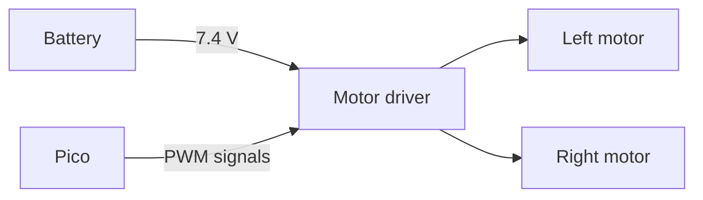

{:class="cover"}

---

By the end of this lesson you will be able to create a canvas, add cards and notes to it, and connect them with labelled arrows.

Sometimes a list of notes is not the best way to think. When you are planning a robot, you want to see the battery feeding the motor driver, the driver feeding the motors, and the Pico telling the driver what to do. A **Canvas** is an infinite board where you can place notes and cards anywhere and draw lines between them.



---

## Creating a canvas

Either of these works:

- Open the command palette (`Ctrl+P` or `Cmd+P`) and run **Canvas: Create new canvas**. It is created in the same folder as the note you have open.
- Right-click a folder in the file explorer and choose **New canvas**.

A canvas is saved as a `.canvas` file in your vault, in an open format called JSON Canvas, so like everything else it is yours to keep.

---

## Adding things to the canvas

- **Text cards**: double-click empty canvas to drop a card and type into it. Good for quick labels and thoughts.
- **Notes from your vault**: drag a note from the file explorer onto the canvas, or right-click the canvas and choose **Add note from vault**. The card shows the real note, so edits show up in both places.
- **Images**: right-click the canvas and choose **Add media from vault**, or drag an image in.
- **Web pages**: right-click the canvas and choose **Add web page**, then paste a URL.

---

## Connecting cards

Hover over the edge of a card until a filled circle appears, then drag it to the edge of another card. Double-click the line to type a label, and press `Escape` when you are done. You can choose whether the arrow is nondirectional, one-way or two-way.

For our Rover, a power diagram might read like this:

On a canvas you would build the very same layout with five cards and five labelled arrows, with the difference that your cards can hold full notes and photos.

---

## When to use a canvas

- Planning how the parts of a robot connect
- Brainstorming features before you commit to building them
- Laying out a project timeline with notes as milestones

If you find yourself drawing lots of boxes and arrows, a canvas is right. If you are mostly writing paragraphs, stay in a normal note.

---

## Try it Yourself

1. Create a canvas called `Rover system` and add four text cards: Battery, Motor driver, Pico, Motors.
2. Connect them with arrows and label at least two of the lines.
3. Drag your `Motor driver wiring` note onto the canvas, and connect it to the Motor driver card.
4. Challenge: add a photo of your robot and group the power parts away from the control parts.

---

## Common Issues

- **Problem**: I cannot draw a line between two cards.
- **Solution**: Hover over the very edge of the card until the circle appears, then drag from the circle.
- **Why**: Connections start from the card's edge handles, not from the middle of the card.

- **Problem**: Text I typed into a card is not in any of my notes.
- **Solution**: Text cards live only in the canvas file. Drag in a note from the vault if you want the text kept as a note.
- **Why**: A text card belongs to the canvas, while a note card shows a real note file.

> **Teachers**: canvases work well for group planning. Give each group one canvas and ask them to explain their robot's parts and connections to the class using it.

---

## Check your understanding


? How do you start a connection between two cards?
- [ ] Press `Ctrl+L`
- [x] Hover over a card's edge and drag the circle to another card
- [ ] Type a link in a card
> Connections are drawn by dragging from the handle at a card's edge.

? What file type is a canvas saved as in your vault?
- [ ] `.png`
- [ ] `.md`
- [x] `.canvas`
> Canvases are `.canvas` files in the JSON Canvas format.

? If you edit a note that is shown as a card on a canvas, what happens?
- [ ] Nothing, the canvas has a separate copy
- [x] The change is made to the real note
- [ ] The canvas is deleted
> A note card shows the real note, not a copy.

