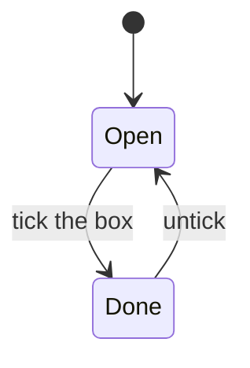

{:class="cover"}

---

By the end of this lesson you will be able to write task checkboxes in a note, tick them off, and know how the Tasks community plugin can gather them from across your vault.

Every build has a to-do list: print the chassis, solder the motor leads, calibrate the line sensor. Let's keep it inside the notes where the work happens.

---

## Checkboxes

A task is a list item that starts with square brackets:

```markdown
- [ ] Print the chassis
- [ ] Solder the motor leads
- [x] Order the motor driver
```

A space between the brackets is an open task, and an `x` means done. In Obsidian's reading view the boxes are clickable, so you can tick them off with the mouse and Obsidian changes the text for you.

Because a task is just text in a note, you can put it anywhere: in the `Parts list`, in a test note, or in a daily note. The task sits next to the context that explains it.



---

## Keeping tasks findable

Plain checkboxes live in the note they were written in, which is fine for small jobs. To keep an overview, add a tag to the line:

```markdown
- [ ] Re-solder the left motor lead #todo
- [ ] Add a second battery holder #todo #idea
```

Now search for `#todo` to see every line with that tag across the vault. Searching for `"- [ ]"` also finds open tasks.

---

## The Tasks plugin

For real task management, there is a community plugin called Tasks, at <https://github.com/obsidian-tasks-group/obsidian-tasks>. Community plugins are **off until you turn them on**: open the settings, go to the community plugins section, turn off restricted mode if asked, then browse and install it. Plugins are written by other people, so only install ones you trust.

With the plugin installed, you can write a query in a code block with the language `tasks`, which lists matching tasks from the whole vault:

````markdown
```tasks
not done
tags include #todo
```
````

Check the plugin's own documentation for its full list of filters, such as due dates and recurring tasks, because it is updated independently of Obsidian.

---

## Try it Yourself

1. Add three tasks to your `Rover Build Log` note and tick one.
2. Add `#todo` to two tasks in different notes, then search for `#todo`.
3. Make a daily note and write the jobs for today as tasks.
4. Challenge: install the Tasks plugin and write a query that lists only tasks that are not done.

---

## Common Issues

- **Problem**: The checkbox is shown as plain text with brackets.
- **Solution**: Make sure there is a space after the dash and a space between the brackets: `- [ ]`.
- **Why**: The task needs the exact pattern to be recognised as a checkbox list item.

- **Problem**: My `tasks` query shows as a code block instead of a list.
- **Solution**: Check that the Tasks plugin is installed and switched on, and that you opened the note in reading view or live preview.
- **Why**: The query is only turned into a list by the plugin. Without it, it is just text.

> **Teachers**: community plugins run code on the learner's machine. In a school setting, check whether your IT policy allows them, or stick to plain checkboxes, which need no plugin at all.

---

## Check your understanding


? Which line is a completed task?
- [ ] `- [ ] Solder leads`
- [x] `- [x] Solder leads`
- [ ] `[x] - Solder leads`
> An `x` between the brackets marks the task as done.

? Do community plugins like Tasks work as soon as you install Obsidian?
- [ ] Yes, they are always on
- [x] No, they are off until you turn them on
- [ ] Only on Windows
> Community plugins must be enabled before they work.

? How can you find all tasks tagged `#todo` without a plugin?
- [ ] You cannot
- [x] Search for the tag
- [ ] Rename the vault
> Tags on the task line are searchable.

