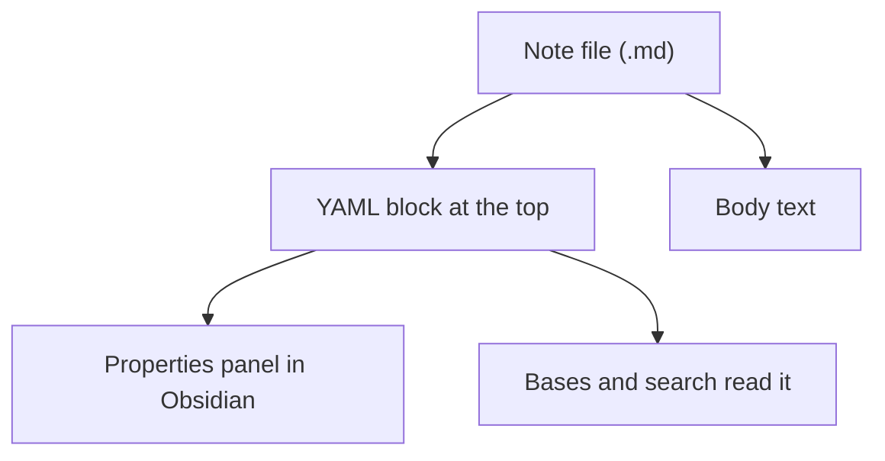

{:class="cover"}

---

By the end of this lesson you will be able to add properties of different types to a note, and write the same block by hand in YAML.

Properties are named values stored at the top of a note, such as `result: pass` or `voltage: 7.4`. They are what Bases read, and they make search and filtering much sharper. You will also hear them called frontmatter, because under the hood they are a YAML block at the very start of the file between two lines of three dashes.

---

## A test note with properties

```yaml
---
tags:
  - test
result: pass
date: 2026-11-24
battery_volts: 7.4
retested: false
parts:
  - "[[Motor driver wiring]]"
  - "[[Parts list]]"
---
```

Everything after the closing `---` is the normal note body. Obsidian shows the block as a tidy list of fields in a properties panel at the top of the note, and you can edit it there without touching YAML.



---

## Adding properties

- Type `---` on the very first line of a note.
- Or run the command **Add file property** from the command palette, press `Ctrl+;` (`Cmd+;` on a Mac), or use the more-options menu on the note.

Each property has a **type**. Obsidian offers these: Text, List, Number, Checkbox, Date, Date & time and Tags. Pick the right type, because it decides how the value is shown and how it is sorted.

| Property from our log | Type | Example |
| --- | --- | --- |
| `result` | Text | `pass` |
| `battery_volts` | Number | `7.4` |
| `retested` | Checkbox | `false` |
| `date` | Date | `2026-11-24` |
| `parts` | List | two links |
{:class="table table-single"}

Three properties are special. `tags`, `aliases` and `cssclasses` are always lists, so write them with the plural name and as a list. `aliases` gives a note other names that links can find it by.

---

## Tips that save pain

- **Do not quote numbers** if you want to sort on them: `7.4`, not `"7.4"`.
- **Use `true` and `false`** in lower case for checkboxes.
- **Dates in ISO order** (year-month-day) sort correctly: `2026-11-24`.
- **Quote links** in YAML: `"[[Parts list]]"`. Without the quotes, YAML can misread the square brackets.
- Keep a **short fixed list of values** for things like `result` (`pass`, `fail`, `retest`) and be consistent, because `Pass` and `pass` look different to a filter.

---

## Using properties

- **Search**: you can search for notes by property.
- **Bases**: each property becomes a column you can sort, filter and group on. See the [previous lesson](/learn/obsidian/08_dataview_and_bases.html).
- **Publishing**: if you later publish notes with a tool like Jekyll, the same block can feed its metadata.

---

## Try it Yourself

1. Add `tags`, `result` and `date` properties to a test note using the properties panel, then view the same note as raw YAML.
2. Add a Number property for `battery_volts` and a Checkbox property for `retested`.
3. Add a list property called `parts` with a link to another note.
4. Challenge: create five test notes with the same properties and show them all in a Base.

---

## Common Issues

- **Problem**: My properties show up as plain text in the note body.
- **Solution**: Move the block to the very first line of the note, and close it with a second `---` line.
- **Why**: Obsidian only reads a properties block that sits at the top of the file.

- **Problem**: Obsidian warns that a property is invalid, or a value looks mangled.
- **Solution**: Check the YAML. Put quotes around values with colons, and around links.
- **Why**: A colon or square bracket has a meaning in YAML, so unquoted text can be misread.

- **Problem**: Sorting numbers puts 10 before 9.
- **Solution**: Make sure the property is a Number and the values are not in quotes.
- **Why**: Text sorts letter by letter, so `10` comes before `9`.

> **Teachers**: properties are a gentle first step into structured data. A class can agree on a fixed set of properties for every test note, then compare results across the whole group in one Base.

---

## Check your understanding


? Where must the properties block sit in a note?
- [ ] At the bottom
- [x] At the very top, between two `---` lines
- [ ] Anywhere in the note
> Obsidian only reads properties at the start of the file.

? How should you write a link to another note in a property?
- [ ] Without quotes
- [x] In quotes, such as `"[[Parts list]]"`
- [ ] You cannot link in properties
> Quoting stops YAML misreading the square brackets.

? Which of these are lists by default?
- [ ] `title` and `date`
- [x] `tags`, `aliases` and `cssclasses`
- [ ] `result` and `done`
> Those three default properties are lists.

