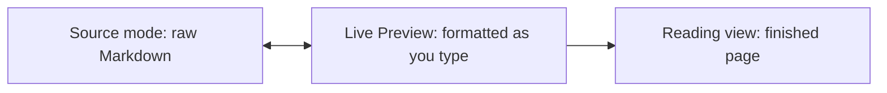

{:class="cover"}

---

By the end of this lesson you will be able to write a well-formatted build-log note using headings, lists, links, tables, code blocks and callouts.

Obsidian stores everything as plain Markdown, so the best investment you can make is learning the handful of symbols that matter. Here is a single test note that uses most of them. We will take it apart below.

````markdown
# Test 3 - turning left

Tried a **gentle** left turn at *half speed*. See [[Motor driver wiring]].

## Settings used

- Left motor speed: 40%
- Right motor speed: 70%

1. Place robot on the floor
2. Run the turn
3. Measure the angle

| Run | Angle | Result |
| --- | ----- | ------ |
| 1   | 80    | pass   |
| 2   | 45    | fail   |

> [!warning]
> Check the battery is above 7 V before testing.

```python
left_speed = 40
right_speed = 70
```
````

---

## The basics

- **Headings**: one to six `#` characters at the start of a line. Use one top heading per note and `##` below it.
- **Emphasis**: `*italic*`, `**bold**`, and `~~strikethrough~~`.
- **Lists**: start lines with `-` for bullets or `1.` for numbered items, and indent for nesting. Leave a blank line before and after a list.
- **External links**: `[text](https://example.com)`. For links to other notes use `[[wikilinks]]`, as in the linking lesson.
- **Task lists**: `- [ ]` and `- [x]`, as in the tasks lesson.

## Tables

Tables use pipes and a divider row of dashes. Obsidian renders them in the note, and you can align columns with colons in the divider row (`:---`, `:---:`, `---:`).

## Code blocks

Put three backticks, then the language name, then your code, then three backticks to finish. Short snippets inside a sentence use single backticks, like `speed = 40`. Code blocks keep their spacing exactly, which is what you want for wiring tables and pin lists.

## Callouts

A callout is a highlighted box. Start a quote with `> [!note]`, `> [!tip]` or `> [!warning]` and the following lines. They are an Obsidian extension, so they will not look the same in other Markdown tools. They are good for safety notes such as battery warnings.

## Images and embeds

- Embed an image that is in your vault with `![[robot.jpg]]`.
- Embed another note with `![[Parts list]]`.
- The standard Markdown form `` also works.

---

## Switching between views

Each note can show **Live Preview**, where formatting appears as you type, or **Source mode**, which shows the raw symbols. Look in the note's more-options menu to switch. Source mode is handy when you are puzzling over why something is not rendering.



---

## Try it Yourself

1. Re-create the sample test note above in your vault and check it renders.
2. Add a callout with a tip about your own robot.
3. Make a table of three motor speeds and the result of each.
4. Challenge: embed your `Parts list` note inside a `Project overview` note and add a task list beneath it.

---

## Common Issues

- **Problem**: My list or table does not render properly.
- **Solution**: Add a blank line before it, and check the pipes and dashes line up.
- **Why**: Markdown needs a blank line to start a new block, and a table needs its divider row.

- **Problem**: My callout shows as a plain quote.
- **Solution**: Check the first line is exactly `> [!warning]` with the type in square brackets after an exclamation mark.
- **Why**: The `[!type]` marker is what turns a quote into a callout.

> **Teachers**: Markdown is a good first formatting language for learners, and notes can be printed or exported later. If your class will hand work in, agree whether callouts are allowed, since not every tool displays them.

---

## Check your understanding


? How do you start a callout?
- [ ] With `#`
- [x] With a quote line such as `> [!warning]`
- [ ] With `[[ ]]`
> A callout is a quote that begins with `[!type]`.

? What does `![[Parts list]]` do?
- [ ] Links to the note
- [x] Embeds the note's content
- [ ] Deletes the note
> A leading `!` makes a wikilink into an embed.

? Why leave a blank line before a list?
- [x] Markdown needs it to start a new block
- [ ] It makes the text bigger
- [ ] Obsidian crashes without it
> The blank line tells Markdown a new block begins.

