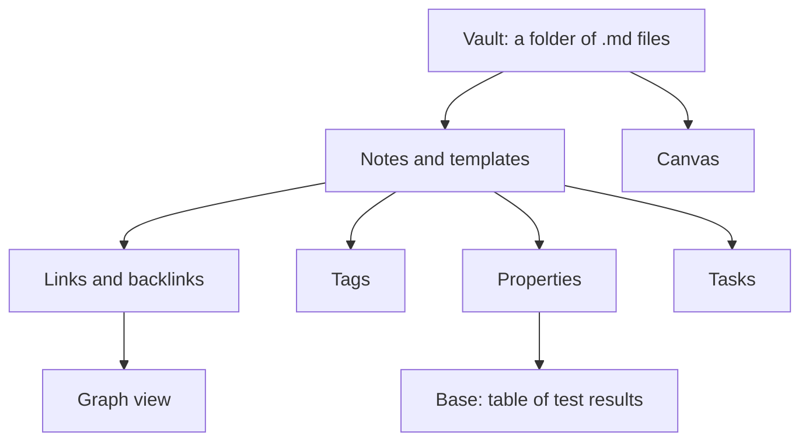

{:class="cover"}

---

By the end of this lesson you will be able to describe what your vault can now do, tell standard Markdown apart from Obsidian-only extras, and choose a next course.

Well done, makers! You started with an empty folder and now have a Rover Build Log: notes for parts, wiring and tests, linked together, tagged, filled with properties, tracked with tasks, planned on a canvas and summarised in a Base.

---

## What you built

The most important idea is the first box. Because the vault is only plain Markdown files, everything else is a convenience on top, and your notes are yours to keep.

---

## What is standard Markdown and what is Obsidian only?

If you want to reuse your notes in another tool, such as a website built with Jekyll, it helps to know which parts travel.

- **Standard Markdown, works nearly everywhere**: headings, bold and italic, lists, `[text](url)` links, images, tables (in most tools), code blocks.
- **Obsidian extras, may not render elsewhere**: `[[wikilinks]]`, `![[embeds]]`, callouts such as `> [!note]`, and `.base` and `.canvas` files.
- **Properties** are YAML at the top of the file, which Jekyll also uses as front matter, so they carry over well.

The [Mastering Markdown for Documentation with Jekyll](/learn/markdown/) course shows how Markdown becomes a web page, and is a natural next step if you want to publish your build log.



---

## Where to go next

- [Build a RAG for Your Obsidian Vault](/learn/obsidian_rag/): use Python to index your notes and ask questions of them, with answers that point back to the note they came from.
- [Mastering Markdown for Documentation with Jekyll](/learn/markdown/): go deeper into Markdown and publish it.
- Keep a real build log. The best practice is a project of your own.

Some note-taking methods you may enjoy reading about are Getting Things Done by [David Allen](https://gettingthingsdone.com/) and the Zettelkasten method, which is described at [zettelkasten.de](https://zettelkasten.de/).

---

## Try it Yourself

1. Write a one-page `Project overview` note that links to your five most important notes.
2. Check your graph view for orphans and link each one.
3. Challenge: copy one of your notes into a plain text editor and decide which bits would not look right outside Obsidian.

---

## Common Issues

- **Problem**: My notes look wrong in another Markdown tool.
- **Solution**: Replace wikilinks and callouts with standard Markdown links and quotes before moving them.
- **Why**: Wikilinks and callouts are Obsidian extensions that other tools may not understand.

> **Teachers**: finish the course by asking each learner to present one linked note from their vault and explain what links to it. Before learners leave, remind them to copy their vault off any shared computer.

---

## Check your understanding


? Which of these is an Obsidian extension rather than standard Markdown?
- [ ] A heading with `#`
- [x] A `[[wikilink]]`
- [ ] A bullet list
> Wikilinks are specific to Obsidian and some similar tools.

? Why is your vault safe from lock-in?
- [ ] Obsidian guarantees it
- [x] It is just plain Markdown files in a folder
- [ ] It is stored on Obsidian's servers
> Any text editor can open the files.

? Which course teaches you to ask questions of your vault with Python?
- [ ] Mastering Markdown for Documentation with Jekyll
- [x] Build a RAG for Your Obsidian Vault
- [ ] Installing Obsidian
> The RAG course indexes your notes and answers questions about them.

