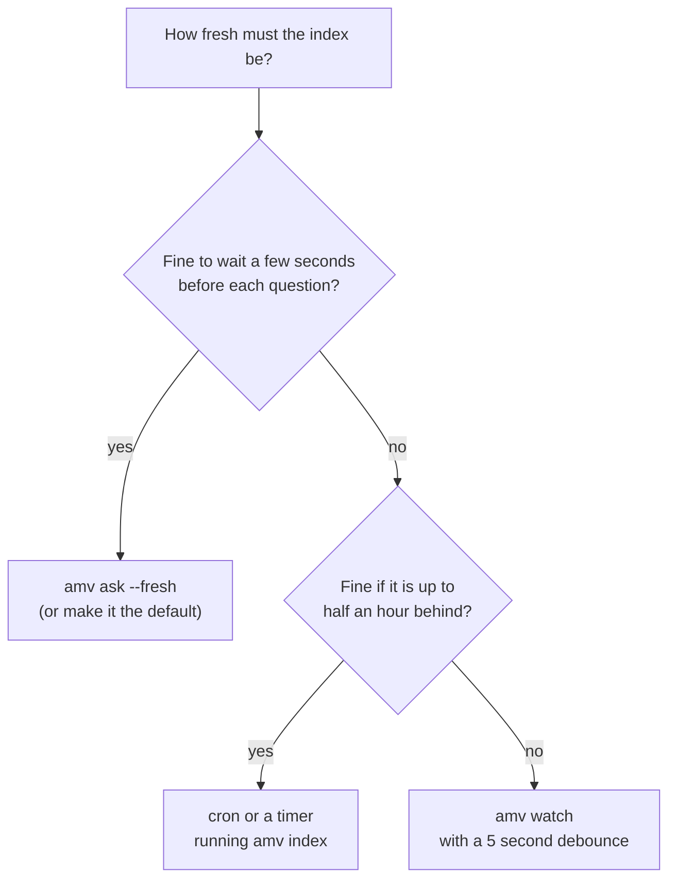

{:class="cover"}

---

By the end of this lesson you will be able to keep the index up to date with a `--fresh` flag, a scheduled job or a debounced file watcher, and choose the simplest option that suits how you work.

An index is only useful if it matches your notes. Right now you have to remember to run `amv index`, and you will not.

Because indexing is incremental, keeping up to date is cheap - a no-change run on a big vault takes well under a second. That opens up options that would be silly if a rebuild took a minute.

---

## Three approaches

| Approach | Latency | Complexity | Good for |
|---|---|---|---|
| Run it before you ask | Seconds | None | Everyone, honestly |
| Scheduled job | Up to an hour | Low | Vaults you edit all day |
| File watcher | Instant | Medium | If instant genuinely matters |
{:class="table table-single"}

Start at the top. Move down only when the one above stops being good enough.

---



## Just index before you ask

The simplest thing that works. Add a flag:

```python
# vault_rag/cli.py  (in build_parser, inside the loop that builds search and ask -
#                     indent it to sit inside that for loop)
if name == "ask":
    sub.add_argument("--fresh", action="store_true",
                     help="Re-index before answering")
```

```python
# vault_rag/cli.py  (in cmd_ask, just below the `from .answer import ...` line -
#                     indent it to sit inside the function)
if args.fresh:
    index_vault(VAULT_PATH, args.db, verbose=False)
```

On a vault where nothing changed, `index_vault` reads the hashes, compares, and returns. You will not notice it happen.

If you find yourself passing `--fresh` every time, just make it the default and add `--stale` for the rare case where you want to skip it.

---

## A scheduled job

For a vault you edit throughout the day, run it on a timer. On macOS or Linux, `cron` is the least effort:

```bash
crontab -e
```

```cron
# Re-index the vault every 30 minutes
*/30 * * * * /Users/kev/ask-my-vault/.venv/bin/amv index --quiet >> /tmp/amv.log 2>&1
```

Two things that catch people out with cron:

**Use the absolute path to the venv's `amv`.** Cron does not run your shell profile, so your virtualenv is not active and `amv` is not on the PATH.

**Cron has almost no environment.** `VAULT_PATH` will not be set, so either put the default in `config.py` or set it in the crontab:

```cron
VAULT_PATH=/Users/kev/Obsidian/MyVault
*/30 * * * * /Users/kev/ask-my-vault/.venv/bin/amv index --quiet >> /tmp/amv.log 2>&1
```

Redirecting to a log file is worth doing. A cron job that fails silently is a cron job you will discover three weeks later when you wonder why the answers are stale.

On a Raspberry Pi that runs all the time, this is the right answer - index every half hour and forget about it.

---

## A file watcher

If you want the index updated the moment you save a note, watch the filesystem. This needs one more dependency:

```bash
pip install watchdog
```

```python
# vault_rag/watch.py
"""Watch the vault and re-index when notes change."""

import time
from pathlib import Path

from watchdog.events import FileSystemEventHandler
from watchdog.observers import Observer

from .config import DB_PATH, VAULT_PATH
from .index import index_vault

DEBOUNCE_SECONDS = 5.0


class VaultHandler(FileSystemEventHandler):
    """Note when a markdown file changes; the main loop does the work."""

    def __init__(self):
        self.dirty_since: float | None = None

    def on_any_event(self, event):
        if event.is_directory:
            return
        if not str(event.src_path).endswith(".md"):
            return
        self.dirty_since = time.time()


def watch(vault_path: Path = VAULT_PATH, db_path: Path = DB_PATH):
    """Re-index a few seconds after the last change settles."""
    # Catch up on anything that changed while the watcher was not running
    stats = index_vault(vault_path, db_path, verbose=False)
    print(f"Caught up: {stats.summary()}")

    handler = VaultHandler()
    observer = Observer()
    observer.schedule(handler, str(Path(vault_path).expanduser()), recursive=True)
    observer.start()
    print(f"Watching {vault_path}. Ctrl-C to stop.")

    try:
        while True:
            time.sleep(1)
            if handler.dirty_since is None:
                continue
            if time.time() - handler.dirty_since < DEBOUNCE_SECONDS:
                continue

            handler.dirty_since = None
            stats = index_vault(vault_path, db_path, verbose=False)
            if stats.added or stats.updated or stats.removed:
                print(f"  {stats.summary()}")
    except KeyboardInterrupt:
        observer.stop()
    observer.join()
```

**The debounce is the important part.** Obsidian saves on a timer while you type, so a single paragraph produces a dozen write events. Without debouncing you would re-index a dozen times. Waiting five seconds after the *last* change means you index once, when you pause.

**We do not track which file changed.** We could, but incremental indexing already figures that out from the hashes, and a "something changed, go look" signal is far simpler than maintaining a queue of paths. Let each layer do its own job.

**The catch-up index on startup** means edits made while the watcher was off are not missed. **Only printing when something happened** keeps the terminal quiet. A watcher that logs "0 changed" every five seconds is a watcher you will kill.

Add it as a command:

```python
# vault_rag/cli.py  (add below cmd_stats, and add a `watch` subparser in build_parser)
def cmd_watch(args) -> int:
    from .watch import watch
    watch(args.vault, args.db)
    return 0
```

```python
# vault_rag/cli.py  (in build_parser, just above `return parser` -
#                     indent it to sit inside the function)
watch_parser = subparsers.add_parser("watch", help="Re-index when notes change")
watch_parser.add_argument("--vault", type=Path, default=VAULT_PATH)
watch_parser.set_defaults(func=cmd_watch)
```

---

## Running the watcher in the background

On macOS, a launch agent at `~/Library/LaunchAgents/com.kevsrobots.amv.plist`:

```xml
<?xml version="1.0" encoding="UTF-8"?>
<!-- ~/Library/LaunchAgents/com.kevsrobots.amv.plist -->
<plist version="1.0">
<dict>
    <key>Label</key>
    <string>com.kevsrobots.amv</string>
    <key>ProgramArguments</key>
    <array>
        <string>/Users/kev/ask-my-vault/.venv/bin/amv</string>
        <string>watch</string>
    </array>
    <key>RunAtLoad</key>
    <true/>
    <key>KeepAlive</key>
    <true/>
    <key>StandardErrorPath</key>
    <string>/tmp/amv.err</string>
</dict>
</plist>
```

```bash
launchctl load ~/Library/LaunchAgents/com.kevsrobots.amv.plist
```

On Linux, a systemd user unit at `~/.config/systemd/user/amv.service`:

```ini
# ~/.config/systemd/user/amv.service
[Unit]
Description=Ask My Vault indexer

[Service]
ExecStart=/home/kev/ask-my-vault/.venv/bin/amv watch
Restart=always
Environment=VAULT_PATH=/home/kev/Obsidian/MyVault

[Install]
WantedBy=default.target
```

```bash
systemctl --user enable --now amv
```

---

## What about sync?

If your vault syncs across devices with Obsidian Sync, iCloud or Dropbox, the watcher fires when a *sync* writes a note, not just when you do. That is correct behaviour - the note really did change - but it means the index updates from edits made on your phone too, which is rather nice.

The one thing to avoid is putting the Chroma database inside the synced vault. It is a binary SQLite file plus index data; syncing it between machines will corrupt it, and re-indexing locally is fast anyway. Keep it in `~/.ask-my-vault/`, as `config.py` already does.

---

## Checkpoint: the finished cli.py

Pieces added in two lessons are easy to get out of order, so here is the whole file as it should look now. It also switches `search` and `ask` over to `hybrid_search` from lesson 12. If yours behaves differently, compare it with this one:

```python
# vault_rag/cli.py  (the finished file - it replaces the pieces from lessons 15 and 16)
"""Ask My Vault - command line interface."""

import argparse
import os
import sys
import time
from pathlib import Path

from .config import DB_PATH, TOP_K, VAULT_PATH
from .index import collection_stats, index_vault
from .retrieve import build_filter, hybrid_search


def cmd_index(args) -> int:
    print(f"Indexing {args.vault}")
    start = time.time()
    stats = index_vault(args.vault, args.db, full=args.full, verbose=args.verbose)
    print(f"Done in {time.time() - start:.1f}s: {stats.summary()}")
    return 0


def cmd_search(args) -> int:
    where = build_filter(tag=args.tag, folder=args.folder)
    hits = hybrid_search(args.question, top_k=args.top_k, db_path=args.db, where=where)
    if not hits:
        print("No matches. Have you run `amv index` yet?")
        return 1
    for number, hit in enumerate(hits, start=1):
        print(f"\n[{number}] {hit.label}  ({hit.score:.0%})")
        print(f"    {hit.path}")
        snippet = hit.text.replace("\n", " ")[:180]
        print(f"    {snippet}...")
    return 0


def cmd_ask(args) -> int:
    if not os.environ.get("ANTHROPIC_API_KEY"):
        print("ANTHROPIC_API_KEY is not set. `amv search` works without it.",
              file=sys.stderr)
        return 1

    from .answer import check_citations, stream_answer

    if args.fresh:
        index_vault(VAULT_PATH, args.db, verbose=False)

    where = build_filter(tag=args.tag, folder=args.folder)
    hits = hybrid_search(args.question, top_k=args.top_k, db_path=args.db, where=where)
    if not hits:
        print("Nothing in your vault matches that. Try `amv index` first.")
        return 1

    pieces = []
    for piece in stream_answer(args.question, hits):
        pieces.append(piece)
        print(piece, end="", flush=True)

    cited, invalid = check_citations("".join(pieces), len(hits))

    print("\n\nSources:")
    for number, hit in enumerate(hits, start=1):
        marker = " " if number in cited else "-"
        print(f" {marker}[{number}] {hit.path}  ({hit.score:.0%})")

    if invalid:
        print(f"\nWarning: cited sources that do not exist: {sorted(invalid)}")
    return 0


def cmd_stats(args) -> int:
    info = collection_stats(args.db)
    print(f"Database: {info['path']}")
    print(f"Notes indexed: {info['notes']}")
    print(f"Chunks stored: {info['chunks']}")
    return 0


def cmd_watch(args) -> int:
    from .watch import watch

    watch(args.vault, args.db)
    return 0


def build_parser() -> argparse.ArgumentParser:
    parser = argparse.ArgumentParser(
        prog="amv", description="Ask questions about your Obsidian vault."
    )
    parser.add_argument("--db", type=Path, default=DB_PATH,
                        help="Where the Chroma database lives")
    subparsers = parser.add_subparsers(dest="command", required=True)

    index_parser = subparsers.add_parser("index", help="Index or re-index the vault")
    index_parser.add_argument("--vault", type=Path, default=VAULT_PATH)
    index_parser.add_argument("--full", action="store_true",
                              help="Wipe and rebuild from scratch")
    index_parser.add_argument("--quiet", dest="verbose", action="store_false")
    index_parser.set_defaults(func=cmd_index)

    for name, handler, help_text in [
        ("search", cmd_search, "Show the raw chunks that match"),
        ("ask", cmd_ask, "Get an answer with citations"),
    ]:
        sub = subparsers.add_parser(name, help=help_text)
        sub.add_argument("question")
        sub.add_argument("--top-k", type=int, default=TOP_K)
        sub.add_argument("--tag", help="Only search notes with this tag")
        sub.add_argument("--folder", help="Only search notes in this folder")
        if name == "ask":
            sub.add_argument("--fresh", action="store_true",
                             help="Re-index before answering")
        sub.set_defaults(func=handler)

    stats_parser = subparsers.add_parser("stats", help="Show index statistics")
    stats_parser.set_defaults(func=cmd_stats)

    watch_parser = subparsers.add_parser("watch", help="Re-index when notes change")
    watch_parser.add_argument("--vault", type=Path, default=VAULT_PATH)
    watch_parser.set_defaults(func=cmd_watch)

    return parser


def main(argv=None) -> int:
    args = build_parser().parse_args(argv)
    try:
        return args.func(args)
    except FileNotFoundError as error:
        print(f"Error: {error}", file=sys.stderr)
        return 1
    except KeyboardInterrupt:
        return 130


if __name__ == "__main__":
    raise SystemExit(main())
```

> **Teachers**: The cron job, launch agent and systemd unit all leave a program running in the background, which is fine on a learner's own machine and a poor idea on a shared school computer. Keep the scheduling and watcher sections as demonstrations on one teacher or home machine, and have learners do the `--fresh` flag and a foreground `amv watch` (stopped with Ctrl-C) instead. If someone does set up a job, make sure they know how to remove it with `crontab -e`, `launchctl unload` or `systemctl --user disable --now amv`.

## Try it Yourself

1. Time `amv index` on your vault with nothing changed. Under a second? Then `--fresh` on every ask costs you nothing.
2. Set up the cron job and check `/tmp/amv.log` the next day. Did it run? Did it find anything?
3. Run the watcher, edit a note in Obsidian, and watch how long the debounce takes to fire. Tune `DEBOUNCE_SECONDS` to how fast you type.
4. Remove the debounce entirely and type a paragraph. Count the re-index messages.
5. Add a `--fresh` flag to `search` as well as `ask`. Do you actually want it there? Searching is often something you do *while* editing.

---

## Common Issues

- **Problem**: The cron job never runs.
- **Solution**: Check `/tmp/amv.log`. If it is empty, cron is not firing at all - on macOS, grant `cron` Full Disk Access in System Settings.
- **Why**: Recent macOS versions block cron from reading Documents and iCloud folders until you allow it explicitly.

- **Problem**: The watcher fires constantly with no edits.
- **Solution**: Check for a sync client or a plugin writing into the vault - some write cache files on a timer.
- **Why**: We already filter to `.md`, but a plugin writing `.md` cache files will still trigger it. Add its folder to `SKIP_DIRS` and filter the event path too.

- **Problem**: `OSError: inotify watch limit reached` on Linux.
- **Solution**: Raise it: `sudo sysctl fs.inotify.max_user_watches=524288`.
- **Why**: Recursive watching costs one inotify watch per directory, and the default limit is low for a big vault.

- **Problem**: The database gets corrupted every few days.
- **Solution**: Move it out of the synced vault folder.
- **Why**: Sync clients merge file changes byte-wise, which is fatal for a SQLite database being written from two machines.

---

## Check your understanding


? Why does the watcher wait five seconds after the last change before re-indexing?
- [x] Obsidian saves repeatedly while you type, so without a debounce one paragraph would trigger a dozen re-indexes
- [ ] Chroma needs five seconds to start
- [ ] The embedding model takes five seconds to load
> Waiting for a pause means you index once, when you stop typing.

? Why does the cron job use the absolute path to `.venv/bin/amv`?
- [ ] Cron cannot run Python
- [x] Cron does not run your shell profile, so the virtualenv is not active and `amv` is not on the PATH
- [ ] Absolute paths are faster
> Cron also has almost no environment, so `VAULT_PATH` must be set in the crontab or in `config.py`.

? Where must the Chroma database NOT live?
- [ ] In your home folder
- [x] Inside a vault folder that is synced between machines
- [ ] On an external drive
> Sync clients merge file changes byte-wise, which is fatal for a SQLite database written from two machines.

? Why does the watcher not track which file changed?
- [x] Incremental indexing already works that out from the hashes, so "something changed, go look" is enough
- [ ] Watchdog cannot report file names
- [ ] It would make the index larger
> Let each layer do its own job.

