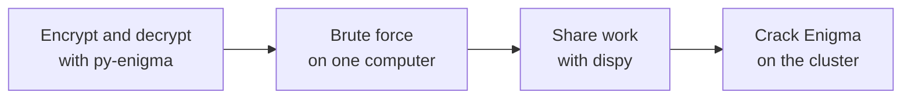

{:class="cover"}

---

Ahoy there makers! One Raspberry Pi is a clever little computer. Eight of them working together are a *cluster*, and a cluster can chew through a problem much faster than any single board. In this course we will build one, give it a historic puzzle, and watch it win.

Kev made a livestream about cracking the Enigma code with a Raspberry Pi 5 cluster. Watch it first, then come back and let's build.



---

## Overview

`OctaPi` is the name for a Raspberry Pi cluster used to teach parallel computing. The original OctaPi project came from GCHQ, the UK's signals intelligence agency, as a way to introduce students to the idea of many computers sharing a job. Our version uses a Python package called `dispy` to send pieces of a job to every Pi on your network.

The job we give it is a classic: breaking a message that was encrypted on an Enigma machine. First we learn how Enigma works by writing a little Python of our own with the `py-enigma` package. Then we try every possible setting, which is slow on one computer, and finally we share that search across the cluster.

---

## Course Content

- **Introduction to Enigma**: what the machine did, and how to encrypt and decrypt messages with Python
- **Brute force attack**: formatting messages the way operators did, then searching every setting with a crib
- **Build OctaPi**: how `dispy` shares jobs between computers, then setting up your Pi nodes and running the search across them

## Key Results

After completing this course, you will be able to:

- Encrypt and decrypt a message with `py-enigma` and explain what the rotors, reflector and plugboard do
- Explain a brute force attack and count how many settings it must try
- Use a crib to recognise the right answer
- Write a `dispy` program that submits jobs and collects their results
- Set up Raspberry Pi nodes with fixed addresses and run `dispynode.py` on each
- Measure how much faster the cluster is than one computer

## What you'll need

- A computer with Python 3.11 or 3.12 for lessons 1 to 5 (the next lessons explain why)
- For the full cluster in lesson 6: two or more Raspberry Pi 4 or 5 boards, each with a power supply and a microSD card
- An Ethernet switch and cables (Wi-Fi works, but wired is steadier)
- A computer on the same network, with SSH and Raspberry Pi Imager
- 64-bit Raspberry Pi OS on every Pi

No cluster yet? You can do every lesson on one computer by running a `dispy` node on it. You will not see a big speed-up, but you will see the whole idea working.

## How the course works

**Real output.** The programs in this course were run, and the output you see is what they printed. Times will differ on your computer, and the Pis will differ again, so treat the numbers as examples.

**Versions checked.** The code was checked against `dispy` 4.15.2 and `py-enigma` 1.0.2, using Python 3.11 and 3.13. The `dispy` documentation is at [dispy.org](https://dispy.org). Where something depends on the Python version, the lesson says so.

**Complete programs.** Every program you are told to save and run is a whole file, so you can paste it and go.

**Two places to type.** Commands say whether they run **on your computer** or **on a Pi**.

**Quizzes and exercises.** Each lesson ends with Try it Yourself, Common Issues and a short quiz. Your quiz score is kept in your browser.

> **Teachers**: this course suits students aged 13 and up who can write a simple Python loop. Allow 30 to 45 minutes per lesson, and a full session of 60 to 90 minutes for lesson 6, where the Pis are set up. Lessons 1 to 5 need only a computer and Python, so a whole class can work with no cluster at all. For lesson 6 plan one Pi per student or per pair, but a shared cluster of four to eight Pis works well for a demonstration. Check the school network first: `dispy` finds nodes over the local network, and managed school switches or Wi-Fi often block that. A small unmanaged switch just for the cluster avoids the problem.

---

## Prerequisites

If Python is new to you, start with the [Python course](/learn/python/). The commands in lesson 6 use a Linux terminal, so [Introduction to the Linux Command Line](/learn/linux_intro/) helps. Once you have finished, the [Docker Swarm cluster course](/learn/docker_swarm/) builds a different kind of Pi cluster.

Ready? Let's meet the Enigma machine.
