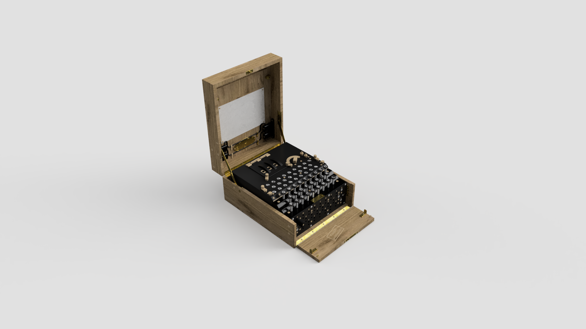
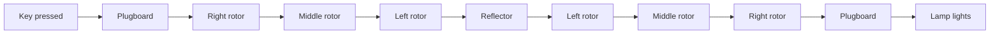
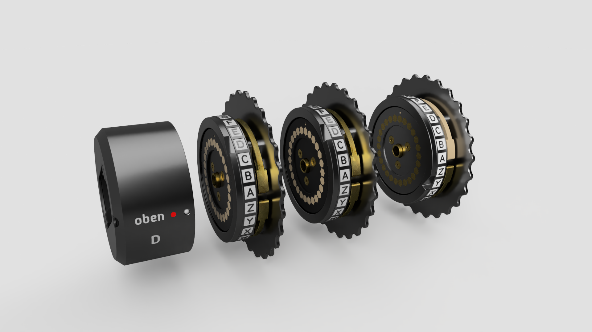
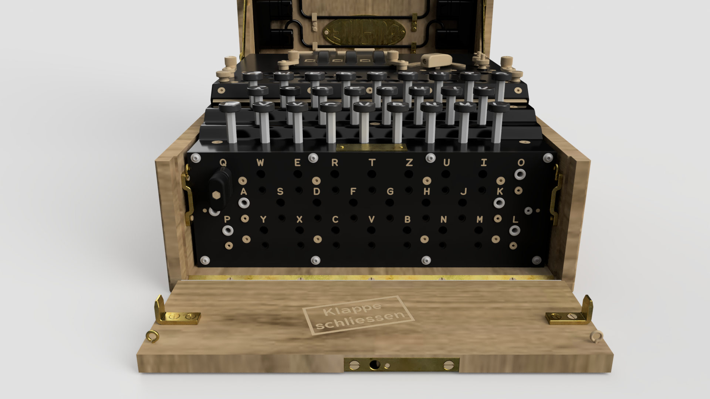

{:class="cover"}

---

By the end of this lesson you will be able to install `py-enigma` and use it to encrypt a short message, and explain what the rotors, plugboard and reflector do.

---

## What is Py-Enigma?

`py-enigma` is a Python package that behaves like a real Enigma machine. The Enigma was used by Germany during the Second World War to keep radio messages secret. Codebreakers, starting with Polish mathematicians and continuing at Bletchley Park in Britain, worked out how to read it, and that effort shaped history.

{:class="img-fluid w-100"}

---

## Install py-enigma

Raspberry Pi OS (Bookworm and later) will not let `pip` install into the system Python, and many Linux systems behave the same way. The tidy fix is a virtual environment, which is a private box of packages for one project. On your computer:

```bash
python3 -m venv octapi-env
source octapi-env/bin/activate
pip install py-enigma
```
{: .no-snakie }

On Windows, activate it with `octapi-env\Scripts\activate` instead. Your prompt gains `(octapi-env)` when it is active. You will need to activate it again in each new terminal.

---

## How Enigma scrambles a letter

Press a key and an electrical signal runs a maze. Follow it in the diagram.



- **Rotors**: wheels with 26 contacts on each face, wired inside so each letter comes out as a different letter. Every key press turns the right rotor one step first, so the same letter is scrambled differently each time.

{:class="img-fluid w-100"}

- **Plugboard**: cables that swap pairs of letters before and after the rotors. The Germans typically used ten pairs.

{:class="img-fluid w-100"}

- **Reflector**: sends the signal back through the rotors a second time. A side effect is that a letter can never be encrypted as itself, and that the machine is its own opposite: type the ciphertext in with the same settings and the original message comes out.
- **Ring settings**: an adjustable ring on each rotor that shifts its internal wiring relative to the letter on its rim.

{:class="img-fluid w-100"}

---

## Encrypt your first message

The settings below are the machine's *key*. Anyone who knows them can read your message, and anyone who does not has a lot of guessing to do. Save this as `encrypt.py` and run it:

```python
from enigma.machine import EnigmaMachine

# Set up the machine: three rotors, a reflector, ring settings and plugboard
machine = EnigmaMachine.from_key_sheet(
    rotors='I II III',
    reflector='B',
    ring_settings=[1, 20, 11],
    plugboard_settings='AV BS CG DL FU HZ IN KM OW RX')

# Where the three rotors start
machine.set_display('WXC')

# Scramble the message
ciphertext = machine.process_text('HELLO')

print(ciphertext)
```

Run it with `python3 encrypt.py` and you should see:

```text
DVIWN
```
{: .no-snakie }

Notice that HELLO gave five different letters, and the two Ls became different letters (I and W). That is the rotors turning between key presses.

**Common mistake:** process the same machine twice without resetting it and the second answer is different, because the rotors have moved on. Call `machine.set_display(...)` again before each new message.

> **Teachers**: students need permission to install packages, so on school computers create the virtual environment in the student's own folder, or check that `pip` can reach the internet through your proxy before the lesson. Enigma is a good cross-curricular link with history. It is also worth saying that real security today relies on modern, public algorithms, not secret machines.

---

## Try it Yourself

1. Change the message to your own name. Is it five letters? Does any letter come out the same as it went in?
2. Change `set_display('WXC')` to `set_display('WXD')` and run it again. How different is the result?
3. Change one plugboard pair, for example swap `AV` for `AW`. What happens to the ciphertext?
4. Challenge: encrypt `AAAAAAAAAA` (ten As) and look at the answer. What do you notice about the letters, and why?

## Common Issues

- **Problem**: `ModuleNotFoundError: No module named 'enigma'`.
- **Solution**: Activate your virtual environment (`source octapi-env/bin/activate`) and run `pip install py-enigma` again.
- **Why**: The package lives inside the virtual environment, so a terminal that has not activated it cannot see it.

- **Problem**: `error: externally-managed-environment` when you run `pip install`.
- **Solution**: Create and activate a virtual environment first, as shown above.
- **Why**: Recent Raspberry Pi OS and Debian releases stop `pip` changing the system Python, so system tools cannot be broken by accident.

## Check your understanding


? Why does the same letter come out differently each time you press it?
- [ ] The plugboard is random
- [x] The right rotor steps forward with every key press
- [ ] The reflector changes its wiring
> Every key press turns the right rotor, so the maze of wiring is different for each letter.

? What does the reflector make true about the Enigma machine?
- [ ] It makes the message shorter
- [x] A letter never encrypts to itself, and the same settings both encrypt and decrypt
- [ ] It stops the rotors from turning
> The signal is sent back through the rotors, which makes the machine reversible.

? Why do we use a virtual environment for `pip install py-enigma`?
- [ ] To make Python run faster
- [x] Because recent Raspberry Pi OS stops pip installing into the system Python
- [ ] Because py-enigma only works in a virtual environment
> The virtual environment is a private space where pip is allowed to install.

