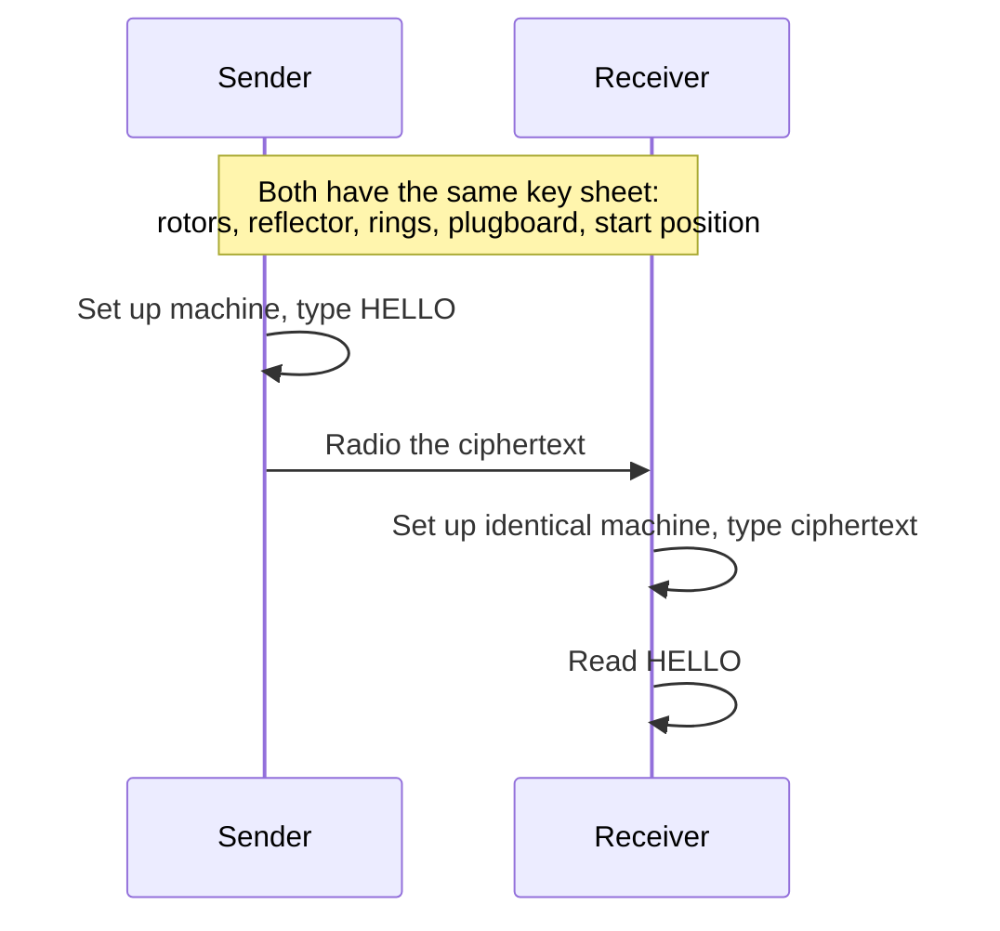

{:class="cover"}

---

By the end of this lesson you will be able to decrypt an Enigma message with `py-enigma`, and explain why the sender and receiver must use exactly the same settings.

---

## Decrypting is encrypting again

Enigma is its own opposite. Because of the reflector, feeding ciphertext through a machine set up exactly like the sender's gives you the plaintext back. There is no separate "decrypt" button, and `py-enigma` has no separate decrypt function either: we use `process_text` for both.



The five things that must match are the **rotors and their order**, the **reflector**, the **ring settings**, the **plugboard** and the **start position**. Change any one and you get nonsense.

---

## Decrypt a real message

Here is a message from a different key. Save this as `decrypt.py` and run it:

```python
from enigma.machine import EnigmaMachine

machine = EnigmaMachine.from_key_sheet(
    rotors='II V III',
    reflector='B',
    ring_settings='1 1 1',
    plugboard_settings='AV BS CG DL FU HZ IN KM OW RX')

# Set the start position of the rotors
machine.set_display('QJF')

ciphertext = 'FKFPQZYVON'

plaintext = machine.process_text(ciphertext)
print(plaintext)
```

It prints:

```text
CHELTENHAM
```
{: .no-snakie }

Cheltenham is the town where GCHQ is based, so it makes a fitting secret word for an OctaPi course.

The settings are written two ways in these lessons. `ring_settings='1 1 1'` is a string, and `ring_settings=[1, 20, 11]` in the last lesson is a list. `py-enigma` accepts both.

---

## Why the machine must be reset

A real operator set the rotors to the start position before every message. So must we. The machine remembers where its rotors are, so if you feed in ciphertext twice in a row without resetting, the second answer is wrong, because the rotors have turned on:

```python
from enigma.machine import EnigmaMachine

machine = EnigmaMachine.from_key_sheet(
    rotors='II V III',
    reflector='B',
    ring_settings='1 1 1',
    plugboard_settings='AV BS CG DL FU HZ IN KM OW RX')

machine.set_display('QJF')
print(machine.process_text('FKFPQZYVON'))   # CHELTENHAM

# No reset here: the rotors have moved on, so this is wrong
print(machine.process_text('FKFPQZYVON'))

machine.set_display('QJF')                  # reset to the start position
print(machine.process_text('FKFPQZYVON'))   # CHELTENHAM again
```

It prints:

```text
CHELTENHAM
GRYOPKQRXA
CHELTENHAM
```
{: .no-snakie }

This idea matters a lot in the next lessons. When we try thousands of start positions, we must call `set_display` before each attempt.

---

## Try it Yourself

1. Encrypt your name with the settings above, then decrypt the answer. Do you get your name back?
2. Change the start position in `decrypt.py` from `QJF` to `QJG`. How much of the answer is still readable?
3. Change one ring setting from `1 1 1` to `1 1 2`. What happens?
4. Challenge: write a function `crypt(text, start)` that builds a fresh machine, sets the display and returns the processed text. Use it to encrypt and decrypt.

## Common Issues

- **Problem**: Decrypting gives gibberish.
- **Solution**: Check all five settings against the sender's key sheet, character by character, including the rotor order.
- **Why**: Even one wrong setting sends the signal through a different maze.

- **Problem**: The first message decrypts but the second one does not.
- **Solution**: Call `machine.set_display(...)` again, or build a new machine, before each message.
- **Why**: The rotors move every time a letter is processed, so the machine is no longer at the start position.

## Check your understanding


? How do you decrypt with py-enigma?
- [ ] Call machine.decrypt()
- [x] Set up the same machine and start position, then call process_text on the ciphertext
- [ ] Reverse the string and encrypt it
> Enigma is reciprocal, so the same process turns ciphertext back into plaintext.

? What happens if you decrypt a second message without calling set_display again?
- [ ] Nothing, the machine resets itself
- [x] The rotors have moved on, so the answer is wrong
- [ ] Python raises an error
> The machine keeps its rotor positions between calls.

? Which of these must match between sender and receiver?
- [ ] Only the start position
- [x] Rotors and order, reflector, ring settings, plugboard and start position
- [ ] Only the plugboard
> All five settings together form the key.

