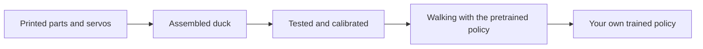

{:class="cover"}

---

You started with a pile of printed parts and a bag of servos, and you finished with a duck that walks on its own legs, steered from an Xbox controller, using a brain trained in a simulator. That's a serious build. Well done!

---

## What you built

| Section | Lessons | What you did |
|---|---|---|
| Meet the duck | 0 to 1 | Learned where the Open Duck Mini came from and how its four repos fit together |
| Parts and printing | 2 to 4 | Sourced the parts from the BOM, printed them in PLA and TPU, and gave all 14 servos their IDs |
| Assembly | 5 to 7 | Built the legs, head and body, and wired the Pi, IMU, foot switches and servo bus |
| Bring it to life | 8 to 11 | Set up the Pi, tested every part, calibrated it and took its first steps |
| The walking brain | 12 to 14 | Learned how the policy was trained, trained your own, and fixed common problems |
{:class="table table-single"}

---

## The ideas to keep

- **Set servo IDs before assembly.** Every servo on the bus needs a unique ID, and it's far easier to set while the servo is on its own.
- **Loctite on metal-to-metal only.** Never on screws into plastic.
- **Test each part on its own** before asking the whole robot to walk.
- **`imu_upside_down` must match your IMU.** Get it wrong and the gait oscillates badly.
- **Offsets make your duck match the simulated duck.** Symmetric legs and foot switches that click together are the goal.
- **Safety first.** Clear the floor, be ready to catch it, and leave Y head control off.
- **Learning happens in simulation, acting happens on the Pi.** The policy is trained on a GPU with thousands of ducks, then runs on the Pi as an ONNX file.
- **The upstream repos are the source of truth.** When this course and the repos disagree, trust the repos.

---

## Thank you

The Open Duck Mini exists because Antoine Pirrone designed it and shared it, and because the Open Duck community keeps improving it. If your duck walks, consider giving back: star the repos, report the problems you hit, and share your build.

- [Open_Duck_Mini](https://github.com/apirrone/Open_Duck_Mini)
- [Open_Duck_Mini_Runtime](https://github.com/apirrone/Open_Duck_Mini_Runtime)
- [Open_Duck_Playground](https://github.com/apirrone/Open_Duck_Playground)
- [Open_Duck_reference_motion_generator](https://github.com/apirrone/Open_Duck_reference_motion_generator)

---

## What's next

- [Reinforcement Learning for Beginners](/learn/reinforcement_learning/): go back over the ideas behind the duck's brain, from rewards to the sim-to-real gap
- [Reinforcement Learning with Gymnasium](/learn/gymnasium/): train your own agents in standard RL environments, a gentler step before the full Playground
- [Learn ROS with me](/learn/learn_ros/): the Robot Operating System, for when your robots grow beyond one script
- [Building a Robot Arm with Raspberry Pi and PCA9685](/learn/pca9685/): drive lots of hobby servos from a Pi, and compare them with the duck's serial bus servos

There is more on the [Open Duck Mini project page](/projects/kev/open-duck-mini).

Now go and show your duck off. Happy making!
