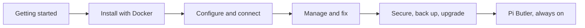

{:class="cover"}

---

Ahoy there makers! Imagine sending a message from your phone, "how's the Pi doing?", and getting a friendly reply from a little computer on your shelf. In this course we'll set that up for real: an OpenClaw AI agent running in Docker on a Raspberry Pi, always on, and answering to you alone.

Kev made a video about running OpenClaw on a Pi, and whether it is safe to do so. Watch it first, then come back and let's build.



---

## Overview

OpenClaw is an open-source personal AI assistant. Its heart is the **Gateway**, a service that sits between the chat apps you already use and an AI model. You message it on Telegram or in a browser, the Gateway hands your message to an **agent**, and the agent can answer, remember things and use tools.

The Pi is a great home for the Gateway: it is cheap, quiet and happy to run all day. The thinking itself happens at an AI model provider in the cloud, which you pay for per use. We'll be honest about that trade-off all the way through.

We'll learn by building one project, **Pi Butler**, which grows a little in every lesson.

## Course Content

- **Getting Started**: what OpenClaw is, which Pi to use, and why we run it in Docker
- **Installation and Setup**: prepare Raspberry Pi OS, install Docker, start OpenClaw with the official setup script, and open the dashboard safely
- **Configuration and Usage**: models, a persona for Pi Butler, a Telegram bot for your phone, and your own skill
- **Management and Troubleshooting**: day-to-day container commands, a morning brief automation, monitoring, and fixing things when they break
- **Advanced Topics**: security, backups, upgrades and an always-on production setup
- **Summary**: what you built and where to go next

## Key Results

By the end of this course you will be able to:

- Explain what the Gateway does, and what stays on your Pi versus what goes to the model provider
- Install OpenClaw on a Raspberry Pi with Docker and the official pre-built image
- Reach the Control UI through an SSH tunnel and configure models and a persona
- Connect a Telegram bot and approve who may talk to your agent
- Write a custom skill and schedule a daily automation
- Monitor, troubleshoot, back up, upgrade and security-audit an always-on agent

## What you'll need

- A Raspberry Pi 4 or Pi 5 with at least 2 GB of RAM. 4 GB is the sweet spot
- The official power supply for your Pi
- A 16 GB or larger microSD card, or better, a USB SSD
- A network connection. Ethernet is best for something that runs all day
- A computer to work from over SSH (Windows, macOS or Linux)
- A Telegram account on your phone, from lesson 9
- An API key from an AI model provider such as Anthropic or OpenAI. Usage is billed per message, so set a spending limit on the provider's site before you start

You should be comfortable typing commands in a terminal. If that is new, start with [Introduction to the Linux Command Line on Raspberry Pi OS](/learn/linux_intro/). You don't need to know Docker already, but the [Docker course](/learn/docker/) is a good companion.

## How the course works

**Pi Butler grows.** Each lesson ends a step further along, and says which stage you have reached. By lesson 17 you'll have an agent that survives power cuts, sends you a morning brief and reports on its own health.

**Two places to type.** Every command says where it runs: **on the Pi** (in an SSH session) or **on your computer**. If a command fails, check that first.

**Checked against the real thing.** Commands follow the official OpenClaw documentation for version 2026.11. OpenClaw moves quickly, so if a menu or message looks a little different, the [OpenClaw docs](https://docs.openclaw.ai) are the final word.

**Quizzes.** Each lesson ends with a short quiz. Your score is kept in your browser and shown in the sidebar.

**Mistakes are normal.** Every lesson has a Common Issues list. Check it before you assume something is broken.

> **Teachers**: this course suits older students (16+) and adults who already use a terminal. Allow 30 to 45 minutes per lesson, and about two hours for lessons 4 to 7, where the Pi is set up. Plan one Pi per pair or small group. Every group needs an AI provider API key, so use one school or club account with a monthly spending limit rather than personal cards, and check your setting's rules on AI services and on Telegram's minimum age before lesson 9. Lessons 1 to 3 and 14 work with no hardware at all, and the dashboard (lesson 7) can stand in for Telegram if phones are not allowed. On a shared school network, use the SSH tunnel from lesson 7 and never open the dashboard port to the network.

Ready? Let's find out what OpenClaw actually is.
