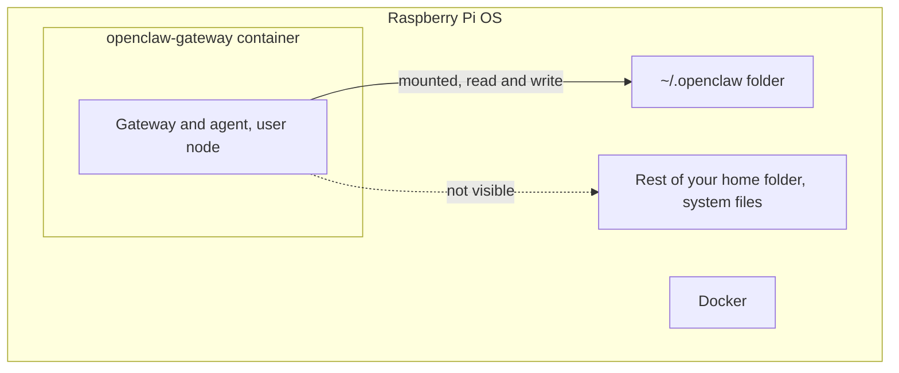

{:class="cover"}

---

OpenClaw can be installed straight onto the Pi, or run inside a Docker container. In this lesson we'll compare the two, see exactly what the container protects you from (and what it doesn't), and explain why this course uses Docker with the pre-built image.

---

## Two ways to install

The official docs treat Docker as **optional**. The native install is a one-line script followed by onboarding, and it runs the Gateway as a systemd service under your own user account:

```bash
curl -fsSL https://openclaw.ai/install.sh | bash
openclaw onboard --install-daemon
```

Don't run those. They're here so you know what the other route looks like. We'll use Docker instead, through the official setup script in the OpenClaw repository.

| | Native install | Docker (this course) |
| --- | --- | --- |
| How you install | `install.sh` then `openclaw onboard --install-daemon` | Clone the repo, run `./scripts/docker/setup.sh` |
| What keeps it running | A systemd user service | Docker, with `restart: unless-stopped` |
| Where the agent's commands run | Directly on the Pi's OS, as your user | Inside the container, as the `node` user |
| What the agent can see | Everything your user can see | Only the folders mounted into the container |
| Upgrades | `openclaw update` | Pull a new image tag and recreate the container |
| Rolling back | Install an older version and restore a backup | Go back to the previous image tag, plus a matching backup |
| Removing it | Uninstall steps for the CLI, service and state | Remove the container and image, then delete the folders |
| Same on another machine | Depends on that machine | The same image runs anywhere Docker does |
{:class="table table-single"}

If you're new to containers, the [Docker course](/learn/docker/) is a good companion.

---

## Why containment matters for an agent

Most apps only do what their code says. An agent is different, because it can decide to run commands. Out of the box, OpenClaw's host exec permission is **full**: the agent can run commands on its host without asking you first. That's a deliberate choice for a single trusted owner, and it makes the agent genuinely useful.

It also means you want the "host" to be something small and disposable. With Docker, that host is the container, not your Pi's whole operating system.



---

## What the container protects

The repository's `docker-compose.yml` adds several layers of hardening:

- **Runs as the `node` user** (uid 1000), not as root.
- **`no-new-privileges`**, so a process inside can't gain extra rights with tricks like setuid programs.
- **Drops `NET_RAW` and `NET_ADMIN`**, so the container can't craft raw network packets or change network settings.
- **`init: true`**, which runs a tiny init process (`tini`) that tidies up finished child processes.
- **Only three folders mounted**: `~/.openclaw` (state and config), its `workspace` folder, and a small folder for auth-profile secret keys (`~/.openclaw-auth-profile-secrets`). The rest of your Pi's files are simply not there.

So if the agent runs something silly, like deleting a folder it shouldn't, the damage stays inside the container and those mounted folders. Your Pi's system files, your other projects and your SSH keys are out of reach.

---

## What the container does not protect

This is the honest bit. Docker is a fence, not a force field.

| Myth | Reality |
| --- | --- |
| "The workspace is a sandbox" | The workspace is just the agent's default working folder. Inside the container, absolute paths reach anything the container can see |
| "My API keys are safe from the agent" | The Gateway uses your keys on every message, and anything in the project's `.env` is passed into the container as environment variables |
| "The agent can't contact anyone" | It can still send messages through any channel you connect, such as Telegram, and it can reach the internet and your home network |
| "Docker stops prompt injection" | A web page, email or file the agent reads can contain sneaky instructions. Docker can't tell good instructions from bad ones |
| "My state is safe if the container breaks" | `~/.openclaw` is mounted read and write, so the agent can change or delete it. Backups still matter |
{:class="table table-single"}

OpenClaw also has an optional *agent sandbox*, which runs tool commands in separate throwaway containers. It needs access to the Docker socket and adds complexity, so we leave it off in this course and lean on the container, careful permissions and good habits instead. We dig into those in [lesson 14](/learn/openclaw_raspberry_pi/14_security.html).

---

## Why the pre-built image

There are two ways to get the Docker image:

1. **Build it yourself** from the source code. The docs say this needs at least 6 GB of RAM. Most Pis would run out of memory part way through.
2. **Download the pre-built image** that OpenClaw publishes for every release. It includes an arm64 build, which is what a 64-bit Pi needs.

We always take option 2. The images live on the GitHub Container Registry as `ghcr.io/openclaw/openclaw`, with a mirror on Docker Hub as `openclaw/openclaw`.

| Tag | What it is |
| --- | --- |
| `latest` | The current stable release. We use this one |
| `2026.11.6` | A specific version. Pin one of these when you want upgrades only when you choose |
| `extended-stable` | A slower-moving release line |
| `latest-browser` | Stable, with a Chromium browser built in for browser tools |
{:class="table table-single"}

Stick to the two official registries and avoid unofficial mirrors.

## Pi Butler progress

Decision made: Pi Butler will live in a container, built from the official pre-built image. Next we get the Pi itself ready.

---

## Try it Yourself

1. **Spot the boundary.** Using the diagram, list two things on your Pi the agent can reach and two it can't.
2. **Myth or fact?** Explain to a friend, in one sentence each, why "the workspace is a sandbox" and "Docker keeps my API key secret from the agent" are both wrong.
3. **Challenge:** Look at the tags on the [OpenClaw package page](https://github.com/openclaw/openclaw/pkgs/container/openclaw) and find the newest version tag. Why might you pin that tag instead of using `latest`?

---

## Common Issues

**Problem**: You tried to build the image on the Pi and it was killed with exit code 137.
**Solution**: Use the pre-built image by setting `OPENCLAW_IMAGE` before running the setup script, as shown in lesson 6.
**Why**: Exit code 137 means the system ran out of memory. A source build needs 6 GB or more.

**Problem**: You assumed the agent can't touch your OpenClaw config because it's "in Docker".
**Solution**: Treat `~/.openclaw` as something the agent can change, and keep backups.
**Why**: That folder is mounted into the container with read and write access.

**Problem**: A guide tells you to install `docker-compose` with apt.
**Solution**: Use the `docker compose` plugin that comes with Docker, written with a space.
**Why**: The old separate `docker-compose` tool is outdated, and OpenClaw's files expect Compose v2.

---

## Check your understanding


? What is OpenClaw's default host exec permission?
- [ ] deny, the agent can't run commands
- [ ] ask, it asks before every command
- [x] full, it runs commands without asking
> The default is full, chosen for a single trusted owner. That's why running the Gateway in a container is a sensible extra layer.

? Which statement about the workspace folder is true?
- [ ] It is a sandbox the agent can't escape
- [x] It is the agent's default working folder, not a sandbox
- [ ] It is read-only inside the container
> Relative paths start in the workspace, but absolute paths can reach anything else the container can see.

? Why does this course use the pre-built image instead of building one?
- [ ] The pre-built image has more features
- [x] Building locally needs 6 GB or more of RAM, and an arm64 image is already published
- [ ] Docker on the Pi can only run images from Docker Hub
> The official images include arm64. Pulling one is quick and avoids running out of memory.

