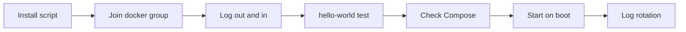

{:class="cover"}

---

In this lesson we'll install Docker on `openclaw-pi`. By the end you'll be running containers without `sudo`, Docker Compose will be ready, Docker will start on boot, and its logs won't quietly eat your SD card.

Everything here is typed **on the Pi**, over SSH.

---

## The plan



---

## Step 1: Run the official install script

Docker publishes a convenience script at `get.docker.com` that works out your system and installs Docker Engine, the command-line tool and the Compose plugin. It's good practice to download a script and glance at it before running it with `sudo`, so let's do that:

```bash
curl -fsSL https://get.docker.com -o get-docker.sh
less get-docker.sh
```

Press `q` to leave `less`. Then run it:

```bash
sudo sh get-docker.sh
```

It takes a few minutes. When it finishes you can tidy up:

```bash
rm get-docker.sh
```

---

## Step 2: Run Docker without sudo

Out of the box, only root can talk to Docker. Let's add your user to the `docker` group:

```bash
sudo usermod -aG docker $USER
```

`$USER` is filled in with your username automatically.

Group changes only apply to new logins, so log out:

```bash
exit
```

Then, on **your computer**, connect again:

```bash
ssh <user>@openclaw-pi.local
```

Back **on the Pi**, check the group stuck:

```bash
groups
```

You should see `docker` in the list.

A word of caution: anyone in the `docker` group can control Docker, and that is effectively the same as having root on the Pi. Only add accounts you trust.

---

## Step 3: Test it with hello-world

```bash
docker run hello-world
```

Docker downloads a tiny test image and runs it. Look for:

```text
Hello from Docker!
This message shows that your installation appears to be working correctly.
```

If you see `permission denied`, you haven't logged out and back in since Step 2.

---

## Step 4: Check Docker Compose

Docker Compose runs a group of containers from one file. It comes with Docker as a plugin, so there's nothing extra to install. Note the **space**: it's `docker compose`, not a separate program with a hyphen.

```bash
docker compose version
```

You'll see something like:

```text
Docker Compose version v2.x.x
```

Any version starting with `v2` or later is what we want. Don't install the old `docker-compose` package from apt. It's out of date and OpenClaw's setup script checks for `docker compose`.

---

## Step 5: Start Docker on boot

Pi Butler should come back by itself after a power cut. The install script normally switches this on already, but it does no harm to make sure:

```bash
sudo systemctl enable docker
systemctl is-enabled docker
```

The second command should print `enabled`. Later, OpenClaw's container uses `restart: unless-stopped`, so once Docker starts, Pi Butler starts too.

---

## Step 6 (optional): Rotate Docker's logs

Docker keeps every line a container prints. On an always-on Pi those logs can grow and grow. Let's cap them: each container keeps at most three log files of 10 MB each.

Create or edit Docker's settings file:

```bash
sudo nano /etc/docker/daemon.json
```

Put this inside. If the file already has settings, merge these keys into it rather than adding a second set of braces:

```json
{
  "log-driver": "json-file",
  "log-opts": {
    "max-size": "10m",
    "max-file": "3"
  }
}
```

Save with Ctrl+X, then Y, then Enter. Restart Docker to load it:

```bash
sudo systemctl restart docker
```

If Docker won't restart, there's almost certainly a typo in the JSON. Run `sudo journalctl -u docker --no-pager -n 20` to see why.

These settings apply to containers created *after* the change. We haven't created the OpenClaw container yet, so the timing is perfect.

## Pi Butler progress

The engine room is ready. Docker and Compose v2 are installed, run without `sudo`, start on boot and keep their logs in check.

---

## Try it Yourself

1. **List what you've got.** Run `docker ps -a` to see the finished hello-world container, and `docker images` to see its image.
2. **Tidy up.** Remove the test container with `docker container prune` and the image with `docker image rm hello-world`.
3. **Challenge:** Reboot the Pi with `sudo reboot`, SSH back in, and run `docker info`. Find the lines that show the logging driver is `json-file`.

---

## Common Issues

**Problem**: `permission denied while trying to connect to the Docker daemon socket`.
**Solution**: Log out completely with `exit`, then SSH back in.
**Why**: Your new `docker` group membership only applies to a fresh login.

**Problem**: `docker: 'compose' is not a docker command`.
**Solution**: Re-run the `get.docker.com` script, which installs the Compose plugin.
**Why**: Compose v2 is a plugin. The old apt `docker-compose` package doesn't provide `docker compose`.

**Problem**: Docker fails to start after you edited `daemon.json`.
**Solution**: Check the file with `cat /etc/docker/daemon.json`, fix the missing comma or bracket, then `sudo systemctl restart docker`.
**Why**: Docker refuses to start if its settings file isn't valid JSON.

---

## Check your understanding


? How do you check that Docker Compose v2 is installed?
- [ ] Install the old hyphenated package with apt, then run it
- [x] Run `docker compose version`
- [ ] Look for a docker-compose.yml file
> Compose v2 is a plugin that comes with Docker. It is run as `docker compose`, with a space.

? After `sudo usermod -aG docker $USER`, Docker still says permission denied. What's the fix?
- [ ] Reinstall Docker
- [x] Log out and log back in
- [ ] Run every Docker command with sudo forever
> Group changes only apply to a new login session.

? Why set `max-size` and `max-file` in `/etc/docker/daemon.json`?
- [ ] To make containers start faster
- [x] To stop container logs growing until they fill the disk
- [ ] To hide errors from the logs
> The json-file driver keeps everything by default. Capping it at three 10 MB files per container protects your storage.

