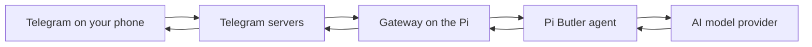

{:class="cover"}

---

By the end of this lesson you will be able to message Pi Butler from your phone over Telegram, and you will know why strangers who find your bot can't talk to it.

As always, `openclaw ...` means the alias from [lesson 7](/learn/openclaw_raspberry_pi/07_first-access.html), typed **on the Pi**.

---

## How a channel works

So far we have only talked to Pi Butler in the Control UI. A **channel** connects the Gateway to a chat app. Telegram is a great first channel: bots are free, you don't need a spare phone number, and setup takes a few minutes.



The Gateway reaches out to Telegram, so you don't need to open any ports on your router. Your messages do pass through Telegram's servers and then go to your model provider, so don't send anything you wouldn't want a cloud service to see.

---

## Step 1: Create a bot with BotFather

Telegram bots are made by chatting with a bot called **@BotFather**.

1. Open Telegram on your phone or computer and search for **@BotFather**. Check the handle is exactly `@BotFather`, as there are fakes.
2. Send `/newbot`.
3. Give it a display name, such as `Pi Butler`.
4. Give it a username. It must end in `bot`, for example `alex_pi_butler_bot`.
5. BotFather replies with a **token**, a long string with a colon in it.

Copy that token somewhere safe. Anyone with it can control your bot, so treat it like a password.

---

## Step 2: Add the token to OpenClaw

Back **on the Pi**, give the token to OpenClaw:

```bash
openclaw channels add --channel telegram --token <bot-token>
```

This writes the token into your config. Thanks to hot reload, the running Gateway picks up the new channel without a restart. Let's check it worked:

```bash
openclaw channels status --probe
```

`--probe` runs a live check against Telegram, so you know the token is good and the Gateway can reach it.

---

## Step 3: Pair your own account

Open your new bot in Telegram (BotFather gives you a link) and send it any message, such as `hello`.

Pi Butler won't answer yet. That message creates a **pairing request** instead. On the Pi, list the requests:

```bash
openclaw pairing list telegram
```

You will see a short code. Approve it:

```bash
openclaw pairing approve telegram <CODE>
```

Codes expire after one hour, so if you wait too long just message the bot again for a new one. Now send another message from your phone. This time Pi Butler replies, in its new butler voice.

---

## What pairing protects

Telegram bot usernames are public. Anyone can search for your bot and message it. If it simply answered everyone, a stranger could use your API credit and ask your agent to run commands on your Pi.

That's why the default DM policy is `pairing`. Unknown senders get a code and nothing else, and only you, on the Pi, can approve them. The other options are:

| `dmPolicy` | Who can DM the bot |
| --- | --- |
| `pairing` (default) | Only senders you approve with a pairing code |
| `allowlist` | Only the numeric Telegram user IDs in `allowFrom` |
| `open` | Anyone, which is only for deliberately public bots |
| `disabled` | Nobody |
{:class="table table-single"}

For Pi Butler, keep `pairing`. Only approve codes from people you trust, because an approved sender can talk to an agent that can run commands.

The first person you approve also becomes the bot's command owner, which matters for owner-only commands later.

---

## Chatting from your phone

Now you can talk to Pi Butler from anywhere your phone has signal, and the Pi stays safely at home. A few chat commands are handy:

| Command | What it does |
| --- | --- |
| `/new` | Archive the current session and start a fresh one |
| `/status` | Show runtime status and provider usage |
| `/whoami` | Show your Telegram user ID |
{:class="table table-single"}

Use `/new` when a conversation has wandered off topic, or after you change `SOUL.md`. A fresh session is also cheaper, because the model isn't re-reading a long history every time.

Run `/whoami` now and note your user ID. We will need it in lesson 11 for the morning brief.

> **Teachers**: Telegram has its own minimum age rules, so check them and your school's policy before students make accounts. A teacher-owned bot that each student pairs with is one option, but remember every approved sender shares the same agent, files and API bill.

---

## Pi Butler progress

Pi Butler is now in your pocket. It has a Telegram bot, your account is paired, and strangers who find the bot only ever get a pairing code. You also have your Telegram user ID ready for the morning brief.

---

## Try it Yourself

1. **Ask from your phone.** Message Pi Butler: "What can you do for me?" Compare the reply with the one you got in the Control UI.
2. **Start fresh.** Send `/new`, then ask "What were we just talking about?" and see that the new session starts clean.
3. **Challenge:** Ask a friend to message your bot. Run `openclaw pairing list telegram` and see their request appear. Decide whether to approve it, and think about what they could ask your agent to do if you did.

---

## Common Issues

**Problem**: `channels status --probe` reports an error for Telegram.
**Solution**: Check you copied the whole token, including the part before the colon, then run `channels add` again.
**Why**: Telegram rejects a token that is incomplete or has been revoked in BotFather.

**Problem**: The bot never replies and `pairing list` is empty.
**Solution**: Send the bot a message first, then list again. Check the Gateway logs with `cd ~/openclaw && docker compose logs -f openclaw-gateway`.
**Why**: A pairing request only appears after a new sender messages the bot.

**Problem**: `pairing approve` says the code is unknown.
**Solution**: Message the bot again to get a fresh code and approve that one.
**Why**: Pairing codes expire after one hour.

---

## Check your understanding


? A stranger finds your bot and sends it a message. What happens with the default settings?
- [ ] Pi Butler answers them using your API key
- [x] They get a pairing code, and nothing happens until you approve it on the Pi
- [ ] Telegram blocks them automatically
> The default dmPolicy is pairing, so unknown senders get a code that only the operator can approve.

? Where do you get a Telegram bot token?
- [ ] From the OpenClaw Control UI
- [x] From @BotFather, using /newbot
- [ ] From ~/openclaw/.env
> BotFather creates the bot and gives you its token, which you pass to openclaw channels add.

? Why is /new useful?
- [ ] It deletes the bot
- [ ] It changes the AI model
- [x] It archives the current session and starts a fresh one, which picks up changed workspace files and keeps context short
> A new session reloads files like SOUL.md and stops the model re-reading a long history.

