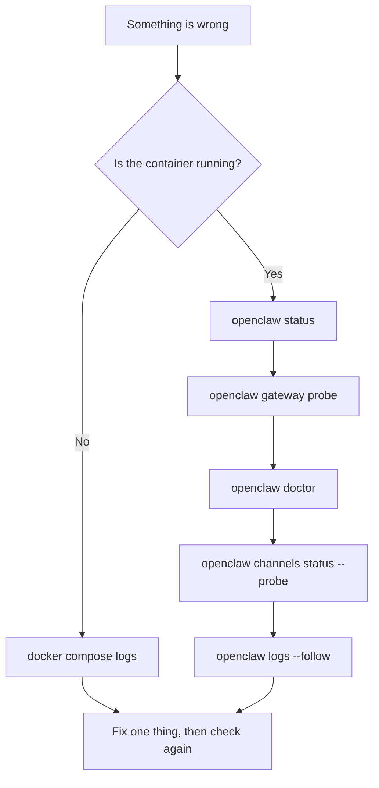

{:class="cover"}

---

By the end of this lesson you will be able to start from what you can see going wrong, run the right first command, read the Gateway's logs and let `openclaw doctor` repair the common problems for you. You'll also know how to ask for help without leaking your keys.

---

## Start from the symptom

When something breaks, it is tempting to start changing settings. Let's not. The quickest fixes come from looking first, in a fixed order, and only then changing one thing at a time.

Two reminders before we start. Every `openclaw ...` command in this lesson uses the shortcut alias from [lesson 7](/learn/openclaw_raspberry_pi/07_first-access.html), and every `docker compose ...` command is typed **on the Pi**, inside `~/openclaw`.

```bash
cd ~/openclaw
```



---

## The troubleshooting ladder

The official troubleshooting page has a ladder of commands to run in order. Each one tells you a little more than the last. Here it is, plus the two Docker commands that matter most on a Pi.

```bash
docker compose ps
openclaw status
openclaw status --all
openclaw gateway probe
openclaw doctor
openclaw channels status --probe
openclaw logs --follow
```

| Command | Good output looks like |
| --- | --- |
| `docker compose ps` | `openclaw-gateway` is `Up` and `(healthy)` |
| `openclaw status` | Your channels are listed with no auth errors |
| `openclaw status --all` | A full, read-only report you can paste when asking for help |
| `openclaw gateway probe` | `Reachable: yes` |
| `openclaw doctor` | No blocking config or service errors |
| `openclaw channels status --probe` | Telegram shows as connected, with `works` or `audit ok` |
| `openclaw logs --follow` | Steady activity, no fatal error repeating over and over |
{:class="table table-single"}

Stop at the first rung that looks wrong. That rung is where your problem lives.

---

## Symptom to first command

Most problems on a Pi fall into a handful of shapes. Find yours in the left column and run the command on the right first.

| Symptom | First command (on the Pi) |
| --- | --- |
| Telegram bot does not reply | `openclaw channels status --probe` |
| Bot replies to you but not to a friend | `openclaw pairing list telegram` |
| Control UI will not load at all | `docker compose ps`, and check the SSH tunnel is still running on your computer |
| Control UI says unauthorized or pairing required | `openclaw devices list` |
| Container keeps restarting | `docker compose logs --tail 100 openclaw-gateway` |
| Container shows `unhealthy` | `curl -fsS http://127.0.0.1:18789/healthz` |
| `EACCES` or permission denied in the logs | `ls -ln ~/.openclaw` |
| Pi is slow, or the container dies with no error | `free -h` |
| A skill fails with "exec format error" | `uname -m` |
| Pi Butler keeps dropping off the network | `iwconfig wlan0` |
| `openclaw: command not found` | `source ~/.bashrc` |
| `no configuration file provided: not found` | `cd ~/openclaw` |
{:class="table table-single"}

---

## Pi-specific problems

### Out of memory

If the Pi grinds to a halt, or the container stops with exit code `137`, it probably ran out of memory. Check how much is free and whether swap is on:

```bash
free -h
sudo dmesg | grep -i -E "out of memory|killed process"
```

On a 2 GB or smaller Pi, the official Pi guide adds a 2 GB swap file:

```bash
sudo fallocate -l 2G /swapfile
sudo chmod 600 /swapfile
sudo mkswap /swapfile
sudo swapon /swapfile
echo '/swapfile none swap sw 0 0' | sudo tee -a /etc/fstab
```

And remember, the Pi only runs the Gateway. Use cloud API models, never a local model on the Pi itself.

### Throttling and heat

A Pi that is too hot or underpowered slows itself down to stay safe. This command runs on the Pi's own shell, not inside the container:

```bash
vcgencmd get_throttled
```

`throttled=0x0` means all is well. Anything else means low voltage or heat, so check your power supply and cooling. We sort both properly in [lesson 17](/learn/openclaw_raspberry_pi/17_production-setup.html).

### Wi-Fi drops

Wi-Fi power saving can put the Pi's radio to sleep, and Pi Butler goes quiet. Turn it off:

```bash
sudo iwconfig wlan0 power off
```

That setting resets at reboot. The real fix for something that runs all day is an Ethernet cable.

### Exec format error

Pi Butler runs on a 64-bit ARM chip. If a skill downloads a program built only for Intel or AMD PCs, it fails with "exec format error". Check your Pi first:

```bash
uname -m
```

It should print `aarch64`. If it does, the skill's program has no ARM64 build. Look on its release page for a `linux-arm64` or `aarch64` download, or pick another skill.

---

## Docker-specific problems

### Permission errors (EACCES)

The container runs as the user `node`, which has user ID `1000`. If the folders on the Pi are owned by someone else, the Gateway cannot write to them. Give them back to user `1000`:

```bash
sudo chown -R 1000:1000 ~/.openclaw
```

This usually happens after copying files around with `sudo`.

### The container is unhealthy

The image has a built-in health check that pings `/healthz` every 30 seconds. Ask it yourself:

```bash
curl -fsS http://127.0.0.1:18789/healthz
curl -fsS http://127.0.0.1:18789/readyz
```

`/healthz` says the Gateway is alive. `/readyz` goes deeper and checks the channels too. One thing to know: the `restart: unless-stopped` policy restarts a container that crashes, but plain Docker does not restart one that is merely `unhealthy`. Read the logs, then restart it yourself:

```bash
docker compose restart openclaw-gateway
```

### Port 18789 is already in use

If Docker says `port is already allocated`, something else on the Pi has the port. Find out what:

```bash
sudo ss -ltnp
```

Look for `:18789` in the list. If you want to keep that other program, give OpenClaw a different port on the Pi's side by editing `~/openclaw/.env`:

```ini
OPENCLAW_GATEWAY_PORT=18800
```

This only changes the port on the Pi. Inside the container the Gateway still listens on `18789`. Apply it with `docker compose up -d openclaw-gateway` (a plain restart does not read `.env` changes), and use the new port in your SSH tunnel.

### Pairing required in the Control UI

A new browser has to be approved once. Find the request and approve it:

```bash
openclaw devices list
openclaw devices approve <requestId>
```

---

## Reading docker compose logs

`docker compose logs` shows everything the container printed, including crashes before the Gateway was fully up. That makes it the place to look when `openclaw` commands cannot reach the Gateway at all.

```bash
docker compose logs --tail 100 openclaw-gateway
docker compose logs -f openclaw-gateway
docker compose logs --since 30m -t openclaw-gateway
```

`--tail 100` shows the last 100 lines, `-f` follows new lines live (Ctrl+C to stop), `--since 30m` limits it to the last half hour, and `-t` adds timestamps.

When you read them, scroll up to the **first** error, not the last. The first error is usually the cause, and the rest are knock-on effects. A few lines you might meet:

| Log line contains | What it means |
| --- | --- |
| `EACCES` | Folder ownership, see the `chown` fix above |
| `EADDRINUSE` | The port is taken |
| `refusing to bind gateway ... without auth` | No valid Gateway token, so check `OPENCLAW_GATEWAY_TOKEN` in `.env` |
| `pairing request` | Someone messaged the bot and is waiting for approval |
| `origin not allowed` | The browser address is not `http://127.0.0.1:18789`, so use the tunnel |
{:class="table table-single"}

`openclaw logs --follow` is the other log. It reads the Gateway's own log file over the Gateway connection, so it only works once the Gateway is running.

---

## openclaw doctor

`openclaw doctor` is the Gateway's own health check. It looks at config, channels, plugins, skills, model routing and local state, and explains what is wrong.

```bash
openclaw doctor
openclaw doctor --json
openclaw doctor --fix
```

| Command | What it does |
| --- | --- |
| `openclaw doctor` | Guided checks, asks before repairs |
| `openclaw doctor --json` | Read-only report as JSON, changes nothing |
| `openclaw doctor --fix` | Applies the supported repairs |
{:class="table table-single"}

Plain `doctor` can still apply safe migrations, so take a backup first if you are worried ([lesson 15](/learn/openclaw_raspberry_pi/15_backup-and-recovery.html)). You don't need it after every upgrade, because the image runs `openclaw doctor --fix --non-interactive` by itself each time the container starts.

---

## Asking for help safely

If you are stuck, the official support site is [community.openclaw.ai](https://community.openclaw.ai/). Make a report to go with your question:

```bash
openclaw status --all
```

`status --all` is a full, read-only report designed to be pasted. Even so, read it before you post it. Say what you tried, what happened, what you expected, and that you are on a Raspberry Pi with Docker.

Never paste these anywhere public:

- Your `~/openclaw/.env` file, which holds your Gateway token
- API keys, bot tokens or the Gateway token
- Your whole `~/.openclaw` folder or `openclaw.json`
- Screenshots of the Control UI's settings or a dashboard link with a token in it

If you think you have found a security bug, don't post it publicly. The OpenClaw docs give a private route for those.

> **Teachers**: when a whole class is stuck at once, it is usually the shared Wi-Fi or the API key's spend limit, not thirty broken Pis. Check `openclaw channels status --probe` on one Pi before anyone starts reinstalling.

---

## Pi Butler progress

Pi Butler can now be diagnosed and repaired by you. You have a ladder of checks, a symptom table and `openclaw doctor`, so when it breaks you know where to look first.

---

## Try it Yourself

1. **Climb the ladder.** Run each rung of the ladder on a healthy Pi Butler and write down what "good" looks like. Next time something breaks, you'll have something to compare against.
2. **Break it on purpose.** Run `docker compose stop openclaw-gateway`, then send Pi Butler a Telegram message. Which rung of the ladder shows the problem first? Start it again with `docker compose up -d openclaw-gateway`.
3. **Challenge:** Run `openclaw status --all` and go through the output as if you were about to post it. Is there anything in there you would remove first?

---

## Common Issues

**Problem**: Every `openclaw` command fails with a connection error.
**Solution**: Run `docker compose ps` and `docker compose logs --tail 100 openclaw-gateway` to see why the Gateway is not up.
**Why**: The `openclaw` CLI talks to the running Gateway. If the container has stopped, only the Docker commands can tell you why.

**Problem**: `docker compose` says `no configuration file provided: not found`.
**Solution**: Run `cd ~/openclaw` first.
**Why**: Docker Compose looks for `docker-compose.yml` in the current folder.

**Problem**: The fix worked, then the problem came back after a reboot.
**Solution**: Make the change permanent, for example in `.env` or in config, rather than by hand inside the container.
**Why**: Anything changed inside a container is lost when it is recreated. Only the mounted folders and `.env` survive.

---

## Check your understanding


? Pi Butler has stopped replying on Telegram. Which command should you run first?
- [ ] `docker compose down`
- [x] `openclaw channels status --probe`
- [ ] `sudo chown -R 1000:1000 ~/.openclaw`
> Look before you change anything. The channel probe tells you whether Telegram is connected and working.

? The logs show `EACCES` on `/home/node/.openclaw`. What is the fix?
- [ ] Run the container as root
- [ ] Delete `~/.openclaw` and start again
- [x] Run `sudo chown -R 1000:1000 ~/.openclaw` on the Pi
> The container runs as user `node` with ID 1000, so the mounted folders must belong to user 1000.

? Which of these is safe to paste into a public support post after reading it through?
- [x] The output of `openclaw status --all`
- [ ] Your `~/openclaw/.env` file
- [ ] A screenshot of the dashboard link with its token
> `status --all` is built to be shared. The `.env` file and dashboard links contain secrets.

