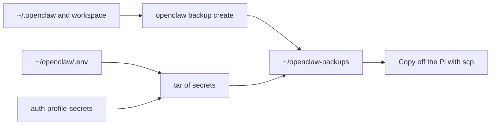

{:class="cover"}

---

SD cards wear out, upgrades go wrong and fingers slip. By the end of this lesson you will know what Pi Butler keeps where, have a verified backup running every night, a copy safely off the Pi, and a tested way to put it all back.

---

## What lives where

Pi Butler's memory, persona and settings are all files on the Pi. Here is what matters and how each one gets backed up.

| On the Pi | What is in it | Backed up by |
| --- | --- | --- |
| `~/.openclaw` | Config `openclaw.json`, credentials, model auth profiles, sessions, all in files and SQLite databases | `openclaw backup create` |
| `~/.openclaw/workspace` | `SOUL.md`, `AGENTS.md`, `USER.md`, memory and your `pi-health` skill | `openclaw backup create`, unless you pass `--no-include-workspace` |
| `~/openclaw/.env` | Your Gateway token, image tag and Docker settings | Copy it yourself |
| `~/.openclaw-auth-profile-secrets` | A local key used to recover older encrypted login details | It sits outside the state folder, so we copy it ourselves to be sure |
| The rest of `~/openclaw` | OpenClaw's git checkout and compose file | Nothing needed, `git clone` gets it back |
{:class="table table-single"}



One rule from the docs is worth saying loudly: **never copy the live `.sqlite` files while the Gateway is running.** They are being written to, and a raw copy can be torn or corrupt. `openclaw backup create` takes a safe snapshot while Pi Butler keeps working.

Backups contain your keys, tokens and chat history. Treat every archive like a password.

---

## Make a backup

The CLI runs inside a container, so it cannot see your Pi's folders unless we hand one in. We mount a backup folder at `/backups` and tell OpenClaw to write there. Type this **on the Pi**:

```bash
mkdir -p ~/openclaw-backups
cd ~/openclaw
docker compose run --rm -v "$HOME/openclaw-backups:/backups" openclaw-cli backup create --output /backups --verify
```

We use the full `docker compose run` command here rather than the `openclaw` alias from lesson 7, because the `-v` option has to go to Docker, before the service name.

`--verify` checks the archive straight after making it. OpenClaw refuses to write the archive inside the state folder itself, which is why it goes to a separate folder. Have a look:

```bash
ls -lh ~/openclaw-backups
```

You'll see a file with a timestamped name ending in `-openclaw-backup.tar.gz`.

Want to see what would be included without writing anything? Swap `--verify` for `--dry-run`.

### Verify an older archive

You can check any archive later. Put its real file name in place of `<archive>`:

```bash
docker compose run --rm -v "$HOME/openclaw-backups:/backups" openclaw-cli backup verify /backups/<archive>.tar.gz
```

Verify checks the archive's structure and databases. It does not make an archive from someone else safe, so only restore archives you made.

---

## A nightly backup with cron

Let's make the Pi do this every night at 02:30. This uses `crontab`, the Pi's **own Linux scheduler**. It is nothing to do with OpenClaw's automations from lesson 11. Those run prompts through the agent. This one runs a plain shell script on the Pi.

First, a small script that backs up OpenClaw, copies the two secret files, locks the archives down and keeps about a week of them:

```bash
nano ~/openclaw-backup.sh
```

```bash
#!/bin/bash
set -e
mkdir -p "$HOME/openclaw-backups"
cd "$HOME/openclaw"
docker compose run --rm -T -v "$HOME/openclaw-backups:/backups" openclaw-cli backup create --output /backups --verify
tar czf "$HOME/openclaw-backups/openclaw-secrets-$(date +%F).tar.gz" -C "$HOME" openclaw/.env .openclaw-auth-profile-secrets
chmod 600 "$HOME"/openclaw-backups/*.tar.gz
find ~/openclaw-backups -name '*.tar.gz' -mtime +7 -delete
```

`-T` turns off Docker's terminal, which a cron job doesn't have. The last line deletes archives more than seven days old. Make the script runnable and try it once by hand:

```bash
chmod +x ~/openclaw-backup.sh
~/openclaw-backup.sh
ls -lh ~/openclaw-backups
```

If that worked, open your crontab:

```bash
crontab -e
```

Pick `nano` if it asks. Add this line at the bottom, then save and exit:

```text
30 2 * * * $HOME/openclaw-backup.sh >> $HOME/openclaw-backup.log 2>&1
```

The five fields mean minute 30, hour 2, every day, every month, every weekday. Any output goes into `~/openclaw-backup.log`, so you can check it next morning:

```bash
tail ~/openclaw-backup.log
```

We put the commands in a script rather than straight into the crontab because cron treats `%` as a special character, and `date +%F` would break.

---

## Copy a backup off the Pi

A backup that lives on the same SD card as the thing it protects is not much of a backup. Copy the archives to another machine. Type this **on your computer**:

```bash
mkdir -p pi-butler-backups
scp '<user>@openclaw-pi.local:openclaw-backups/*.tar.gz' ./pi-butler-backups/
```

Swap `<user>` for your Pi username. Keep the copies somewhere private, ideally on an encrypted disk.

---

## Restore into a fresh folder

OpenClaw never restores over the top of live state. `backup restore` verifies the archive, then extracts it into a **fresh, empty** folder and stops there. Putting it into use is a separate step that you do deliberately.

```bash
cd ~/openclaw
docker compose run --rm -v "$HOME/openclaw-backups:/backups" openclaw-cli backup restore /backups/<archive>.tar.gz --target /backups/restored
```

The target must not exist yet, or must be empty. Inside you'll find a `manifest.json` that lists every original path, and a `payload/` folder with the files.

### Activating a restore (offline)

Activation means swapping the restored state in while the Gateway is **stopped**. The docs describe it like this: stop the Gateway, move the current state aside, move the restored state into place, run `openclaw doctor`, then start again. On Pi Butler that looks like:

```bash
cd ~/openclaw
docker compose down
mv ~/.openclaw ~/.openclaw.before-restore
ls ~/openclaw-backups/restored/*/payload/posix/home/node/
```

Inside the container the state lived at `/home/node/.openclaw`, so that is where it appears in the payload. Check `manifest.json` agrees, then move it into place and hand it back to user `1000`:

```bash
mv ~/openclaw-backups/restored/*/payload/posix/home/node/.openclaw ~/.openclaw
sudo chown -R 1000:1000 ~/.openclaw
docker compose run --rm --no-deps openclaw-gateway node openclaw.mjs doctor
docker compose up -d openclaw-gateway
```

The `doctor` line runs a one-off copy of the Gateway image against the restored state without starting the Gateway itself. Keep `~/.openclaw.before-restore` until you are sure everything works.

Restoring is time travel. Pending approvals and some channel state roll back too, so check `openclaw channels status --probe` afterwards.

---

## The cold copy alternative

There is a simpler, blunter option: stop everything and archive the folders as they are. With the Gateway stopped, nothing is writing to the databases, so a plain copy is safe.

```bash
cd ~/openclaw
docker compose stop openclaw-gateway
sudo tar czf ~/openclaw-cold-$(date +%F).tar.gz -C ~ .openclaw .openclaw-auth-profile-secrets openclaw/.env
sudo chown $USER: ~/openclaw-cold-*.tar.gz
docker compose up -d openclaw-gateway
```

It costs a minute or two of downtime, but it is easy to understand and easy to put back. Use it before a big change, such as moving to an SSD in lesson 17.

> **Teachers**: backups contain API keys and chat history. Don't let archives travel round the classroom on shared USB sticks, and delete them from school machines at the end of term.

---

## Pi Butler progress

Pi Butler is now **backed up every night**, with a week of archives on the Pi, copies on another machine and a restore you have practised.

---

## Try it Yourself

1. **Make and verify.** Create a backup with `--verify`, then run `backup verify` on it again by name.
2. **Schedule it.** Set up the nightly cron job, then check `~/openclaw-backup.log` the next morning.
3. **Challenge:** Practise a restore. Run `backup restore` into `/backups/restored`, open `manifest.json`, and find your `SOUL.md` inside the payload. You don't have to activate it to learn a lot.

---

## Common Issues

**Problem**: The backup fails with a permission error writing to `/backups`.
**Solution**: Run `id -u` on the Pi. If it is not `1000`, run `sudo chown 1000:1000 ~/openclaw-backups`.
**Why**: The container writes as user `node`, ID 1000, so the backup folder must be writable by that user.

**Problem**: The cron job never seems to run.
**Solution**: Check `crontab -l` shows your line, and read `~/openclaw-backup.log` for errors.
**Why**: Cron runs with a very small environment, so errors only show up in the log you sent its output to.

**Problem**: `backup restore` says the target is not empty.
**Solution**: Pick a new target name, such as `/backups/restored-2`.
**Why**: Restore only ever writes to a fresh folder, so it can never overwrite anything by accident.

---

## Check your understanding


? Why shouldn't you just copy `~/.openclaw` while Pi Butler is running?
- [ ] It is too big to copy
- [x] The SQLite databases are being written to, so a raw copy can be corrupt
- [ ] Docker locks the folder
> `openclaw backup create` takes a safe snapshot while the Gateway runs. A plain copy is only safe with the Gateway stopped.

? What does `openclaw backup restore` do?
- [ ] Overwrites your live state with the archive
- [x] Verifies the archive and extracts it into a fresh, empty folder
- [ ] Restarts the Gateway on the old version
> Activation is a separate offline step that you do yourself.

? Which file holds your Gateway token but is not inside the OpenClaw state, so our script copies it separately?
- [x] `~/openclaw/.env`
- [ ] `~/.openclaw/workspace/SOUL.md`
- [ ] `~/.openclaw/openclaw.json`
> The `.env` file lives in the git checkout, which is never mounted into the container, so `openclaw backup create` cannot see it.

