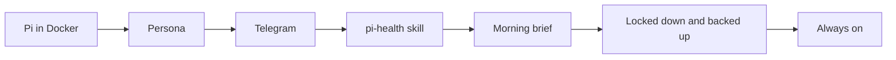

{:class="cover"}

---

You did it. In this lesson we look back at everything you built, and then at where you could take Pi Butler next, with a final capstone challenge to prove it all works together.

---

## What you built

Pi Butler started as an empty Raspberry Pi. Here is how it grew.

| Lesson | Pi Butler stage |
| --- | --- |
| 1 to 3 | You learned what the Gateway does, which Pi to use and why we use Docker |
| 4 to 6 | A 64-bit Pi running OpenClaw in Docker, installed with the official setup script |
| 7 | First conversation, through the SSH tunnel and the Control UI |
| 8 | A persona of its own, written in `SOUL.md` |
| 9 | On your phone, through a Telegram bot with DM pairing |
| 10 | A custom `pi-health` skill that reports temperature, memory and disk |
| 11 | A 7 am morning brief, and the everyday compose commands |
| 12 | Monitoring, with `~/pi-check.sh` |
| 13 | You can fix it, with the troubleshooting ladder and `openclaw doctor` |
| 14 | Locked down, with the port off your network and exec approvals on |
| 15 | Backed up every night, with a restore you have practised |
| 16 | Kept up to date, with pinning and rollback |
| 17 | Always on, surviving power cuts and reachable through Tailscale |
{:class="table table-single"}



And you have been honest with yourself about the trade-off all the way through. The Pi runs the Gateway and keeps your config, memory, workspace and chat history. The thinking happens at the model provider you chose, and you pay for it per use.

---

## What's next

Here are some ideas to grow Pi Butler further. Each one builds on something you already know. As always, `openclaw` is the alias from lesson 7 and runs **on the Pi**.

### More channels

Telegram is just one channel. OpenClaw also supports WhatsApp, Discord, Slack, Signal, Matrix and many more. The pattern is the same as lesson 9: add the channel, check it with `openclaw channels status --probe`, and keep DM pairing on so strangers can't talk to your agent.

```bash
openclaw channels list
```

### A second agent

One Gateway can run more than one agent, each with its own workspace and persona. A "work" agent, separate from Pi Butler, is a nice next step:

```bash
openclaw agents add work --workspace ~/.openclaw/workspace-work
openclaw agents list
```

Remember the trust model from lesson 14. Agents on one Gateway share one trust boundary, so this is for your own personas, not for sharing with people you don't trust.

### Sandboxing

At the moment, the agent's commands run inside the Gateway container. OpenClaw can go further and run each agent's tools in their own throwaway sandbox containers. The setup script switches it on with `OPENCLAW_SANDBOX=1`.

Read the [Sandboxing docs](https://docs.openclaw.ai/gateway/sandboxing) before you try it on a Pi. The script checks for the Docker CLI inside the Gateway image and skips sandbox setup if it is missing, and the standard pre-built image may not include it. It also gives the Gateway access to the Pi's Docker socket, which is a big step up in trust. A worthwhile project, but not a quick toggle.

### A local model on a bigger machine

The Pi is too slow to run a model itself, and the official Pi guide says not to try. But a bigger computer on your network can. Run Ollama or LM Studio on that machine, set it to listen on the network (for Ollama, `OLLAMA_HOST=0.0.0.0:11434 ollama serve`), and point OpenClaw at **that computer's** address, such as `http://<big-pc-ip>:11434`.

Inside the container, `host.docker.internal` means the Pi itself, so it only helps when the model runs on the same machine as Docker. For another computer, use its LAN address. The [Ollama provider docs](https://docs.openclaw.ai/providers/ollama) cover the details, including a recipe for a LAN host. Your messages then stay on your own network, though a small local model will be less capable, and easier to trick, than a frontier cloud model.

### Write more skills

`pi-health` was your first skill. What else would be handy? A skill that checks your Pi's backup log, one that summarises your 3D printer's status, or one that reads a sensor on another board. Use the same `SKILL.md` pattern from lesson 10 and check it with:

```bash
openclaw skills check
```

### Share a skill on ClawHub

Proud of a skill? You can publish it to [ClawHub](https://clawhub.ai), OpenClaw's skill marketplace, with the separate `clawhub` command line tool (`clawhub login`, then `clawhub skill publish`). Remember how lesson 14 asked you to read other people's skills before installing them. Make yours easy to read, with no surprises, and never include a key or token.

---

## Related KevsRobots courses

- [Docker](/learn/docker/): go deeper on images, containers and compose files
- [Introduction to the Linux Command Line on Raspberry Pi OS](/learn/linux_intro/): brush up on the shell skills Pi Butler relies on
- [From Docker to Podman](/learn/podman/): run containers without a root daemon
- [Running K3s on Raspberry Pi](/learn/k3s/): take containers further with a small Kubernetes cluster
- [Arduino Uno Q - Two Brains, One Board](/learn/arduino_uno_q/): a Linux board with a microcontroller built in

And two of Kev's blog posts on the same theme:

- [Why I'm Running Hermes Agent on an Arduino Uno Q](/blog/hermes-agent-on-arduino-uno-q.html)
- [ClawBox Review: A Lovely Box Betting on a Moving Target](/blog/clawbox-review.html)

> **Teachers**: the capstone below makes a good end-of-unit assessment. Students can demonstrate it live from their phones, and the security audit gives you something objective to mark.

---

## Pi Butler progress

Pi Butler is **complete**: an always-on OpenClaw agent on your Pi, in Docker, that you talk to from your phone, with its own persona, a `pi-health` skill and a 7 am morning brief, locked down, backed up and kept up to date.

---

## Try it Yourself

1. **Show it off.** From your phone, ask Pi Butler for a health report and check the numbers against `vcgencmd measure_temp`, `free -m` and `df -h` on the Pi.
2. **Pick your next step.** Choose one idea from What's next and write down what you'd need to change on Pi Butler to do it.
3. **Challenge: the capstone.** Prove Pi Butler is production ready in one sitting. Reboot the Pi with `sudo reboot`, then, without touching the Pi, get a Telegram reply from it. Next, ask it for a `pi-health` report. Then run `openclaw security audit --deep` with no critical findings, and finally verify last night's backup with `backup verify`. If all four pass, Pi Butler is done.

---

## Check your understanding


? Where does the "thinking" happen for Pi Butler?
- [ ] On the Pi, inside the Gateway container
- [x] At the model provider you chose, paid for per use
- [ ] On Telegram's servers
> The Pi runs the Gateway and keeps your files and history. The model itself runs at the provider.

? You run Ollama on a bigger PC on your network. Which address should Pi Butler use?
- [ ] `http://host.docker.internal:11434`
- [x] `http://<big-pc-ip>:11434`, the other computer's LAN address
- [ ] `http://127.0.0.1:11434`
> Inside the container, `host.docker.internal` is the Pi and `127.0.0.1` is the container itself. Another computer needs its own address.

? What should you do before publishing a skill to ClawHub?
- [ ] Add your API key so it works for everyone
- [x] Make it easy to read, with no hidden surprises and no secrets in it
- [ ] Turn off DM pairing so people can test it
> Other people should read your skill before installing it, just as you read theirs.

