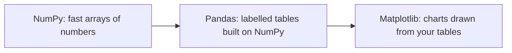

{:class="cover"}

---

By the end of this lesson you will be able to explain what Pandas and NumPy are for, and create a NumPy array and a Pandas Series.

## Overview

Welcome to the first lesson of the `Data Manipulation with Pandas and NumPy` course. This lesson serves as your gateway into the world of data analysis and manipulation in Python. Pandas and NumPy are two of the most popular libraries used in data science and analytics. They provide powerful tools to manipulate, analyze, and visualize data in Python.

---

## What is Pandas?

`Pandas` is an open-source library providing high-performance, easy-to-use data structures and data analysis tools. Its main data structure, the DataFrame, allows you to store and manipulate tabular data in rows of observations and columns of variables.

The Pandas documentation is hosted at <https://pandas.pydata.org>.

---

## What is NumPy?

`NumPy`, short for Numerical Python, is a foundational package for numerical computing in Python. It provides support for large, multi-dimensional arrays and matrices, along with a collection of mathematical functions to operate on these arrays.

We use Numpy to perform mathematical and logical operations on arrays. It is the fundamental package for scientific computing in Python.

For example, let's create a NumPy array:


import numpy as np

arr = np.array([1, 2, 3, 4, 5])
print(arr)



Output:

```shell
[1 2 3 4 5]
```

---

## Installing Pandas and NumPy

Before diving into the functionalities of Pandas and NumPy, you need to install these libraries. Here's how you can do it:

```shell
pip install pandas numpy
```

The next lesson covers installation in more detail.

---

## Basic Concepts

### Data Frames

Data Frames are two-dimensional, size-mutable, and potentially heterogeneous tabular data structures with labeled axes (rows and columns). Think of it as a spreadsheet with superpowers.

---

### Series

A Series, in Pandas, is a one-dimensional array-like object that can hold many data types, such as numbers or strings.

### How the libraries fit together



NumPy does the number crunching, Pandas adds row and column labels so you can work with data the way you do in a spreadsheet, and Matplotlib turns the result into a chart. We use all three in this course.

---

## Code Playground

To follow along with the examples in this course, you can use the interactive code playground below. Click the `Run` button to execute the code and see the output.


import numpy as np
import pandas as pd

# A NumPy array
arr = np.array([1, 2, 3, 4, 5])
print(arr)

# A Pandas Series
s = pd.Series([1, 2, 3, 4, 5])
print(s)



---

## Try it Yourself

1. In the playground, change the array to hold five battery readings from a robot, such as `[87, 85, 82, 80, 76]`, and print it.
2. Add `print(arr * 2)` and `print(arr.mean())`. Notice that NumPy works on the whole array at once, with no loop.
3. Give the Series labels: `pd.Series([87, 85, 82], index=['Mon', 'Tue', 'Wed'])`. Then print `s['Tue']`.
4. Challenge: make a second Series for a different robot and print the two added together.

---

## Common Issues

- **Problem**: `ModuleNotFoundError: No module named 'pandas'`
- **Solution**: Install it with `pip install pandas numpy`, making sure you use the same Python that runs your script. The next lesson covers this in detail.
- **Why**: Pandas and NumPy are not part of the Python that comes with your computer. They are separate packages you add once.

---

## Check your understanding


? What is a Pandas Series?
- [x] A one-dimensional labelled array, like a single column
- [ ] A two-dimensional table
- [ ] A type of chart
> A DataFrame is made of Series: each column is one.

? Which library is Pandas built on top of?
- [ ] Matplotlib
- [x] NumPy
- [ ] Seaborn
> Pandas stores its data in NumPy arrays, which is why the two are taught together.

? What does NumPy let you do that a plain Python list does not?
- [ ] Draw charts
- [x] Do maths on a whole array at once, such as `arr * 2`
- [ ] Read Excel files
> NumPy arrays apply an operation to every element without a loop. Charts come from Matplotlib.


---

## Summary

This introductory lesson provided a glimpse into what Pandas and NumPy are and their significance in data analysis. In the upcoming lessons, we will delve deeper into these libraries, exploring various functionalities and how they can be applied to real-world data.

---
