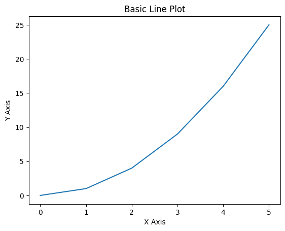
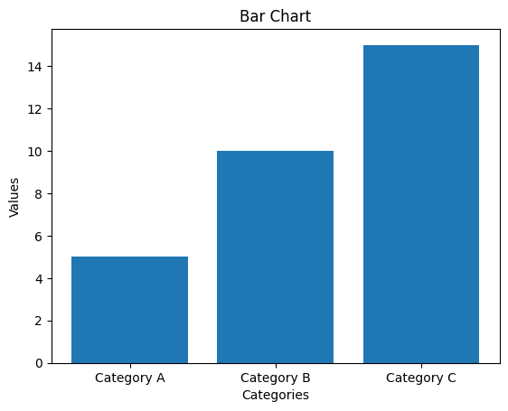
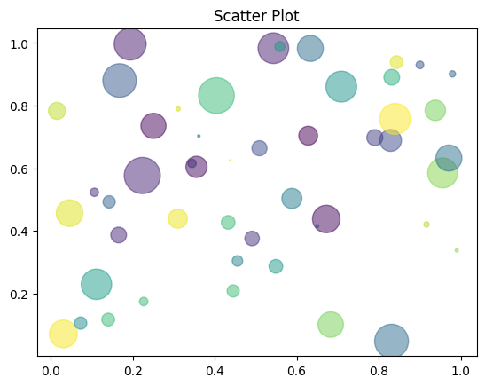
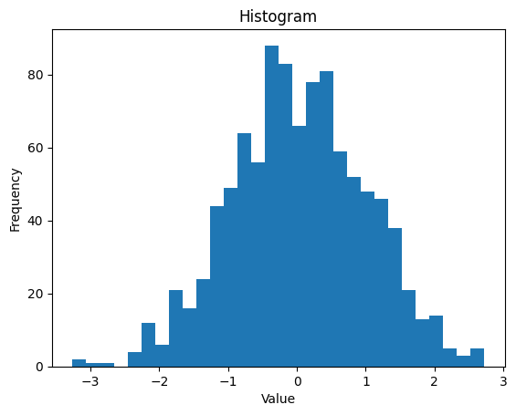
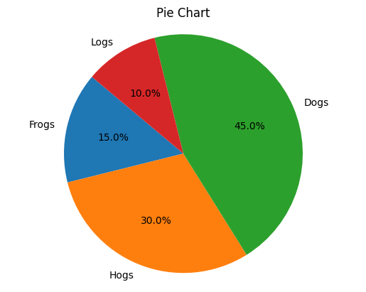

{:class="cover"}

---

By the end of this lesson you will be able to draw line, bar, histogram and scatter charts from a Data Frame with `.plot()` and Matplotlib.

## Overview

In this lesson, we focus on Visualization with Pandas and Matplotlib. Effective data visualization is crucial for interpreting and communicating data insights. We'll explore how Pandas integrates with Matplotlib to create a variety of charts and graphs for effective data presentation.

## Introduction to Matplotlib

`Matplotlib` is a comprehensive library for creating static, animated, and interactive visualizations in Python. Pandas data structures integrate well with Matplotlib.

## Basic Plotting with Pandas

Pandas DataFrames and Series have a `.plot()` method, which is a wrapper around Matplotlib's functionality:

```python
import pandas as pd
import matplotlib.pyplot as plt

df = pd.DataFrame({
    'day': ['Mon', 'Tue', 'Wed', 'Thu', 'Fri'],
    'SMARS': [12, 15, 9, 20, 17],
    'Quad': [8, 6, 11, 7, 10],
})

# Basic line plot
df['SMARS'].plot()
plt.show()

# Basic histogram
df['SMARS'].plot.hist()
plt.show()
```

In a script, `plt.show()` opens the window. In a Jupyter notebook the chart appears on its own.

## Customizing Plots

You can customize plots with various parameters:

```python
# Customized plot
df.plot(x='day', kind='bar', title='Distance per day', legend=True, fontsize=12)
plt.show()
```

## Plotting Multiple Columns

Compare multiple columns in a single plot:

```python
# Plotting multiple columns
df.plot(x='day', y=['SMARS', 'Quad'], kind='line')
plt.show()
```

## Time Series Plotting

When the index holds dates, `plot()` puts them along the x-axis automatically:

```python
log = pd.DataFrame(
    {'distance_m': [12, 15, 9, 20]},
    index=pd.to_datetime(['2024-01-01', '2024-01-02', '2024-01-03', '2024-01-04']),
)
log.plot()
plt.show()
```

## Advanced Plots with Matplotlib

For more advanced plots, directly use Matplotlib:

```python
import matplotlib.pyplot as plt

# Scatter plot with Matplotlib
plt.scatter(df['SMARS'], df['Quad'])
plt.title('Scatter Plot')
plt.xlabel('SMARS distance')
plt.ylabel('Quad distance')
plt.show()
```

---

## Some more examples

Matplotlib is a versatile plotting library in Python, widely used for creating static, interactive, and animated visualizations. Here are a few examples to showcase its capabilities:

### 1. Basic Line Plot

```python
import matplotlib.pyplot as plt

x = [0, 1, 2, 3, 4, 5]
y = [0, 1, 4, 9, 16, 25]

plt.plot(x, y)
plt.title('Basic Line Plot')
plt.xlabel('X Axis')
plt.ylabel('Y Axis')
plt.show()
```

This code produces a simple line plot, plotting `x` versus `y`.

{:class="img-fluid w-50 shadow-lg"}

---

### 2. Bar Chart

```python
categories = ['Category A', 'Category B', 'Category C']
values = [5, 10, 15]

plt.bar(categories, values)
plt.title('Bar Chart')
plt.xlabel('Categories')
plt.ylabel('Values')
plt.show()
```

This creates a bar chart displaying the values of different categories.

{:class="img-fluid w-50 shadow-lg"}

---

### 3. Scatter Plot

```python
import numpy as np

x = np.random.rand(50)
y = np.random.rand(50)
colors = np.random.rand(50)
area = (30 * np.random.rand(50))**2

plt.scatter(x, y, s=area, c=colors, alpha=0.5)
plt.title('Scatter Plot')
plt.show()
```

This scatter plot uses random data, with varying sizes and colors for the points.

{:class="img-fluid w-50 shadow-lg"}

---

### 4. Histogram

```python
data = np.random.normal(0, 1, 1000)

plt.hist(data, bins=30)
plt.title('Histogram')
plt.xlabel('Value')
plt.ylabel('Frequency')
plt.show()
```

This code generates a histogram of normally distributed data.

{:class="img-fluid w-50 shadow-lg"}

---

### 5. Pie Chart

```python
sizes = [15, 30, 45, 10]
labels = ['Frogs', 'Hogs', 'Dogs', 'Logs']

plt.pie(sizes, labels=labels, autopct='%1.1f%%', startangle=140)
plt.axis('equal')
plt.title('Pie Chart')
plt.show()
```

This creates a pie chart showing the relative sizes of different items.

{:class="img-fluid w-50 shadow-lg"}

---

## Try it Yourself

1. Run the first example, then change `df['SMARS'].plot()` to `df['Quad'].plot()`. Which robot's line is more jumpy?
2. Make a bar chart of both robots with `df.plot(x='day', y=['SMARS', 'Quad'], kind='bar')`, and add a title.
3. Add `plt.ylabel('Distance (m)')` before `plt.show()` so the chart explains itself.
4. Challenge: save a chart as a picture with `plt.savefig('distance.png')` placed before `plt.show()`, then find the file in your folder.

---

## Common Issues

- **Problem**: `ModuleNotFoundError: No module named 'matplotlib'`
- **Solution**: Run `pip install matplotlib`.
- **Why**: Pandas draws charts through Matplotlib, but does not install it for you.

- **Problem**: Your script runs but no chart window appears, or it appears blank.
- **Solution**: Make sure `plt.show()` comes after your plot lines. On a computer with no screen (such as a Raspberry Pi over SSH) use `plt.savefig('chart.png')` instead.
- **Why**: In a script, nothing is drawn on screen until `plt.show()` runs, and a machine with no display has nowhere to show it.

- **Problem**: A bar chart has numbers along the bottom instead of day names.
- **Solution**: Tell Pandas which column to use with `x='day'`.
- **Why**: Without `x`, Pandas uses the row numbers.

> **Teachers**: notebooks and scripts behave differently. In a Jupyter notebook or Colab the chart appears under the cell on its own, while a script needs `plt.show()` and opens a separate window that can be hidden behind other windows on a busy desktop. Decide which you will use before the lesson, and make sure everyone is using the same one.

---

## Check your understanding


? Which plot shows how values are distributed across ranges?
- [ ] Pie chart
- [x] Histogram
- [ ] Line plot
> A histogram groups values into bins and shows how many fall in each.

? In a script (not a notebook), which line makes the chart appear?
- [ ] `plt.draw_chart()`
- [x] `plt.show()`
- [ ] `df.display()`
> Pandas draws on a Matplotlib figure, and `plt.show()` opens it.

? What does `df.plot(x='day', kind='bar')` do?
- [ ] Draws a pie chart
- [x] Draws a bar chart with the `day` column along the bottom
- [ ] Sorts the table by day
> `kind` picks the type of chart and `x` picks the column for the horizontal axis.


---

## Summary

This lesson introduced you to the basics of visualization with Pandas and Matplotlib. From simple line charts to more complex scatter plots, you now have the tools to visualize and communicate your data effectively.

---
