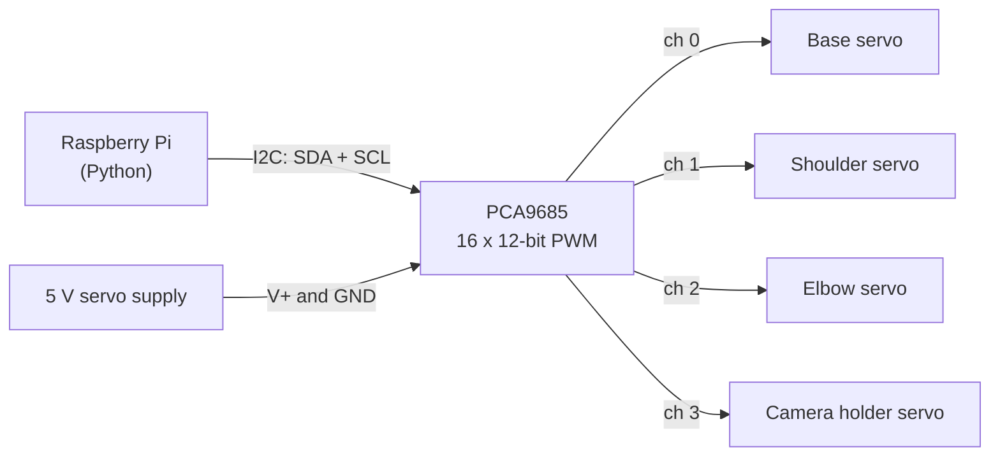

{:class="cover"}

---

Ahoy there makers! In this course we'll build a small robot arm called Buddy Jr and teach it to move with Python. Watch Kev's video of the build first, then come back and let's get going.



## Overview

A Raspberry Pi can talk to servos directly, but it only has a couple of hardware PWM pins and they are shared with other jobs. A **PCA9685** board fixes that. It is a 16-channel, 12-bit PWM driver that you talk to over I2C, using just two wires, and it makes the pulses for up to 16 servos on its own. Once you've told it what to do, the Pi is free to think about other things.

We'll use one PCA9685 to drive the four servos of Buddy Jr: a base that turns, a shoulder, an elbow and a camera holder that tilts. Every lesson adds one step, and by the end you will have an arm that moves smoothly between named poses and runs a little routine on its own.

## Course Content

- **Getting started**: set up a Raspberry Pi for I2C and learn the bits of Python a robot needs
- **The PCA9685**: what the board does, how to wire it safely, and your first servo moving
- **Building the arm**: designing, printing and assembling Buddy Jr
- **Programming the arm**: angles to pulses, smooth moves, named poses and automation
- **Taking it further**: project ideas and a troubleshooting guide

## Key Results

After completing this course, you will:

- Wire a PCA9685 to a Raspberry Pi and power servos from their own supply
- Turn an angle into a 12-bit PWM count, and explain the maths
- Control four servos from Python with the Adafruit PCA9685 library
- Calibrate each joint so the arm never pushes against its own limits
- Make smooth, repeatable movements and run an automated routine
- Diagnose the common problems: no I2C device, jitter, brown-outs and wrong angles

## What you'll need

- A Raspberry Pi with header pins and Raspberry Pi OS (the Pi 5 was used in the video, but any Pi with a 40-pin header will do)
- A PCA9685 16-channel servo driver board
- Four SG90 style 9 g hobby servos
- A separate 5 V power supply for the servos, able to give at least 2 A, with a way to connect it to the board's screw terminal
- Jumper wires (female to female) for the four connections between the Pi and the board
- The 3D printed Buddy Jr parts, with screws and a screwdriver (printing files are on the [Buddy Jr page](/blog/buddy_jr.html))
- A computer to write code on (or the Pi itself with a keyboard and screen)

New to the pieces? These courses help, and are worth a look before or alongside this one:

- [Python for beginners](/learn/python/)
- [Introduction to the Linux Command Line on Raspberry Pi OS](/learn/linux_intro/)
- [Electronics basics](/learn/electronics_basics/)
- [Talking to the World - Working with I2C and SPI](/learn/i2c_spi/)

## How the course works

**Every program is complete.** When a lesson says "save this as a file", you can copy the whole listing, save it on the Pi and run it with `python3`. Short snippets that are only part of a program say so.

**Maths on a computer first.** The angle and pulse maths lives in small programs that run on any computer, so you can check your understanding before a servo ever moves.

**Quizzes and exercises.** Each lesson ends with a short quiz, a few exercises that rise in difficulty, and a Common Issues list. Check that list before you decide something is broken.

**Power safely.** The servos always get their own supply. We'll explain why in lesson 4, and you'll see it come up again in the troubleshooting lesson.

> **Teachers**: this course suits learners from about 11 upwards who can use a keyboard and a terminal. Allow 45 to 60 minutes per lesson, with the printing and assembly (lessons 6 and 7) needing a few extra hours, mostly waiting on the 3D printer. One Pi, one PCA9685, four servos and a 5 V supply per pair is ideal, and the servo supply must be a proper 5 V adapter or battery pack, never the Pi's pins. Lessons 3, 6 and 11 need no hardware at all, and the angle maths in lessons 4 and 8 runs on any computer, so a class can start before the kit arrives. Check your school's rules on soldering and on 3D printer use before lessons 6 and 7.

Ready? Let's start by getting a Raspberry Pi set up for the job.
