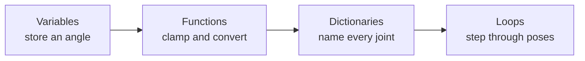

{:class="cover"}

---

By the end of this lesson you will be able to write a small Python program that stores joint angles, keeps them within safe limits and steps through them with a loop.

## Just enough Python

You don't need to be a Python wizard to move a robot arm. A few ideas come up again and again, and we'll meet them here using Buddy Jr's four joints as examples. Every listing in this lesson runs on any computer with Python 3, so you can try it on your laptop with no hardware.



## Variables: remembering an angle

A variable is a name for a value. Servo angles are whole numbers or decimals, and joint names are text.

```python
base_angle = 90        # an integer: degrees
pulse_ms = 1.5         # a float: milliseconds
joint = "shoulder"     # a string: text

print(joint, "is at", base_angle, "degrees")
```

**Why this matters:** `90` on its own means nothing. `base_angle = 90` tells the next person (and future you) what the number is for.

**Common mistake:** writing `"90"` with quotes makes text, not a number. Maths on text raises a `TypeError`.

## Functions: do one job, reuse it

A servo only accepts angles between 0 and 180. Asking for 250 would push the joint against something. A function can protect us every time we move.

```python
def clamp(value, low, high):
    """Keep value between low and high."""
    return max(low, min(high, value))

print(clamp(250, 0, 180))   # 180
print(clamp(-20, 0, 180))   # 0
print(clamp(90, 0, 180))    # 90
```

Read `clamp` from the inside out: `min(high, value)` stops the value going above `high`, then `max(low, ...)` stops it going below `low`. We'll use this exact function in lesson 8.

## Dictionaries: name every joint

Buddy Jr has four servos on four PCA9685 channels. A dictionary stores `name: value` pairs, so we can write `CHANNELS["elbow"]` instead of remembering that the elbow is channel 2.

```python
CHANNELS = {"base": 0, "shoulder": 1, "elbow": 2, "camera": 3}

print("The elbow is on channel", CHANNELS["elbow"])
```

## Loops: repeat without copying

A `for` loop repeats a block for each item. A `while` loop repeats while a condition is true. Together with `time.sleep()` they make a joint sweep.

```python
import time

CHANNELS = {"base": 0, "shoulder": 1, "elbow": 2, "camera": 3}
poses = [90, 60, 120, 90]          # a list: angles in order

for name, channel in CHANNELS.items():
    print("Channel", channel, "is the", name)

for angle in poses:
    print("Move the base to", angle, "degrees")
    time.sleep(0.5)                # wait half a second

count = 3
while count > 0:
    print("Starting in", count)
    count -= 1
    time.sleep(1)
print("Go!")
```

Notice that `count -= 1` makes the number smaller each time round. Without it, `while count > 0` would never finish.

## Putting it together

Save this as `joint_planner.py`. It checks a list of requested angles, clamps any that are out of range and prints the plan. Later the `print` line becomes a real servo move.

```python
import time

CHANNELS = {"base": 0, "shoulder": 1, "elbow": 2, "camera": 3}
MIN_ANGLE = 0
MAX_ANGLE = 180


def clamp(value, low, high):
    """Keep value between low and high."""
    return max(low, min(high, value))


plan = [
    ("base", 90),
    ("shoulder", 45),
    ("elbow", 200),      # too big on purpose
    ("camera", -10),     # too small on purpose
]

for joint, requested in plan:
    safe = clamp(requested, MIN_ANGLE, MAX_ANGLE)
    channel = CHANNELS[joint]
    note = "" if safe == requested else "  (clamped from " + str(requested) + ")"
    print("Channel", channel, joint, "->", safe, "degrees" + note)
    time.sleep(0.2)
```

Run it with `python3 joint_planner.py`. You should see the elbow clamped to 180 and the camera clamped to 0.

## Try it Yourself

1. Add a fifth joint called `"gripper"` on channel 4 to `CHANNELS` and to the plan.
2. Change `MAX_ANGLE` to 150 for the shoulder only. Hint: a second dictionary of limits, such as `LIMITS = {"shoulder": (20, 150)}`, keyed by joint name.
3. Challenge: write a function `describe(joint, angle)` that returns a sentence, then print one for every joint.

## Common Issues

- **Problem**: `KeyError: 'wrist'`
- **Solution**: Check the spelling against the keys in `CHANNELS`, such as `"camera"`
- **Why**: A dictionary only knows the names you stored. Asking for a key that isn't there raises a `KeyError`

- **Problem**: `IndentationError`
- **Solution**: Indent the body of every `def`, `for` and `while` by the same amount, usually four spaces
- **Why**: Python uses the indent to decide which lines belong inside the loop or function

- **Problem**: `TypeError: unsupported operand type(s)`
- **Solution**: Check you haven't put a number in quotes, and use `int()` or `float()` to convert text to a number
- **Why**: `"90" + 10` mixes text and a number, and Python won't guess what you meant

## Check your understanding


? What does `clamp(250, 0, 180)` return?
- [ ] 250
- [x] 180
- [ ] 0
> `min(180, 250)` is 180, and `max(0, 180)` is 180, so the value is held at the top of the range.

? Why store the channels in a dictionary?
- [ ] It makes the servo faster
- [x] Names such as `"elbow"` are easier to read than channel numbers
- [ ] Python requires it
> `CHANNELS["elbow"]` says what you mean, and the number is kept in one place so you only change it once.

? What stops `while count > 0:` running forever in the countdown?
- [x] `count -= 1` makes count smaller each time round
- [ ] `time.sleep(1)`
- [ ] The `print` call
> Without a line that changes `count`, the condition would stay true for ever.


Next up: the PCA9685 board itself.
