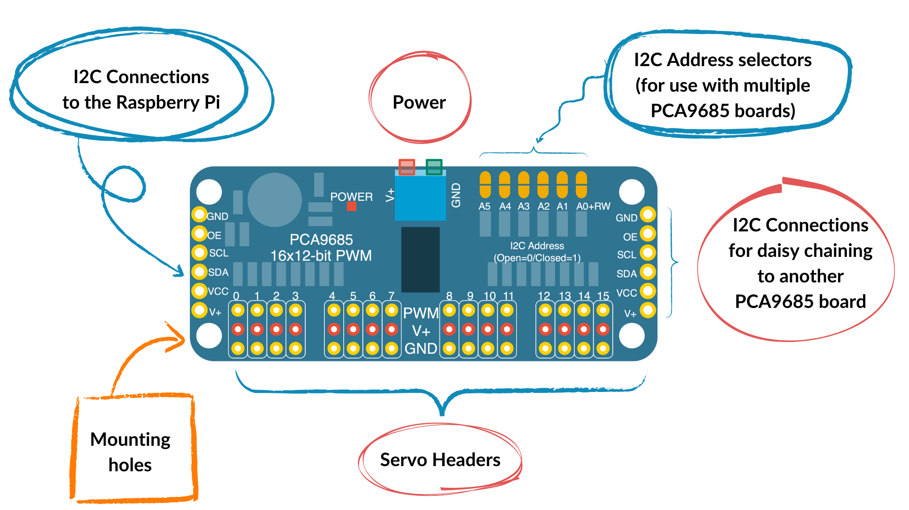
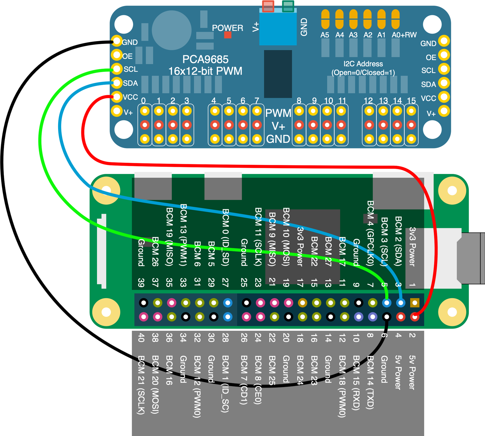

{:class="cover"}

---

By the end of this lesson you will be able to wire a PCA9685 to a Raspberry Pi, power the servos from their own supply, and turn a pulse length into a 12-bit count.

## What the PCA9685 does

{:class="w-100 img-fluid"}

The PCA9685 is a 16-channel, 12-bit PWM controller that you talk to over I2C. A servo needs a pulse repeated every 20 milliseconds, with the length of the pulse choosing the angle. Making those pulses is a timing job, and the PCA9685 does it in hardware, for all 16 channels at once, without the Pi doing anything once the numbers are set. Your Pi only sends a short message when you want a servo to move.

That is why it suits a robot arm: one board, two signal wires (SDA and SCL), and room for up to 16 servos. Buddy Jr uses four.

Look at the picture and find these parts:

- **I2C pins on the left** (GND, OE, SCL, SDA, VCC, V+): these connect to the Pi.
- **Screw terminal at the top** (V+ and GND): this is where the servo power goes in.
- **Servo headers along the bottom**, numbered 0 to 15. Each has three pins: PWM (signal), V+ and GND.
- **Address jumpers** (A0 to A5): the default address is 0x40, and these let you give extra boards a different address.
- **Matching pins on the right**: the same signals again, for chaining a second board.

## Two different power inputs

The board has two power connections and they are not interchangeable:

| Connection | What it powers | Where it comes from |
|---|---|---|
| `VCC` pin (on the I2C side) | The PCA9685 chip itself, and the I2C signals | The Pi's 3.3 V pin |
| `V+` screw terminal | The servos | A separate 5 V supply |
{:class="table table-single"}

Servos are motors. A small one can draw several hundred milliamps while it moves, and more if it is pushing against something. Four together will go far beyond what the Pi's pins can give, and a dip in voltage can reset the Pi. So the servos get their own supply, and only the ground is shared with the Pi so that both sides agree what "zero volts" means.

> **Teachers**: the servo supply is the one thing groups must not improvise. Use a proper 5 V adapter or battery pack that can give at least 2 A, wired to the screw terminal, never the Pi's 5 V or 3.3 V pins. Check polarity before switching on, because a reversed supply can damage the board. Label each supply with its voltage, and keep it unplugged while wiring.

## Wire it up

Power the Pi off before you connect anything. Use this table, which matches every program in the course:

| PCA9685 | Connects to | Raspberry Pi header pin |
|---|---|---|
| `GND` (I2C side) | Pi ground | 6 (GND) |
| `VCC` | The 3.3 V pin of the Pi | 1 (3.3V) |
| `SDA` | Pi SDA, GPIO 2 | 3 (SDA) |
| `SCL` | Pi SCL, GPIO 3 | 5 (SCL) |
| `V+` screw terminal | Servo supply positive (+5 V) | not connected to the Pi |
| `GND` screw terminal | Servo supply negative | not connected to the Pi |
{:class="table table-single"}

The photo below shows the same wiring. It was made with VCC on a 5 V pin; use pin 1 (3.3 V) as in the table instead, so the board's I2C pull-up resistors never put 5 V onto the Pi's pins.

{:class="img-fluid w-50"}

## From pulse to count

At 50 Hz the period is 1 / 50 seconds, which is 20 ms. The PCA9685 cuts each period into 4096 steps (that's what 12-bit means), so one step lasts 20 / 4096 ms, which is about 4.9 microseconds. To turn a pulse length into a count, use `count = pulse_ms / period_ms * 4096`.

For a 1.5 ms pulse: 1.5 / 20 * 4096 = 307.2, so we send 307. Save this as `pulse_maths.py`. It runs on any computer and prints the counts we'll use throughout the course.

```python
FREQ_HZ = 50
PERIOD_MS = 1000 / FREQ_HZ      # 20.0 ms
STEPS = 4096                    # 12-bit

print("Period:", PERIOD_MS, "ms; one step =", round(PERIOD_MS / STEPS * 1000, 2), "microseconds")

for pulse_ms in (0.5, 1.0, 1.5, 2.0, 2.5):
    count = round(pulse_ms / PERIOD_MS * STEPS)
    print("Pulse", pulse_ms, "ms ->", count, "counts out of", STEPS)
```

You'll see 102, 205, 307, 410 and 512. Most small servos sit in the middle at 1.5 ms, which is count 307.

## Say hello to the board

With the board wired (and the servos not yet plugged in), save this as `hello_pca.py`:

```python
from Adafruit_PCA9685 import PCA9685

# 0x40 is the default I2C address. busnum=1 is the Pi's header I2C bus.
pwm = PCA9685(address=0x40, busnum=1)
pwm.set_pwm_freq(50)      # 50 Hz: one pulse every 20 ms
print("PCA9685 is awake and running at about 50 Hz")
```

If it prints without an error, the Pi and the board are talking. Lesson 5 checks the connection properly and gets a servo moving.

## Try it Yourself

1. Change the list in `pulse_maths.py` to `(1.2, 1.7)` and predict the counts before you run it.
2. Change `FREQ_HZ` to 60. What is the new period, and what count does a 1.5 ms pulse need now?
3. Challenge: write a function `ms_to_count(pulse_ms, freq_hz)` and use it to print the count for a 1 ms pulse at 50 Hz and at 100 Hz.

## Common Issues

- **Problem**: `hello_pca.py` stops with an `OSError`, such as `Remote I/O error`
- **Solution**: Power off, then recheck SDA and SCL (pins 3 and 5) and make sure `VCC` and `GND` are connected
- **Why**: The Pi sent a message and nothing on the bus answered, so the board is not powered or the data wires are loose or swapped

- **Problem**: The Pi resets, or the servos twitch, when they move
- **Solution**: Power the servos from their own 5 V supply on the `V+` terminal
- **Why**: Moving servos pull a lot of current, which drags down the voltage the Pi runs on

## Check your understanding


? How long is one period at 50 Hz?
- [ ] 1.5 ms
- [x] 20 ms
- [ ] 50 ms
> 1 / 50 seconds is 0.02 seconds, which is 20 milliseconds.

? What count gives a 1.5 ms pulse at 50 Hz?
- [ ] 150
- [x] 307
- [ ] 1500
> 1.5 / 20 * 4096 = 307.2, rounded to 307.

? Where do the servos get their power?
- [ ] The Pi's 3.3 V pin, through VCC
- [x] A separate 5 V supply on the V+ screw terminal
- [ ] The SDA wire
> `VCC` only runs the chip. Servos draw too much current for the Pi, so they have their own supply and share only the ground.


Next, we'll prove the connection works and make a real servo move.
