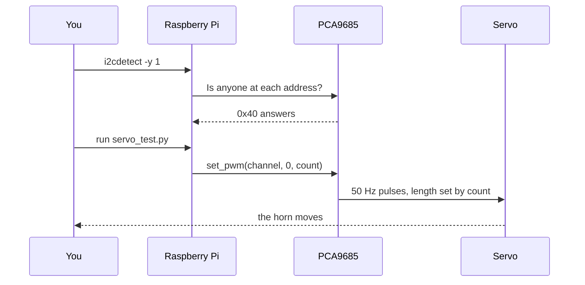

{:class="cover"}

---

By the end of this lesson you will be able to confirm the Pi can see the PCA9685, and move a servo to three positions from a Python program.

## Check before you move

Moving a servo is the fun part, but we'll check the connection first. If something is wrong, it is much easier to find with nothing else attached. The plan is to prove each link in the chain in order.



## What you need

- The Pi and PCA9685 wired as in the lesson 4 table, with I2C turned on (lesson 2)
- One servo
- The 5 V servo supply, wired to the `V+` and `GND` screw terminal, but switched off for now

## Step 1: can the Pi see the board?

Power on the Pi, open a terminal and run:

```bash
i2cdetect -y 1
```

You get a grid of addresses. The board shows up as `40`, because the default address is 0x40.

```text
     0  1  2  3  4  5  6  7  8  9  a  b  c  d  e  f
00:          -- -- -- -- -- -- -- -- -- -- -- -- --
10: -- -- -- -- -- -- -- -- -- -- -- -- -- -- -- --
20: -- -- -- -- -- -- -- -- -- -- -- -- -- -- -- --
30: -- -- -- -- -- -- -- -- -- -- -- -- -- -- -- --
40: 40 -- -- -- -- -- -- -- -- -- -- -- -- -- -- --
```

You may also see `70` in the grid. That's the board's all-call address, which it answers to as well, so it isn't a fault. If the grid is empty, jump to Common Issues before going further.

## Step 2: plug in a servo

With the servo supply **off**, plug a servo into channel 0. The plug has three wires: the signal wire (usually yellow or orange), the power wire (red) and ground (brown or black). Match them to the three rows on the header, labelled PWM, V+ and GND: signal to PWM, red to V+, brown or black to GND. Get it the wrong way round and nothing will move, so check against the picture on the board. Then switch the supply on.

## Step 3: move it

Save this as `servo_test.py` and run it with `python3 servo_test.py`. It sends three pulse lengths from lesson 4's table: 1.0 ms (count 205), 1.5 ms (307) and 2.0 ms (410).

```python
import time
from Adafruit_PCA9685 import PCA9685

pwm = PCA9685(busnum=1)
pwm.set_pwm_freq(50)          # one pulse every 20 ms

CHANNEL = 0
POSITIONS = [307, 205, 410, 307]    # centre, one end, other end, centre

for count in POSITIONS:
    print("Sending count", count)
    pwm.set_pwm(CHANNEL, 0, count)   # (channel, on-count, off-count)
    time.sleep(1)

pwm.set_pwm(CHANNEL, 0, 0)           # stop the pulses so the servo relaxes
print("Done")
```

`set_pwm(channel, on, off)` tells the chip to switch the output on at count `on` and off at count `off`, out of 4096. We always start at 0, so `off` is the pulse length in counts. The servo swings to the middle, one end, the other end and back to the middle.

**Why this matters:** every program in the rest of the course is built on that one call.

## Centre all four servos

Next lesson's assembly needs every servo set to its middle position before the horns go on. Save this as `centre.py`. Run it while the arm is being built:

```python
import time
from Adafruit_PCA9685 import PCA9685

pwm = PCA9685(busnum=1)
pwm.set_pwm_freq(50)

CENTRE = 307            # 1.5 ms at 50 Hz
for channel in range(4):   # base, shoulder, elbow, camera
    pwm.set_pwm(channel, 0, CENTRE)
    time.sleep(0.3)

print("Servos 0 to 3 are centred. Press Ctrl+C to stop.")
while True:
    time.sleep(1)       # keep the pulses coming so the servos hold still
```

## Try it Yourself

1. Add `102` or `512` to `POSITIONS` one at a time. Does the servo go further? Listen for a buzzing noise, which means it has hit its end stop, and stop at once if you hear it.
2. Plug a second servo into channel 1 and make both servos move together.
3. Challenge: make the servo sweep slowly from count 205 to 410 in steps of 5, with a short sleep after each step.

## Common Issues

- **Problem**: `i2cdetect -y 1` shows only dashes
- **Solution**: Check I2C is on (`sudo raspi-config`), SDA is on pin 3, SCL is on pin 5, and `VCC` and `GND` are connected
- **Why**: The Pi can only see the board when both data wires reach the right pins and the chip has power

- **Problem**: The grid shows `40`, but the servo doesn't move
- **Solution**: Switch the servo supply on, check the servo plug the right way round, and check the channel number
- **Why**: The chip is powered from `VCC`, but the servo only gets power from the `V+` terminal

- **Problem**: The servo buzzes or shakes at the ends of its travel
- **Solution**: Use counts closer to the middle, such as 205 to 410
- **Why**: Counts beyond the servo's real range push it against its stop, and it strains against it

## Check your understanding


? What address should `i2cdetect` show for the PCA9685 by default?
- [ ] 0x20
- [x] 0x40
- [ ] 0x68
> The PCA9685 defaults to 0x40, shown as `40` in the grid.

? In `pwm.set_pwm(0, 0, 307)`, what does 307 set?
- [ ] The channel
- [x] The count at which the pulse ends, out of 4096
- [ ] The angle in degrees
> `set_pwm(channel, on, off)`: the pulse starts at count 0 and ends at count 307, which is 1.5 ms at 50 Hz.

? The servo doesn't move but the board shows at 0x40. What should you check first?
- [ ] The Python version
- [x] That the servo supply is on and connected to V+
- [ ] The name of the file
> `VCC` powers only the chip. The servo is powered from `V+`.


> **Teachers**: keep the servo supply switched off while groups plug servos in, and check each group's plug orientation before it goes on. Ask groups to stop immediately if a servo buzzes, as a servo forced against its stop can overheat.

Your first servo is moving. Next: designing the arm it will live in.
