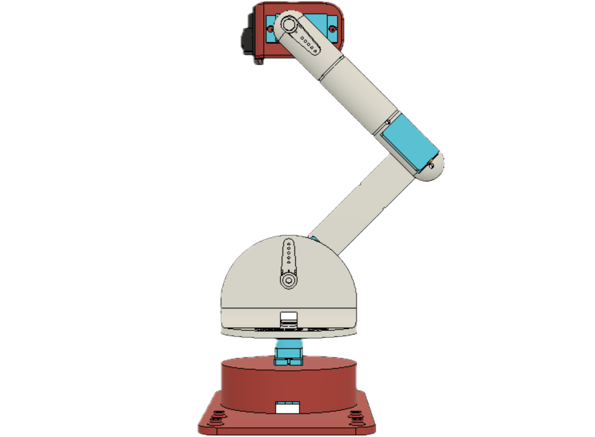
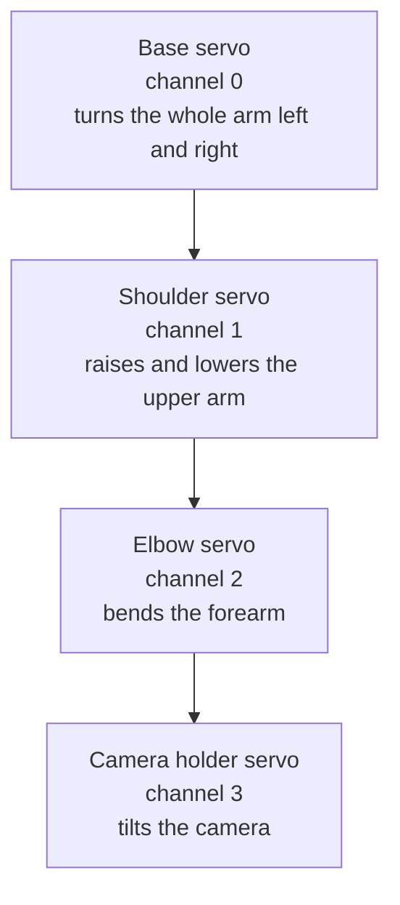
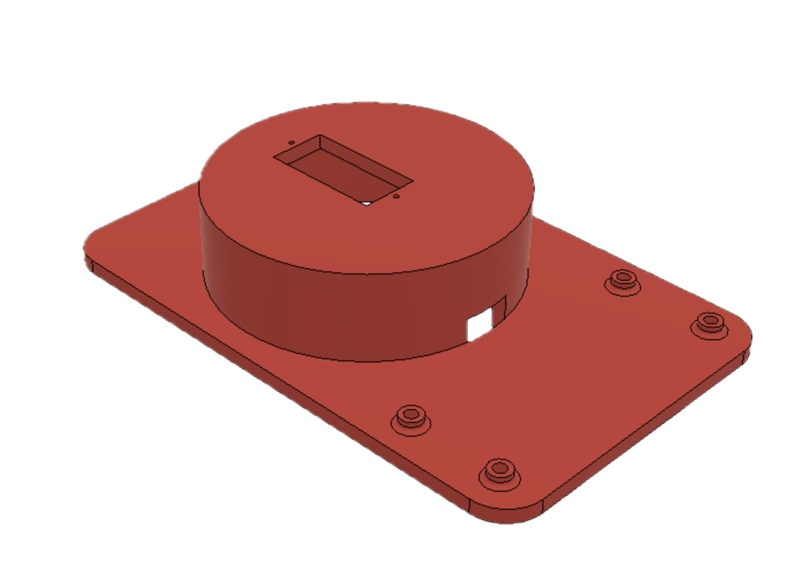
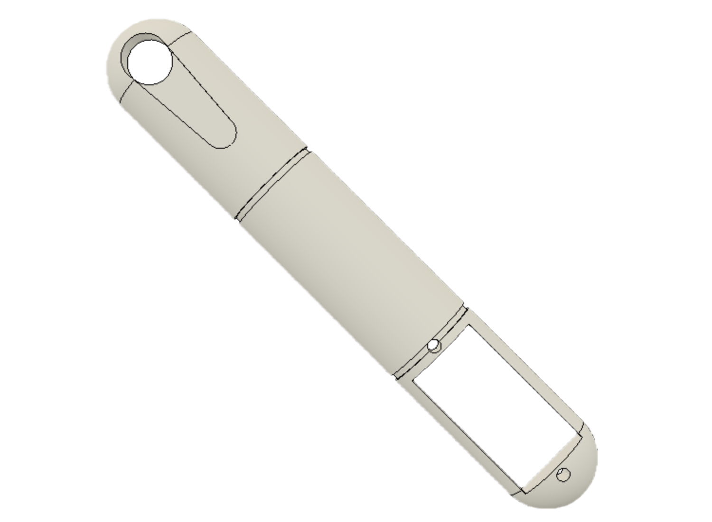

{:class="cover"}

---

By the end of this lesson you will be able to name the joints and printed parts of Buddy Jr, say which PCA9685 channel drives each one, and calculate how far the arm can reach.

## Design starts with what the arm must do

A robot arm is a chain of joints, and each joint is a servo. Before choosing parts, a designer asks three questions: how much must it lift, how far must it reach, and how precisely must it move?

Buddy Jr's answers are modest on purpose. It carries only a small camera, so we can use cheap SG90 micro servos, print light parts and keep the arm simple. Small servos have small torque (twisting force), so every gram of arm hanging out at the end makes the shoulder and elbow work harder. Light and short wins.

{:class="img-fluid w-50"}

## The four joints



Each joint moves everything that hangs below it in the chain, which is why the base is the strongest joint and the camera holder the lightest. We'll use these channel numbers for every program from now on. If you wire your servos differently, change the numbers in one place when we reach lesson 8.

## The printed parts

Buddy Jr's parts are 3D printed. The files are on the [Buddy Jr page](/blog/buddy_jr.html), and the pictures here show what they look like.

| Part | How many | What it does |
|---|---|---|
| Base | 1 | A flat plate with a round housing; holds the base servo and has space for the PCA9685 |
| Shoulder (or the older pivot) | 1 | A curved upright that sits on the base servo and holds the shoulder servo |
| Arm | 2 | The upper arm and the forearm, each with room for a servo |
| Camera holder | 1 | An L-shaped bracket for a Raspberry Pi camera module, moved by the last servo |
{:class="table table-single"}

There are two base designs, v1 and v2, and a shoulder that replaces the older pivot. Use whichever matches the files you downloaded, because the steps are the same.

{:class="img-fluid w-50"}
{:class="img-fluid w-50"}

## Work out the reach

An arm's reach is how far the tip can get from the base. With the arm fully stretched out, it is the length of the upper arm plus the forearm. Kev's code for Buddy Jr treats both as 80 units long, so the full reach is 160 units. You can check what happens when you change the design with a short program. Save it as `reach.py`; it runs on any computer.

```python
UPPER_ARM = 80      # length of the upper arm, in the same units as below
FOREARM = 80        # length of the forearm

max_reach = UPPER_ARM + FOREARM
min_reach = abs(UPPER_ARM - FOREARM)   # fully folded back on itself

print("Maximum reach:", max_reach)
print("Minimum reach:", min_reach)

# What happens if we print a longer forearm?
for forearm in (60, 80, 100, 120):
    print("Forearm", forearm, "-> reach", UPPER_ARM + forearm)
```

**Why this matters:** a longer arm reaches further, but the servo at the shoulder then has to hold a longer lever. Doubling the length of the arm roughly doubles the twisting force the shoulder needs to hold it level. That is the trade-off every arm designer makes.

## Tools and materials

You'll need a 3D printer (or a friend with one), a small cross-head screwdriver, the screws that come with the servos, and time to clean up the prints. No soldering is needed for this build, as everything plugs into the PCA9685 with the servos' own connectors.

> **Teachers**: the parts are quick to print, but plan the printer time well in advance for a class, as one set needs a printer for a while. Printed parts can be shared between groups if you print a few sets in advance. Check your school's rules on 3D printers and supervise the removal of parts from the print bed. If you have no printer, lesson 6 still works as a design exercise, and the learners can finish the build using the same servos on a cardboard or craft-stick arm.

## Try it Yourself

1. Sketch Buddy Jr from the front and mark each joint with its servo channel.
2. Change `FOREARM` in `reach.py` to 50 and predict the minimum and maximum reach before you run it.
3. Challenge: design a different end for the arm, such as a pen holder. Which of the four joints would it load most, and why?

## Common Issues

- **Problem**: A printed part doesn't fit the servo
- **Solution**: Check the part is the right version (v1 or v2) and that the servo is a 9 g SG90 style. Lightly sand the edges of the slot, a little at a time
- **Why**: Printers vary slightly in size, and a tight fit is better than a loose one that you then have to fix

- **Problem**: The arm droops when it is stretched out
- **Solution**: Keep the load light, shorten the arm, or add a counterweight on the other side of the shoulder
- **Why**: A long arm acts like a lever, so the shoulder servo has to supply more twisting force than a small SG90 has

## Check your understanding


? Which channel drives the shoulder joint in this course?
- [ ] 0
- [x] 1
- [ ] 3
> The base is channel 0, the shoulder is channel 1, the elbow is channel 2 and the camera holder is channel 3.

? What is the maximum reach of an arm with a forearm of 80 and an upper arm of 80?
- [ ] 80
- [x] 160
- [ ] 0
> Fully stretched out, the reach is the two lengths added together.

? Why keep the arm light?
- [x] Small servos have little torque, so extra weight makes the shoulder and elbow struggle
- [ ] Light parts print faster than heavy ones, which is the only reason
- [ ] The PCA9685 can only drive light loads
> A small servo's torque is limited, and weight far from the joint multiplies the load.


Time to pick up the screwdriver. Next lesson, we put Buddy Jr together.
