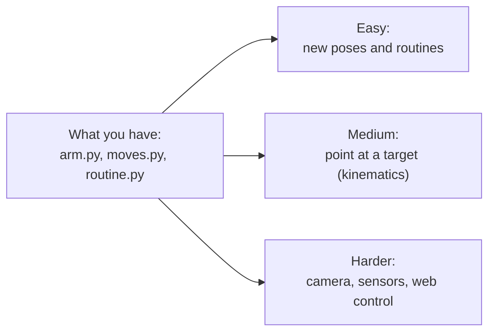

{:class="cover"}

---

By the end of this lesson you will be able to choose a next project for your arm, and use the law of cosines to turn a target point into shoulder and elbow angles.

## You have a working arm, what now?

You can move four joints by name, glide between poses and run a routine. Every project below builds on exactly those pieces. We've sorted them by how much new you'll need to learn, so pick the one that makes you grin.



## Easy: more poses and routines

- **Greeter**: a wave and a nod when you press a key, using only `moves.py`.
- **Desk lamp**: fit a small light to the camera holder and aim it with named poses such as `READ` and `RELAX`.
- **Puppet show**: write a sequence of poses to the beat of a song, and tweak the `steps` of each move to match the rhythm.

## Medium: point at a target

So far you chose angles. A more natural way to talk to an arm is to say "go to this point" and let the code find the angles. This is called **inverse kinematics**, and for an arm with two links in a plane, the law of cosines is all you need. Kev's Buddy Jr code uses this idea, with both links 80 units long.

Save this as `kinematics.py`. It runs on any computer.

```python
import math

UPPER_ARM = 80.0     # same units as x and y
FOREARM = 80.0


def solve(x, y):
    """Return (shoulder, elbow) angles in degrees to put the tip at (x, y),
    or None if the point is out of reach.

    x is how far out from the base, y is how high.
    shoulder is measured up from horizontal; elbow is the angle between the arms.
    """
    d = math.hypot(x, y)                       # straight-line distance to the target
    if d > UPPER_ARM + FOREARM or d < abs(UPPER_ARM - FOREARM) or d == 0:
        return None                            # too far, too close, or at the base

    # Law of cosines: cos(angle) = (a*a + b*b - c*c) / (2*a*b)
    cos_elbow = (UPPER_ARM**2 + FOREARM**2 - d**2) / (2 * UPPER_ARM * FOREARM)
    cos_inner = (UPPER_ARM**2 + d**2 - FOREARM**2) / (2 * UPPER_ARM * d)

    elbow = math.degrees(math.acos(cos_elbow))
    shoulder = math.degrees(math.atan2(y, x) + math.acos(cos_inner))
    return shoulder, elbow


for point in [(160, 0), (80, 80), (100, 40), (200, 0)]:
    result = solve(*point)
    if result is None:
        print(point, "is out of reach")
    else:
        print(point, "-> shoulder %.1f, elbow %.1f" % result)
```

You should see `(160, 0)` give a shoulder of 0 and an elbow of 180 (a fully stretched arm), `(80, 80)` give 90 and 90, and `(200, 0)` reported as out of reach.

**Why this matters:** the angles that come out are the geometry of the arm, not servo angles. To drive the real servos, you still have to map them onto the angles you found when you calibrated each joint in lesson 8. That mapping is yours to work out, and it is a great exercise.

**Common mistake:** asking for a point the arm can't reach. The check at the top of `solve` stops a `math domain error` from `acos`.

## Harder: bring in the world

- **Camera watcher**: Buddy Jr has a holder for a Raspberry Pi camera module. Show the picture on your screen and tilt the camera holder to follow it.
- **Button or sensor control**: replace the keyboard `input()` in `routine.py` with a button or distance sensor, and let the reading choose the pose.
- **Web control**: put sliders in a web page that call `set_angle`. You'll need a web framework such as Flask or FastAPI, which is a project in itself.
- **A newer library**: Kev's latest Buddy Jr code on GitHub uses Adafruit's ServoKit library, which has an `angle` setting built in. Our `arm.py` is a good way to learn what such a library does for you before you switch.

## Try it Yourself

1. Add three more points to the list in `kinematics.py` and predict which will be out of reach before you run it.
2. Change `FOREARM` to 60 and work out by hand the maximum reach, then check it with a point on the edge.
3. Challenge: write a `goto(x, y)` function that calls `solve`, maps the angles to your servos and calls `move_to`. Add a safety check so it does nothing if the point is out of reach.

## Common Issues

- **Problem**: `ValueError: math domain error`
- **Solution**: Check the distance is within the arm's reach before calling `acos`, as `solve` does
- **Why**: `acos` only accepts values between -1 and 1, and an unreachable target produces a value outside that range

- **Problem**: The solved angles move the arm to the wrong place
- **Solution**: Check how your servo angles map onto the geometry, including which way each servo turns
- **Why**: The maths gives geometric angles. Your horns and servos might be mounted the other way round

## Check your understanding


? What does inverse kinematics do?
- [ ] Reverses the direction of a servo
- [x] Works out joint angles from a target point
- [ ] Makes the PCA9685 faster
> You give it where you want the tip to be, and it gives you the angles that put it there.

? Which point can an arm with two 80-unit links not reach?
- [ ] (80, 80)
- [ ] (160, 0)
- [x] (200, 0)
> The most it can reach is 80 + 80 = 160, and 200 is further than that.

? Why does `solve` return the angles of the arm's geometry rather than servo angles?
- [x] Servo angles depend on how your horns are mounted, so you map them yourself
- [ ] Servos don't use angles
- [ ] The law of cosines only gives servo angles
> The calculation knows the lengths, not how the servos are fitted to your build.


Pick one idea, sketch it and get building. Last stop: what to do when things go wrong.
