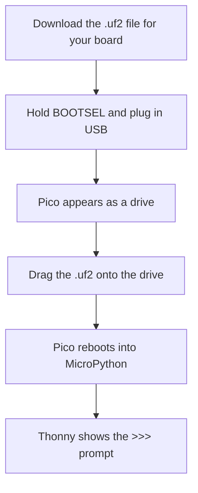

{:class="cover"}

---

By the end of this lesson you will be able to download the right MicroPython firmware for your board, copy it onto the Pico and check it is running.

A brand-new Pico has no Python on it. MicroPython is a small version of Python built for microcontrollers, and it is installed as **firmware**: one file that you copy onto the Pico. After that, the Pico understands Python and you can send it programs from Thonny. You only do this once per board.



---

## Step 1: Download MicroPython firmware

Each board needs its own firmware, so check which Pico you have first. The name of the board is printed on its back, and a Pico W also has a small silver Wi-Fi module at one end.

1. Visit the official MicroPython download page for your board:
   - Raspberry Pi Pico: [micropython.org/download/RPI_PICO](https://micropython.org/download/RPI_PICO/)
   - Raspberry Pi Pico W: [micropython.org/download/RPI_PICO_W](https://micropython.org/download/RPI_PICO_W/)
   - Raspberry Pi Pico 2: [micropython.org/download/RPI_PICO2](https://micropython.org/download/RPI_PICO2/)
2. Download the latest stable `.uf2` firmware file (not a preview build).

---

## Step 2: Enter bootloader mode

1. Hold down the **BOOTSEL** button on your Pico.
2. While holding the button, connect the Pico to your computer using a USB cable.
3. Let go of the button. The Pico appears as a removable storage device called `RPI-RP2` (`RP2350` on a Pico 2).

---

## Step 3: Flash the firmware

1. Drag and drop the downloaded `.uf2` file onto the Pico's drive.
2. The Pico copies the firmware, reboots, and the drive disappears. That is normal: the Pico is now running MicroPython and shows up as a serial port instead of a drive.

---

## Step 4: Verify the installation

1. Open Thonny and select **MicroPython (RP2040)** in the interpreter settings (called **MicroPython (Raspberry Pi Pico)** in older versions of Thonny).
2. You should see a `>>>` prompt in Thonny's Shell. Type this and press Enter:

   ```python
   print("MicroPython is ready!")
   ```

3. You should see the message appear straight away. The Shell is a live conversation with the Pico: each line you type runs immediately.

Congratulations, MicroPython is now installed. Every program in the rest of the course runs on this firmware.

> **Teachers**: set the firmware up once for the whole class. Download the three `.uf2` files in advance and put them on a shared drive, as downloads can be slow or blocked on school networks. If a class has a mix of Pico, Pico W and Pico 2 boards, label them, because the wrong firmware will not run properly. A Pico with MicroPython already installed can be reused for the next class without repeating this lesson.

---

## Try it Yourself

1. In the Shell, type `2 + 3` and press Enter. MicroPython prints the answer without needing `print()`.
2. Type `import sys` then `sys.implementation` to see which MicroPython version and board you have.
3. Challenge: type `import machine` then `machine.freq()`. It prints the processor speed in hertz. Can you work out how many millions of cycles per second that is?

## Common Issues

- **Problem**: No `RPI-RP2` drive appears when you plug in the Pico.
- **Solution**: Unplug, hold BOOTSEL first, then plug in and keep holding for a second or two.
- **Why**: The Pico only enters bootloader mode if BOOTSEL is held as it powers up.

- **Problem**: The drive is still there after copying, and there is no `>>>` prompt.
- **Solution**: Check the file you copied ends in `.uf2` and matches your board. Download it again if you are not sure.
- **Why**: A web page or a partly downloaded file will not install, and the drive stays in bootloader mode until valid firmware arrives.

- **Problem**: The Pico W firmware was installed on a Pico, or the other way round.
- **Solution**: Repeat the steps with the correct file. Installing again simply replaces the old firmware.
- **Why**: The two boards have different hardware, so each needs its own build.

## Check your understanding


? What file type is the MicroPython firmware you copy to the Pico?
- [ ] `.py`
- [x] `.uf2`
- [ ] `.exe`
> The `.uf2` file is the format the Pico's bootloader accepts when it appears as a drive.

? What does it mean when the `RPI-RP2` drive vanishes after you copy the file?
- [ ] The copy failed
- [x] The Pico rebooted into MicroPython and is now a serial port
- [ ] The Pico has been erased
> The drive only exists in bootloader mode. Once the firmware is installed the board restarts and the drive goes away.

? Why do the three Pico boards use different firmware files?
- [ ] They use different Python syntax
- [x] They have different hardware, so each needs its own build
> The Pico, Pico W and Pico 2 differ in their chips and Wi-Fi hardware.

