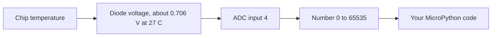

{:class="cover"}

---

By the end of this lesson you will be able to explain where the temperature sensor is, how an ADC turns a voltage into a number, and why the readings are rough rather than exact.

Most sensors need wires, a breadboard and a handful of components. This one needs none, because it is built into the Pico's microcontroller chip: the RP2040 on the Pico and Pico W, and the RP2350 on the Pico 2. That makes it the friendliest sensor you will ever meet, and a great way to learn how a computer measures the real world.

---

## How the temperature sensor works

1. It measures the temperature of the chip itself, not the air around it. The chip warms up a little when it is busy, so readings are usually a few degrees above room temperature.
2. The sensor is a tiny diode whose voltage drops as it gets warmer: about 0.706 V at 27°C, falling by about 1.721 mV for every degree Celsius.
3. That voltage is fed to the ADC's fifth input, channel 4, which is why you will see `machine.ADC(4)` in the code.
4. The ADC turns the voltage into a number, and a formula turns the number back into degrees Celsius. We write that formula in the next two lessons.

**Real-world robot example:** a robot with a motor driver and a Pico inside a closed case can get warm. Reading the chip temperature lets the robot slow down or switch a fan on before anything overheats, with no extra parts.

## Understanding the ADC

An ADC (analogue-to-digital converter) measures a voltage and gives back a whole number. Think of it as a ruler with very fine markings.

| Channel | What it reads |
| --- | --- |
| 0 | Pin GP26 |
| 1 | Pin GP27 |
| 2 | Pin GP28 |
| 4 | The internal temperature sensor |
{:class="table table-single"}

- The ADC itself is 12-bit, so it really measures 4,096 steps (0 to 4095). MicroPython's `read_u16()` scales that up to the range 0 to 65535, so your code works the same way on boards with different ADCs.
- The full range represents 0 V to about 3.3 V. Each real 12-bit step is about 0.8 mV, which is roughly half a degree Celsius for this sensor. Expect readings to move in small jumps rather than smoothly.
- The sensor is not very precise: treat a single reading as accurate to within a few degrees. Later lessons show how to smooth and calibrate it.

**Common mistakes:**

- Looking for a pin to connect to. Channel 4 is inside the chip, so there is no pin and no wiring.
- Expecting the room temperature. You get the chip's temperature, so it reads a little warm.
- Using `read()` instead of `read_u16()`. On MicroPython the method is `read_u16()`.

## Preparing for the next lesson

In the next lesson we write a script to read the raw numbers from the sensor and show them in the Thonny Shell. Make sure your Pico is running MicroPython and Thonny shows the `>>>` prompt.

> **Teachers**: this lesson is mostly explanation and needs no hardware, so it works well as a discussion or a short unplugged activity. Ask learners to guess the temperature of the chip compared with the room, then check their guesses in the next lesson. The "chip, not room" idea is the key point to land.

---

## Try it Yourself

1. Type `import machine` in the Shell, then `machine.ADC(4)`. What does the Pico print back? That is the ADC object you will use in the next lesson.
2. Work out how many volts one 12-bit step is: divide 3.3 by 4095. Does it match the figure of about 0.8 mV above?
3. Challenge: the sensor changes by 1.721 mV per degree, and a step is about 0.8 mV. How many degrees is one step? Compare your answer with the "roughly half a degree" in the lesson.

## Common Issues

- **Problem**: You cannot find a pin for the temperature sensor.
- **Solution**: Use `machine.ADC(4)`. Channel 4 is internal.
- **Why**: The sensor is part of the chip, so it is connected to the ADC inside it and not to a pin on the board.

- **Problem**: `machine.ADC(4)` raises an error on your board.
- **Solution**: Check Thonny shows the MicroPython interpreter and reinstall the firmware for your board if needed.
- **Why**: The code is only valid when it runs on the Pico's MicroPython, not on your computer's Python.

## Check your understanding


? Which ADC channel is the built-in temperature sensor?
- [ ] 0
- [ ] 2
- [x] 4
> Channels 0 to 2 are the pins GP26 to GP28. Channel 4 is the internal sensor.

? What does the sensor actually measure?
- [ ] The temperature of the air in the room
- [x] The temperature of the chip itself
- [ ] The temperature of the USB cable
> It is a diode inside the chip, so it reports the chip's own temperature, which is usually a few degrees above the room.

? Why do readings move in small jumps instead of smoothly?
- [ ] The Pico is broken
- [x] The ADC works in coarse steps, about half a degree each
- [ ] The formula is wrong
> The 12-bit ADC has 4,096 steps, and one step is about half a degree for this sensor.

