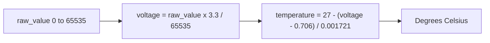

{:class="cover"}

---

By the end of this lesson you will be able to convert a raw ADC reading into a voltage, and the voltage into degrees Celsius, in a MicroPython program.

Raw numbers like 14018 are not much use to a person. Nobody says "it's 14018 in here". Let's turn the number into degrees Celsius using the same formula the chip's designers publish in the RP2040 datasheet.



---

## The conversion formula

The conversion happens in two steps.

First, turn the raw reading into a voltage. `read_u16()` gives a number from 0 to 65535 that covers 0 V to 3.3 V:

```python
voltage = raw_value * 3.3 / 65535
```
{: .no-snakie }

Second, turn the voltage into a temperature with the formula from the RP2040 datasheet:

```python
temperature = 27 - (voltage - 0.706) / 0.001721
```
{: .no-snakie }

Note that the second formula uses the **voltage**, not the raw ADC value. Putting `raw_value` straight into it gives a nonsense answer of about minus eight million degrees.

**Worked example:** a raw reading of 14018 gives a voltage of 14018 x 3.3 / 65535, which is about 0.706 V. At 0.706 V the formula gives 27 - 0 = 27°C. Warmer chips give a lower voltage, so the answer goes above 27.

## Step 1: Updating your script

Modify your previous script to include the temperature calculation:

```python
import machine
import time

# Initialize the ADC for the temperature sensor
sensor_adc = machine.ADC(4)

while True:
    # Read the raw ADC value
    raw_value = sensor_adc.read_u16()

    # Convert the ADC value to voltage
    voltage = raw_value * 3.3 / 65535

    # Convert voltage to temperature
    temperature = 27 - (voltage - 0.706) / 0.001721

    print(f"Temperature: {temperature:.2f}°C")
    time.sleep(1)
```

The `:.2f` inside the curly braces is a format code. It means "show this number with two decimal places". Without it you would see a long string of digits.

## Step 2: Running the script

1. Save the updated script as `read_temp_with_conversion.py`.
2. Run the script in Thonny.
3. Observe the temperature readings displayed in degrees Celsius.

Expect a value a few degrees above room temperature, for example 24 to 30°C in a warm room. Now touch the chip and watch it climb.

**Why this matters:** this "read, convert to voltage, convert to units" pattern is how nearly every analogue sensor works, whether it measures temperature, light or distance.

**Common mistakes:**

- Skipping the voltage step and feeding `raw_value` straight into the temperature formula.
- Dividing by 65536 or 4095 instead of 65535. The divisor must match `read_u16()`.
- Mixing up the sign. The sensor's voltage falls as it warms, so the formula subtracts.

## What you've learned

- How to use the conversion formula to calculate temperature.
- How to display formatted output in the console.

---

## Try it Yourself

1. Print the `voltage` as well, using `{voltage:.3f}`, so you can see it hover around 0.7 V.
2. Show the temperature in Fahrenheit as well. The formula is `temperature * 9 / 5 + 32`.
3. Challenge: keep track of the highest temperature seen since the program started and print it every loop.

## Common Issues

- **Problem**: The temperature is something like -8,000,000.
- **Solution**: Convert to voltage first and pass `voltage` into the formula, not `raw_value`.
- **Why**: The formula expects a voltage near 0.7 V. A raw number in the thousands blows the result up.

- **Problem**: The reading is much higher than the room, for example 35°C.
- **Solution**: Let the Pico run for a minute, keep your finger off the chip, and compare against a thermometer.
- **Why**: The sensor reads the chip, which warms itself and is a few degrees above the air.

- **Problem**: The `°` symbol shows as a strange character.
- **Solution**: Replace `°C` with `C` in the print line.
- **Why**: Some consoles and fonts do not draw the degree sign correctly.

## Check your understanding


? What must you pass into the temperature formula?
- [ ] The raw ADC value
- [x] The voltage
- [ ] The number of seconds
> The formula expects a voltage near 0.706 V. Passing the raw value gives nonsense.

? What voltage does the sensor give at 27°C?
- [ ] 3.3 V
- [x] About 0.706 V
- [ ] 0 V
> The datasheet formula is anchored at 0.706 V for 27°C.

? What does `{temperature:.2f}` do in an f-string?
- [ ] Rounds to the nearest whole number
- [x] Shows the number with two decimal places
- [ ] Multiplies by two
> `.2f` is a format code for a float with two digits after the decimal point.

