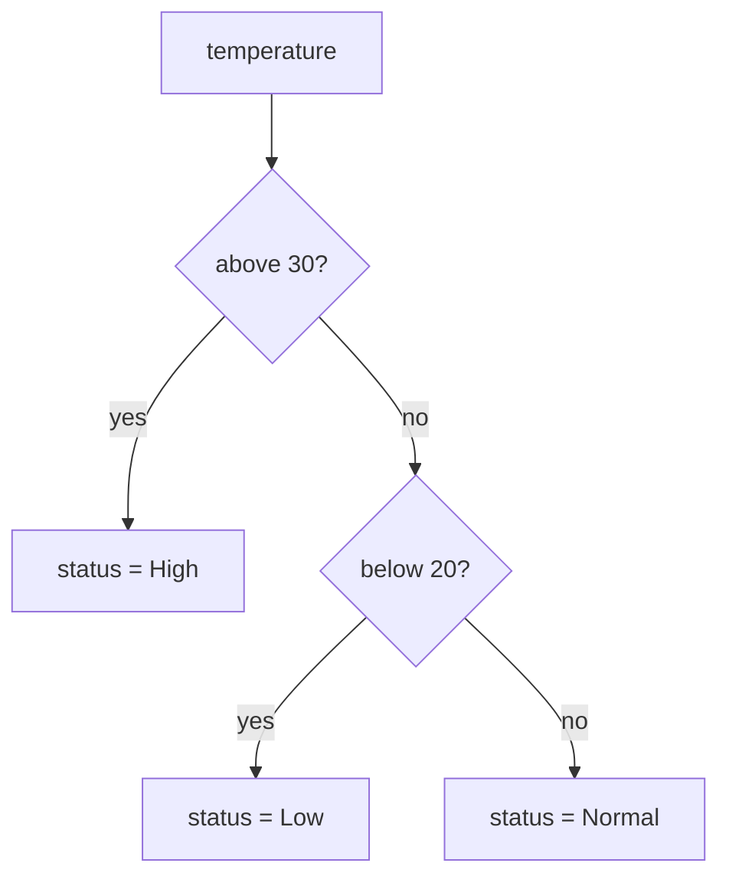

{:class="cover"}

---

By the end of this lesson you will be able to label readings with a status such as Low, Normal or High using `if`, `elif` and `else`, and separate readings with a divider line.

Now that the Pico can tell us the temperature, let's make it tell us what it *means*. Instead of "29.8", we want "29.8, Normal". Adding a status is the first step towards a machine that makes decisions, and it uses one of the most important ideas in programming: choosing between options.



---

## Step 1: Adding visual separators

To make the output easier to read, add a simple separator line. `"-" * 30` repeats the dash 30 times:

```python
print("-" * 30)
```
{: .no-snakie }

Here is the whole program with the separator:

```python
import machine
import time

# Initialize the ADC for the temperature sensor
sensor_adc = machine.ADC(4)

while True:
    # Read the raw ADC value
    raw_value = sensor_adc.read_u16()

    # Convert the ADC value to voltage
    voltage = raw_value * 3.3 / 65535

    # Convert voltage to temperature
    temperature = 27 - (voltage - 0.706) / 0.001721

    # Get the current time (a tuple in MicroPython)
    timestamp = time.localtime()

    # Print formatted output
    print(f"Time: {timestamp[3]:02}:{timestamp[4]:02}:{timestamp[5]:02}")
    print(f"Temperature: {temperature:.2f}°C")
    print("-" * 30)
    time.sleep(1)
```

## Step 2: Conditional formatting for temperature ranges

You can describe specific temperature ranges by adding a status to the output. Python checks each condition from the top and uses the first one that is true:

```python
if temperature > 30:
    status = "High"
elif temperature < 20:
    status = "Low"
else:
    status = "Normal"
```
{: .no-snakie }

Here is the complete script with the status added:

```python
import machine
import time

# Initialize the ADC for the temperature sensor
sensor_adc = machine.ADC(4)

while True:
    # Read the raw ADC value
    raw_value = sensor_adc.read_u16()

    # Convert the ADC value to voltage
    voltage = raw_value * 3.3 / 65535

    # Convert voltage to temperature
    temperature = 27 - (voltage - 0.706) / 0.001721

    # Determine the status
    if temperature > 30:
        status = "High"
    elif temperature < 20:
        status = "Low"
    else:
        status = "Normal"

    # Get the current time (a tuple in MicroPython)
    timestamp = time.localtime()

    # Print formatted output with status
    print(f"Time: {timestamp[3]:02}:{timestamp[4]:02}:{timestamp[5]:02}")
    print(f"Temperature: {temperature:.2f}°C - Status: {status}")
    print("-" * 30)
    time.sleep(1)
```

## Step 3: Testing the enhanced script

1. Save the updated script as `enhanced_temp_readings.py`.
2. Run the script in Thonny.
3. Watch how the status changes with the temperature.

## Example output

```raw
Time: 15:34:21
Temperature: 29.80°C - Status: Normal
------------------------------
Time: 15:34:22
Temperature: 30.27°C - Status: High
------------------------------
```

Tip: the chip warms up quickly if you hold a finger on it, which is an easy way to see the status change to **High**.

**Why this matters:** a status word is what lets another part of the program, or a person glancing at a screen, act without doing any maths.

**Common mistakes:**

- Writing `if temperature > 30:` without the colon, or with the wrong indentation, which raises a `SyntaxError` or `IndentationError`.
- Using `=` where you meant a comparison. `=` stores a value, while `>` and `<` compare.
- Putting the `else` branch before the others. Python checks from the top, so the order matters.

## What you've learned

- How to use separators and labels for better readability.
- How to use `if`, `elif` and `else` to choose a status.
- How to present clean, user-friendly output.

---

## Try it Yourself

1. Change the limits to 28 and 22 so the status flips more easily in your room.
2. Add a fourth status, `"Hot"`, for readings above 35, using another `elif` in the right place.
3. Challenge: make the separator line change character with the status, for example `"!" * 30` when it is High.

## Common Issues

- **Problem**: `IndentationError: unexpected indent` or `expected an indented block`.
- **Solution**: Line up the statements under each `if`, `elif` and `else` with four spaces.
- **Why**: Python uses indentation, not brackets, to decide which lines belong to which branch.

- **Problem**: The status is always `Normal`, even when you warm the chip.
- **Solution**: Print the temperature and compare it with your limits, then adjust the limits. The chip may simply not have reached 30.
- **Why**: Many rooms are cooler than the default limits, and the chip is only a few degrees above the air.

- **Problem**: `NameError: name 'status' isn't defined`.
- **Solution**: Make sure every branch, including `else`, sets `status` before you print it.
- **Why**: A variable only exists once something has given it a value.

## Check your understanding


? What does `"-" * 30` produce?
- [ ] The number negative 30
- [x] A line of 30 dash characters
- [ ] An error
> Multiplying a string repeats it, so this gives 30 dashes in a row.

? A reading is 25°C and the code uses `> 30`, `< 20`, `else`. What is the status?
- [ ] High
- [ ] Low
- [x] Normal
> 25 is not above 30 and not below 20, so it falls through to `else`.

? Why does the order of `if` and `elif` branches matter?
- [ ] It does not matter
- [x] Python uses the first condition that is true
- [ ] Python always runs the last branch
> Once a branch matches, Python skips the rest, so an earlier, broader condition can hide a later one.

