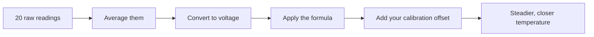

{:class="cover"}

---

By the end of this lesson you will be able to explain each number in the temperature formula, average several readings to smooth them, and calibrate your Pico against a thermometer.

You already have a script that converts the Pico's ADC readings into degrees Celsius. In this lesson you'll look more closely at that formula, find out why the readings jump around and are often a few degrees out, and make them steadier and more accurate.



---

## Step 1: Understanding the Conversion Formula

The built-in sensor produces a small voltage that changes with the chip's temperature. The ADC measures that voltage, and this formula from the RP2040 datasheet turns it into degrees Celsius:

```python
temperature = 27 - (voltage - 0.706) / 0.001721
```
{: .no-snakie }

### Explanation:

- `0.706` is the sensor's typical output voltage, in volts, when the chip is at 27°C.
- `27` is that reference temperature, in degrees Celsius.
- `0.001721` is how much the voltage changes for each degree: 1.721 mV per °C.
- The sensor's voltage **falls** as the chip warms up, which is why the formula subtracts. A voltage below 0.706 V means warmer than 27°C, and one above means cooler.

These are *typical* values. Every chip is slightly different, so two Picos side by side can disagree by a few degrees.

---

## Step 2: Why the Readings Are Not Perfect

There are three main reasons your readings may be noisy or a little off:

1. **It's the chip's temperature, not the room's.** The chip warms itself while it runs, so readings are usually a few degrees above the air around it.
2. **The steps are coarse.** The ADC is 12-bit, so each step is about 0.8 mV, which is roughly 0.47°C. Readings jump in steps of about half a degree, and the last digit of `{temperature:.2f}` is not meaningful.
3. **The 3.3 V reference is not exact.** The formula assumes the ADC's reference is exactly 3.3 V. On the Pico it comes from the board's 3.3 V supply, which can be a little high or low and has some electrical noise on it. Because the sensor's voltage changes by less than 2 mV per degree, an error of just 1% in the reference shifts the result by about 4°C.

---

## Step 3: Smoothing the Readings

Taking several readings and averaging them removes most of the jitter:

```python
import machine
import time

# Initialize the ADC for the temperature sensor
sensor_adc = machine.ADC(4)

SAMPLES = 20  # number of readings to average

def read_temperature():
    total = 0
    for _ in range(SAMPLES):
        total += sensor_adc.read_u16()
    raw_value = total / SAMPLES

    # Convert the average ADC value to voltage
    voltage = raw_value * 3.3 / 65535

    # Convert voltage to temperature
    return 27 - (voltage - 0.706) / 0.001721

while True:
    temperature = read_temperature()
    print(f"Temperature: {temperature:.1f}°C")
    time.sleep(1)
```

Printing one decimal place (`.1f`) is more honest than two, given how coarse the sensor is.

---

## Step 4: Calibrating Against a Thermometer

To correct the offset for *your* Pico:

1. Leave the Pico running in a room with a thermometer you trust for a few minutes so the chip settles.
2. Note the difference between the thermometer and the Pico. If the thermometer says 21.0°C and the Pico says 23.4°C, the offset is `21.0 - 23.4 = -2.4`.
3. Add that offset to every reading:

```python
import machine
import time

sensor_adc = machine.ADC(4)

SAMPLES = 20
OFFSET = -2.4  # thermometer reading minus Pico reading, for your Pico

def read_temperature():
    total = 0
    for _ in range(SAMPLES):
        total += sensor_adc.read_u16()
    voltage = (total / SAMPLES) * 3.3 / 65535
    return 27 - (voltage - 0.706) / 0.001721 + OFFSET

while True:
    print(f"Temperature: {read_temperature():.1f}°C")
    time.sleep(1)
```

The offset is only valid for the Pico you measured it on, and works best close to the temperature where you measured it.

---

## Step 5: Running the script

1. Save the script as `convert_adc_to_temp.py`.
2. Run the script in Thonny.
3. Compare the steadier readings with the ones from your earlier script.

Example output:

```raw
Temperature: 21.2°C
Temperature: 21.0°C
Temperature: 21.2°C
```

**Common mistakes:**

- Setting `OFFSET` the wrong way round. It is the thermometer reading **minus** the Pico reading.
- Calibrating while your finger is on the chip, or straight after unplugging a busy Pico. Let it settle first.
- Averaging with a very large `SAMPLES` and a long delay. 20 readings take a tiny fraction of a second, so there is no need.

> **Teachers**: calibration needs a trusted thermometer. One shared thermometer per group is enough, but make sure it has been in the room long enough to settle. This lesson is a good place to discuss measurement error: ask learners to compare their offsets and explain why two boards differ.

---

## What you've learned

- What each number in the temperature formula means, and why it subtracts.
- Why the built-in sensor is noisy and often a few degrees out.
- How to average readings to smooth them out.
- How to calibrate your Pico against a thermometer with an offset.

---

## Try it Yourself

1. Change `SAMPLES` to 5, then 100, and compare how steady the readings feel.
2. Run the uncalibrated script and the calibrated one side by side and note the difference with a thermometer.
3. Challenge: take readings at two different room temperatures, for example near a window and next to a radiator, and see whether one offset fits both.

## Common Issues

- **Problem**: The calibrated reading is further from the thermometer than before.
- **Solution**: Recalculate the offset as thermometer minus Pico, and check the sign.
- **Why**: Adding a positive offset where you needed a negative one doubles the error instead of cancelling it.

- **Problem**: Readings still drift upwards over the first minute.
- **Solution**: Wait a few minutes after starting, or keep the Pico running while you measure.
- **Why**: The chip warms itself as it runs, so the reading rises until it settles.

- **Problem**: The readings change a lot when a motor or Wi-Fi is switched on.
- **Solution**: Compare readings with and without them and calibrate under normal conditions.
- **Why**: Extra power use warms the chip, and electrical noise can disturb the reference voltage.

## Check your understanding


? Why does averaging 20 readings help?
- [ ] It makes the chip cooler
- [x] It smooths out random jitter between single readings
- [ ] It changes the formula
> Random noise tends to cancel when you average several readings.

? The thermometer says 21.0°C and the Pico says 23.4°C. What is the offset?
- [ ] 2.4
- [x] -2.4
- [ ] 44.4
> The offset is the thermometer reading minus the Pico reading: 21.0 - 23.4 = -2.4.

? Why can a 1% error in the 3.3 V reference matter so much?
- [ ] The Pico stops working
- [x] The sensor changes by under 2 mV per degree, so a small voltage error shifts the result by several degrees
- [ ] It changes the number of ADC steps
> A 1% error on a reading of about 0.7 V is roughly 7 mV, which is about 4 degrees at 1.721 mV per degree.

