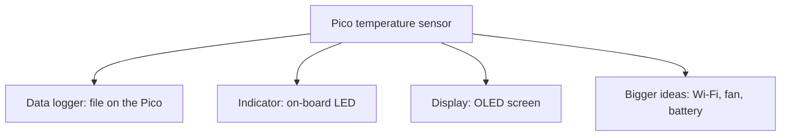

{:class="cover"}

---

By the end of this lesson you will be able to log readings to a file, drive the on-board LED from a threshold, and show the temperature on an I2C OLED display.

You have built a working monitor, so let's make it do more. This lesson gives you three complete projects to try, then a list of bigger ideas to dream about. Pick the one that sounds most fun. You do not have to do them all.



---

## Project 1: Temperature data logger

Store temperature readings over time for analysis. The Pico has about 1.4 MB of its own flash storage, so you can save a `.csv` file straight onto it without any extra hardware. For long-term logging, a microSD card module gives you far more space.

This program adds one line to the file every minute:

```python
import machine
import time

sensor_adc = machine.ADC(4)

while True:
    voltage = sensor_adc.read_u16() * 3.3 / 65535
    temperature = 27 - (voltage - 0.706) / 0.001721
    t = time.localtime()  # a tuple in MicroPython

    with open("temperature_log.csv", "a") as log:
        log.write(f"{t[3]:02}:{t[4]:02}:{t[5]:02},{temperature:.2f}\n")

    time.sleep(60)
```

Flash memory wears out after many thousands of writes, so log every minute or so rather than every second. Remember that the time is only real if Thonny set the clock, as we saw in lesson 7. To read the file afterwards, open `temperature_log.csv` from the Pico in Thonny's **File > Open**.

## Project 2: Visual temperature indicator

Use the on-board LED to show when it is too hot. This one lights up above `MAX_TEMP`:

```python
import machine
import time

MAX_TEMP = 30

sensor_adc = machine.ADC(4)
led = machine.Pin("LED", machine.Pin.OUT)  # the onboard LED

while True:
    voltage = sensor_adc.read_u16() * 3.3 / 65535
    temperature = 27 - (voltage - 0.706) / 0.001721
    led.value(temperature > MAX_TEMP)
    time.sleep(1)
```

`Pin("LED")` works on the Pico, Pico W and Pico 2. On the Pico W the LED is wired to the Wi-Fi chip, so the older `Pin(25)` does not work there. Want a green, red and blue indicator? Add three external LEDs, each with a resistor of about 330 ohms, on spare GPIO pins, and set them in the same `if` / `elif` / `else` chain from lesson 8.

## Project 3: Display on an OLED screen

Connect a small SSD1306 OLED and show the temperature without a computer. Wire it like this:

| OLED pin | Pico pin |
| --- | --- |
| GND | GND (physical pin 3) |
| VCC | 3V3(OUT) (physical pin 36) |
| SDA | GP0 (physical pin 1) |
| SCL | GP1 (physical pin 2) |
{:class="table table-single"}

Check your display's printed pin labels, because some boards order them differently. Most SSD1306 modules run happily on 3.3 V.

The `ssd1306` driver is **not** built into MicroPython, so you have to copy it onto the Pico first. Pick one method:

- **From Thonny** (any Pico): open **Tools > Manage packages**, search for `ssd1306` and install it. Thonny copies it to the board for you.
- **From the Shell on a Pico W with Wi-Fi connected**: run `import mip` then `mip.install("ssd1306")`.
- **By hand**: download `ssd1306.py` from the `micropython-lib` repository on GitHub (it is under `micropython/drivers/display/ssd1306`), open it in Thonny, and use **File > Save as > Raspberry Pi Pico** to save it on the board with the same name.

Then save and run this program:

```python
import machine
from ssd1306 import SSD1306_I2C

import time

sensor_adc = machine.ADC(4)
i2c = machine.I2C(0, sda=machine.Pin(0), scl=machine.Pin(1))
oled = SSD1306_I2C(128, 64, i2c)

while True:
    voltage = sensor_adc.read_u16() * 3.3 / 65535
    temperature = 27 - (voltage - 0.706) / 0.001721

    oled.fill(0)  # clear the screen
    oled.text(f"Temp: {temperature:.1f}C", 0, 0)
    oled.show()
    time.sleep(1)
```

The built-in font has no degree symbol, which is why the example writes just `C`. If your screen is 128 x 32 pixels, change `64` to `32`.

## Bigger ideas

- **Web dashboard**: a Pico W can publish readings to a service such as ThingSpeak or Adafruit IO and draw a live chart.
- **Smart fan**: switch a fan on through a transistor or relay board when it gets hot. Never connect a motor straight to a GPIO pin.
- **Battery monitor**: run from a battery pack, and use `machine.lightsleep()` between readings to save energy.
- **Graphs on your computer**: copy the CSV from the logger and plot it with Matplotlib or a spreadsheet.
- **Environment station**: add a humidity or light sensor and show everything on the OLED.

> **Teachers**: the logger and the LED indicator need no extra parts, so every learner can complete them. The OLED and Wi-Fi extensions need extra kit, and Wi-Fi projects usually need the school network to allow the Pico W to connect, which many do not for unknown devices. A mobile hotspot or a spare router can be a workaround. Check with your IT team before planning a cloud dashboard.

---

## Try it Yourself

1. Run the logger for ten minutes, then open the file and count the lines.
2. Change the indicator project so the LED lights when the temperature is *below* a limit instead.
3. Challenge: combine the OLED and the alert, showing `TOO HOT` as well as the number when it is above your maximum.

## Common Issues

- **Problem**: `ImportError: no module named 'ssd1306'`.
- **Solution**: Copy `ssd1306.py` to the Pico using one of the three methods above.
- **Why**: The driver is a separate file, not part of the MicroPython firmware.

- **Problem**: `OSError: [Errno 5] EIO` on the OLED line.
- **Solution**: Check the four wires against the table, and that SDA is on GP0 and SCL on GP1.
- **Why**: The Pico cannot find the display on the I2C bus when the wires are swapped or loose.

- **Problem**: The OLED stays blank but there is no error.
- **Solution**: Confirm `oled.show()` is called, and that the width and height match your display.
- **Why**: Drawing only updates a memory buffer. `show()` sends it to the screen.

- **Problem**: The log file is empty.
- **Solution**: Wait for the first minute, then look again in the Pico's file list.
- **Why**: The program writes only once every 60 seconds.

## Check your understanding


? Why log every minute rather than every second?
- [ ] The ADC cannot read faster
- [x] Flash memory wears out after many thousands of writes
- [ ] The CSV format needs a minute
> Frequent writes shorten the life of the Pico's flash storage.

? The OLED example uses `ssd1306`. What must you do first?
- [ ] Nothing, it is built in
- [x] Copy the driver onto the Pico
- [ ] Change the ADC channel
> The `ssd1306` driver is not part of the firmware and must be installed.

? In the OLED wiring, which Pico pin does SDA connect to?
- [ ] GP1
- [x] GP0
- [ ] 3V3(OUT)
> SDA goes to GP0 and SCL to GP1 in this lesson's code.

